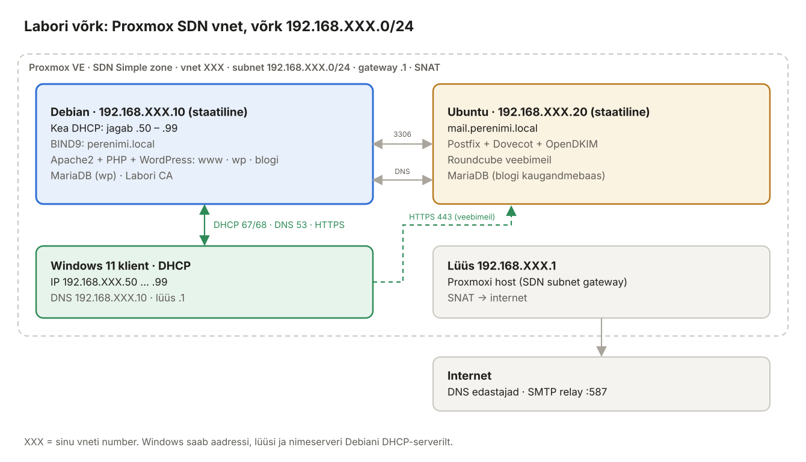

# Meili- ja veebiserverite haldus Linuxis — õppematerjal ja laboritööd

Õppematerjal DHCP-, nime-, veebi- ja meiliserverite haldusest Linuxis: mõisted, selgitused, joonised, interaktiivsed harjutused ja 15 laboritööd. Labor töötab **Proxmox VE** keskkonnas, võrguks on **SDN vnet**:

| Masin | OS | IP | Roll |
| --- | --- | --- | --- |
| Debian | Debian 13 | 192.168.XXX.10 (staatiline) | Kea DHCP, BIND9 (`perenimi.local`), Apache2 + PHP + WordPress (`www`, `wp`, `blogi`), MariaDB, labori CA |
| Ubuntu | Ubuntu 24.04 LTS | 192.168.XXX.20 (staatiline) | Postfix, Dovecot, OpenDKIM, Roundcube (`mail.perenimi.local`), MariaDB (blogi kaugandmebaas) |
| Windows klient | Windows 11 | DHCP: 192.168.XXX.50–99 | brauser, testimine |
| Lüüs | – | 192.168.XXX.1 | Proxmoxi SDN-i alamvõrgu lüüs, SNAT |

**XXX = Proxmoxi vneti number**, võrk `192.168.XXX.0/24`.

**Domeeninimi = õppija perekonnanimi.** Kus materjalis on `perenimi`, kirjuta oma perekonnanimi väiketähtedega ja ilma täpitähtedeta (nt Tõnisson → `tonisson.local`).

**Lõpptulemus:** Windowsi kliendis avaneb `https://mail.perenimi.local`, kasutaja logib sisse, saadab ja loeb kirju nii oma domeenis kui ka päris internetti (relay kaudu); kõik ühendused on TLS-iga, kirjad on DKIM-allkirjaga ning domeenil on SPF ja DMARC.



## Interaktiivsed harjutused

| Simulaator | Teema |
| --- | --- |
| [DHCP simulaator](https://valdonolvak.github.io/meili--ja_veebiserverite_haldus/interaktiivne/dhcp-simulaator.html) | DORA paketid, `ipconfig /all`, Kea rendifail ja logi; rendi pikendamine (T1, T2); rikked (teine DHCP-server, vale liides, vahemik otsas, DNS puudub, reserveering) |
| [Virtuaalpostkastide simulaator](https://valdonolvak.github.io/meili--ja_veebiserverite_haldus/interaktiivne/virtuaal-simulaator.html) | PostfixAdmini tabelid ja Postfixi/Dovecoti SQL-päringud: aliased, tundmatu saaja, sisselogimine, saatja kontroll, backscatter, vale `mydestination` |
| [DNS-i simulaator](https://valdonolvak.github.io/meili--ja_veebiserverite_haldus/interaktiivne/dns-simulaator.html) | Kes vastab: tsoonifail, vahemälu või edastaja; kirjetüübid; rikked (seerianumber, puuduv punkt, ACL) |
| [Apache virtuaalhosti simulaator](https://valdonolvak.github.io/meili--ja_veebiserverite_haldus/interaktiivne/apache-vhost-simulaator.html) | Millise saidi Apache valib (`Host:` päis, `ServerName`, vaikehost, HTTP→HTTPS, SNI) |
| [E-kirja teekonna simulaator](https://valdonolvak.github.io/meili--ja_veebiserverite_haldus/interaktiivne/e-kirja-simulaator.html) | SMTP vestlus samm-sammult, Postfixi piirangud, DKIM/SPF/DMARC; lülita sisse rikkeid ja vaata, kus ahel katkeb |

## Sisukord

- [1. Sissejuhatus ja laborikeskkond](peatykid/01-sissejuhatus-ja-laborikeskkond.md)
- [2. Linuxi serveri alused: võrk, SSH, sudo, teenused, logid, tulemüür](peatykid/02-linuxi-serveri-alused.md)

### Võrguteenused ja veebiserver

- [3. DNS ja BIND9 (Debian)](peatykid/03-dns-bind9.md)
- [4. DHCP ja Kea (Debian)](peatykid/04-dhcp-kea.md)
- [5. Apache2 ja virtuaalhostid (Debian)](peatykid/05-apache2-ja-virtuaalhostid.md)
- [6. WordPress samas masinas – LAMP (Debian)](peatykid/06-wordpress-samas-masinas.md)
- [7. WordPress kaugandmebaasiga (Debian + Ubuntu)](peatykid/07-wordpress-kaugandmebaasiga.md)
- [8. Labori CA ja HTTPS](peatykid/08-labori-ca-ja-https.md)

### Meiliserver

- [9. E-posti alused: rollid, protokollid, DNS-kirjed](peatykid/09-e-posti-alused.md)
- [10. Postfix ja Dovecot (Ubuntu)](peatykid/10-postfix-ja-dovecot.md)
- [11. Meiliserveri turvalisus: DKIM, SPF, DMARC, fail2ban](peatykid/11-meiliserveri-turvalisus.md)
- [12. Veebimeil Roundcube](peatykid/12-roundcube-veebimeil.md)
- [13. Väljaminev post internetti relay kaudu](peatykid/13-valjaminev-post-relay.md)

### Praktika

- [14. Laboritööd 1–12](peatykid/14-laboritood.md)
- [15. Tõrkeotsing, käskude spikker ja enesekontroll](peatykid/15-torkeotsing-ja-spikker.md)
- [16. Allikad](peatykid/16-allikad.md)

### Osa III – andmebaasipõhine meiliserver (MariaDB + PostfixAdmin)

Sama meiliserver, kuid domeenid, postkastid, aliased ja paroolid on MariaDB-s ning neid hallatakse veebiliidesega. Linuxi kasutajaid meili jaoks ei looda; ühes serveris on mitu domeeni.

- [17. Andmebaasipõhine meiliserver – põhimõtted](peatykid/17-andmebaasipohine-meiliserver.md)
- [18. PostfixAdmin: andmebaas ja veebiliides](peatykid/18-postfixadmin.md)
- [19. Postfix ja Dovecot loevad andmebaasi](peatykid/19-postfix-dovecot-mariadb.md)
- [20. Haldus, laborid 13–15 ja tõrkeotsing](peatykid/20-osa3-haldus-laborid-torkeotsing.md)

## Testitud

Meiliserveri seadistus (peatükid 8.8, 10–13) on läbi testitud Ubuntu 24.04-l (Postfix 3.8.6, Dovecot 2.3.21, OpenDKIM 2.11, Roundcube 1.6.6, fail2ban 1.0.2): kohalik kohaletoimetamine, relee keeld, 587/465 autentimine, võltssaatja keeld, DKIM allkiri ja selle kontroll, IMAPS, Roundcube'i sisselogimine ja saatmine brauserist ning relay-saatmine koos aadressi ümberkirjutusega. BIND9 tsoonifailid on kontrollitud `named-checkzone`-iga. Osa III (MariaDB, PostfixAdmin 3.3, `postfix-mysql`, `dovecot-mysql`) on testitud otsast lõpuni: domeenid ja postkastid loodi veebiliidesest, kiri jõudis andmebaasi postkastidesse ja aliastele, tundmatu saaja lükati kohe tagasi, uus postkast töötas Roundcube'is ilma taaskäivituseta ning DKIM töötas ka teisele domeenile. Kea DHCP seadistus (peatükk 4) on testitud päris DHCP-vahetusega: klient sai DORA kaudu aadressi `.50` koos lüüsi, DNS-i ja domeeniga ning reserveeringuga aadressi `.100`.

> **Dovecot:** meiliserver on Ubuntu 24.04 peal, sest Debian 13 sisaldab Dovecot 2.4-t, mille seadistuse süntaks on teistsugune. Peatüki 10 Dovecoti seadistust ei saa Debian 13-s kasutada.

## Repo ülesehitus

```text
README.md                 sisukord (see fail)
peatykid/                 iga peatükk eraldi .md failina
peatykid/joonised/        skeemid PNG-failidena
interaktiivne/            simulaatorid (HTML, avanevad GitHub Pagesi kaudu)
```

### Varasemad juhendid (repo juurkaustas)

Uus materjal kasutab neid osaliselt ja viitab neile peatükkide lõpus. Täielik seoste tabel on peatükis [16. Allikad](peatykid/16-allikad.md).

- `Veebiserver/` – Apache ja WordPressi paigaldus, sudo, iseseisev töö (WordPress teisele serverile) ja kontrollskriptid
- `Epost_DNS/` – Postfix, Dovecot, SPF/DKIM/DMARC, BIND9, DDNS
- `Postfix-Dovecot/` – meiliserver virtuaalkasutajatega (MySQL)
- `Turvalisus/` – HTTPS, ründed veebiserveritele
- `test/` – kontrollskriptid
