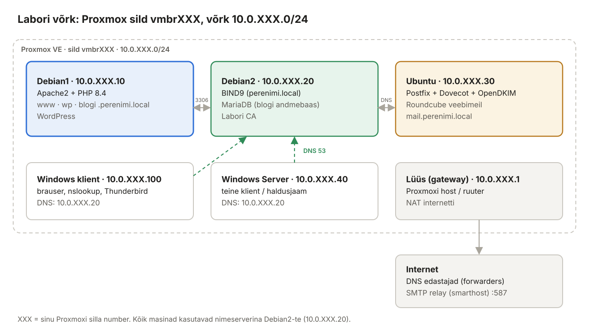

## 1. Sissejuhatus ja laborikeskkond

Selles õppematerjalis ehitad kolmest Linuxi serverist väikese, kuid päris ettevõtte moodi teenuste komplekti:

- **veebiserver** (Apache2) mitme saidiga ja WordPress – esmalt andmebaasiga samas masinas, seejärel andmebaasiga teises serveris;
- **nimeserver** (BIND9), mis teab kõiki sinu domeeni nimesid;
- **meiliserver** (Postfix + Dovecot + OpenDKIM) koos **veebimeiliga** (Roundcube), kuhu saab Windowsi kliendi brauserist sisse logida, kirju saata ja lugeda ning kust kirjad jõuavad ka päris internetti.

Iga teenus on seadistatud nii, nagu seda tehakse tootmises: krüpteeritud ühendused, autentimine, piiratud õigused, logid ja tulemüür.

### 1.1 Laborikeskkond

*Joonis 1.1: Labori võrk ja masinate rollid*

Labor töötab **Proxmox VE** keskkonnas. Igal õppijal on oma sild (*bridge*) `vmbrXXX` ja oma võrk `10.0.XXX.0/24`, kus **XXX on silla number**. Kui sinu sild on `vmbr123`, on sinu võrk `10.0.123.0/24` ja Debian1 aadress `10.0.123.10`.

| Masin | OS | Hostinimi (FQDN) | IP | Roll |
| --- | --- | --- | --- | --- |
| Debian1 | Debian 13 (trixie) | `debian1.perenimi.local` | 10.0.XXX.10 | Apache2, PHP, WordPress (`www`, `wp`, `blogi`) |
| Debian2 | Debian 13 (trixie) | `debian2.perenimi.local` | 10.0.XXX.20 | BIND9 nimeserver, MariaDB, labori CA |
| Ubuntu | Ubuntu 24.04 LTS | `mail.perenimi.local` | 10.0.XXX.30 | Postfix, Dovecot, OpenDKIM, Roundcube |
| Windows klient | Windows 11 | – | 10.0.XXX.100 | brauser, `nslookup`, Thunderbird (valikuline) |
| Windows Server | Windows Server 2022 | – | 10.0.XXX.40 | teine klient / haldusjaam |
| Lüüs | – | – | 10.0.XXX.1 | Proxmoxi host / ruuter, NAT internetti |

> **NB! Lüüsi aadress** (`10.0.XXX.1`) ja Windowsi masinate aadressid on näited. Kui sinu laboris on need teised, kasuta õpetaja antud väärtusi – ülejäänud juhend jääb samaks.

### 1.2 Kokkulepped

**Domeeninimi = perekonnanimi.** Kus materjalis on `perenimi`, kirjuta oma perekonnanimi **väiketähtedega ja ilma täpitähtedeta**: Tõnisson → `tonisson.local`, Mägi → `magi.local`. Näidetes ja testväljundites kasutame nime `tamm`.

**XXX = sinu silla number.** Kõik `10.0.XXX.y` aadressid asenda oma numbriga.

**Käsud.** Käsud on kirjutatud tavakasutajale, kellel on `sudo` õigus. Kui `sudo` puudub (Debiani paigaldusel, kus root-kasutajale anti parool), vaata peatükki 2.2. Faili muutmiseks kasutame `nano`: salvestamine **Ctrl+O**, Enter, väljumine **Ctrl+X**.

**Kus käsk käivitatakse?** Iga koodiploki kohal on märgitud masin, nt **Debian2:** või **Ubuntu:**. Vale masina peal käivitatud käsk on laboris kõige sagedasem viga.

**Paroolid.** Näidisparoolid (`Parool.123`, `WpParool.2026!`) on ainult näited – kasuta laboris oma paroole ja kirjuta need laboripäevikusse.

### 1.3 Versioonid

| Komponent | Debian 13 | Ubuntu 24.04 |
| --- | --- | --- |
| Apache2 | 2.4.x | 2.4.58 |
| PHP | 8.4 | 8.3 |
| MariaDB | 11.8 | – (Roundcube kasutab SQLite'i) |
| BIND9 | 9.20 | – |
| Postfix | – | 3.8 |
| Dovecot | – | **2.3.21** |
| OpenDKIM | – | 2.11 |
| Roundcube | – | 1.6 |
| fail2ban | – | 1.0.2 |

> **Miks meiliserver on just Ubuntul?** Debian 13 sisaldab Dovecot **2.4**-t, mille seadistuse süntaks on 2.3-st täiesti erinev (nt `mail_location` → `mail_driver` + `mail_path`, `ssl_cert` → `ssl_server_cert_file`). Internetis olevad juhendid on peaaegu kõik 2.3 jaoks. Selle materjali meiliserveri seadistus on testitud Ubuntu 24.04 Dovecot 2.3.21-ga. **Ära kopeeri Dovecoti seadistust Debian 13 masinasse** – see ei käivitu.

### 1.4 Õppematerjali ülesehitus

| Peatükk | Teema | Masin |
| --- | --- | --- |
| 2 | Linuxi serveri alused: võrk, SSH, sudo, teenused, logid, tulemüür | kõik |
| 3 | DNS ja BIND9 | Debian2 |
| 4 | Apache2 ja virtuaalhostid | Debian1 |
| 5 | WordPress samas masinas (LAMP) | Debian1 |
| 6 | WordPress kaugandmebaasiga | Debian1 + Debian2 |
| 7 | Labori CA ja HTTPS | Debian2 → Debian1, Ubuntu, Windows |
| 8 | E-posti alused: protokollid, rollid, DNS-kirjed | – |
| 9 | Postfix ja Dovecot | Ubuntu |
| 10 | Meiliserveri turvalisus: DKIM, SPF, DMARC, fail2ban | Ubuntu + Debian2 |
| 11 | Veebimeil Roundcube | Ubuntu |
| 12 | Väljaminev post internetti relay kaudu | Ubuntu |
| 13 | Laboritööd 1–11 | – |
| 14 | Tõrkeotsing ja käskude spikker | – |

Interaktiivsed harjutused (DNS-i lahendamine, Apache virtuaalhosti valik, e-kirja teekond ja rikked) on kaustas [`interaktiivne/`](../interaktiivne/index.html).

### 1.5 Hetktõmmised

Tee Proxmoxis igast Linuxi masinast **hetktõmmis** (*snapshot*) enne iga laborit (nt `enne-labor-7`). Kui seadistus läheb sassi, saad masina mõne sekundiga tagasi keerata. Hetktõmmis ei asenda arusaamist, miks viga tekkis – enne tagasikeeramist vaata alati logi (peatükk 14).
