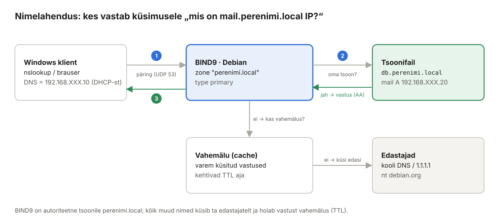

## 3. DNS ja BIND9 (Debian)

DNS (*Domain Name System*) tõlgib nimed IP-aadressideks. Ilma DNS-ita ei leia brauser saiti `wp.perenimi.local` ega meiliserver teab, kuhu `@perenimi.local` kirjad saata. Selles peatükis teeme Debianist **domeeni `perenimi.local` autoriteetse nimeserveri** ja kogu labori **rekursiivse nimelahendaja**.



*Joonis 3.1: Kuidas BIND9 päringule vastab*

### 3.1 Mõisted

| Termin | Selgitus | Näide laboris |
| --- | --- | --- |
| Tsoon (*zone*) | Domeeni osa, mille kirjeid üks server haldab. | `perenimi.local` |
| Autoriteetne server | Server, kellel on tsooni originaalandmed; vastus märgitakse lipuga `aa`. | Debian tsoonile `perenimi.local` |
| Rekursiivne server | Otsib klientide eest vastuse ka võõraste domeenide kohta. | Debian küsib `debian.org` edastajatelt |
| Edastaja (*forwarder*) | Teine nimeserver, kellelt BIND küsib kõike, mida ise ei tea. | kooli DNS, `1.1.1.1` |
| Pöördtsoon (*reverse zone*) | IP → nimi. Nimi on IP võrguosa tagurpidi + `.in-addr.arpa`. | `XXX.168.192.in-addr.arpa` |
| TTL (*Time To Live*) | Mitu sekundit tohib vastust vahemälus hoida. | `3600` |
| SOA (*Start of Authority*) | Tsooni esimene kirje: peamine server, admini e-post, **seerianumber**, ajastused. | `ns1.perenimi.local.` |
| Seerianumber | Peab **iga muudatusega suurenema** – teisesed (*secondary*) serverid võrdlevad seda ja laadivad tsooni alla ainult siis, kui number on kasvanud. Kuju `AAAAKKPPNN`. | `2026111201` |
| Vahemälu (*cache*) | Rekursiivne server ja klient (Windows) hoiavad vastust TTL-i jooksul meeles – muudatus jõuab nendeni alles pärast TTL-i möödumist või vahemälu tühjendamist. | `ipconfig /flushdns` |
| FQDN-i lõpupunkt | Tsoonifailis tähendab `mail.perenimi.local.` (punktiga) täisnime. Ilma punktita lisatakse lõppu `$ORIGIN`: `mail` → `mail.perenimi.local.` | |
| `@` | Tsooni nimi ise (`perenimi.local.`). | `@ IN MX 10 mail` |

### 3.2 Kirjetüübid

| Tüüp | Tähendus | Näide |
| --- | --- | --- |
| A | nimi → IPv4 | `mail IN A 192.168.XXX.20` |
| AAAA | nimi → IPv6 | (laboris ei kasuta) |
| CNAME | nimi on teise nime **varjunimi** | `wp IN CNAME debian` |
| NS | tsooni nimeserver | `@ IN NS ns1.perenimi.local.` |
| MX | domeeni meiliserver ja prioriteet (väiksem = eelistatum) | `@ IN MX 10 mail.perenimi.local.` |
| TXT | vaba tekst; kasutatakse SPF, DKIM, DMARC jaoks | `@ IN TXT "v=spf1 mx -all"` |
| PTR | IP → nimi (pöördtsoonis) | `20 IN PTR mail.perenimi.local.` |
| SOA | tsooni parameetrid | iga tsoonifaili algus |

> **CNAME-i reeglid:** CNAME-i kõrval ei tohi samal nimel olla muid kirjeid ning MX ja NS ei tohi osutada CNAME-ile. Seepärast on `mail` **A-kirje**, mitte CNAME.

### 3.3 Paigaldus

**Debian:**

```bash
sudo apt install -y bind9 bind9-utils bind9-dnsutils
sudo systemctl status named
```

Debian 13-s on teenuse nimi **`named`** (`bind9` on selle varjunimi – töötavad mõlemad).

Seadistusfailid kaustas `/etc/bind/`:

| Fail | Sisu |
| --- | --- |
| `named.conf` | põhifail, laeb kolm allolevat |
| `named.conf.options` | üldseaded: kes tohib küsida, edastajad |
| `named.conf.local` | **sinu tsoonid** |
| `named.conf.default-zones` | localhost, juurvihjed – ära muuda |
| `zones/` | sinu tsoonifailid (kausta loome ise) |

### 3.4 Üldseaded: named.conf.options

**Debian:**

```bash
sudo cp /etc/bind/named.conf.options /etc/bind/named.conf.options.orig
sudo nano /etc/bind/named.conf.options
```

Asenda kogu sisu:

```text
// Kes on "oma" – ainult nendelt võtame päringuid vastu
acl labor {
    127.0.0.0/8;
    192.168.XXX.0/24;
};

options {
    directory "/var/cache/bind";

    listen-on { any; };
    listen-on-v6 { none; };

    allow-query     { labor; };     // kes tohib küsida
    allow-recursion { labor; };     // kelle eest otsime võõraid nimesid
    allow-transfer  { none; };      // tsooni tervikuna ei anna kellelegi

    // Kõik, mida me ise ei tea, küsime edasi
    forwarders {
        1.1.1.1;                    // või kooli DNS-server
        8.8.8.8;
    };
    forward only;

    dnssec-validation auto;
    version "ei avalda";            // ära ütle ründajale BIND-i versiooni
};
```

> **Avatud rekursiivne DNS on ohtlik.** Kui `allow-recursion` puudub ja server on internetis nähtav, kasutatakse seda DDoS-rünnakute võimendajana. Seepärast lubame rekursiooni ainult `labor` ACL-ile.

> Kui edastajaks on kooli DNS, mis DNSSEC-allkirju edasi ei anna, ebaõnnestuvad võõraste nimede päringud veaga `SERVFAIL` ja logis on `broken trust chain`. Sel juhul muuda `dnssec-validation no;`.

### 3.5 Tsoonide kirjeldus: named.conf.local

**Debian:**

```bash
sudo nano /etc/bind/named.conf.local
```

```text
// Edasisuunatud tsoon: nimi -> IP
zone "perenimi.local" {
    type primary;
    file "/etc/bind/zones/db.perenimi.local";
    allow-update { none; };
};

// Pöördtsoon: IP -> nimi  (192.168.XXX.0/24 -> XXX.168.192.in-addr.arpa)
zone "XXX.168.192.in-addr.arpa" {
    type primary;
    file "/etc/bind/zones/db.192.168.XXX";
};
```

`type primary` on uus nimi vanale `type master`-ile (töötavad mõlemad).

### 3.6 Edasisuunatud tsoonifail

**Debian:**

```bash
sudo mkdir -p /etc/bind/zones
sudo nano /etc/bind/zones/db.perenimi.local
```

```text
$TTL 3600
$ORIGIN perenimi.local.
@       IN  SOA ns1.perenimi.local. admin.perenimi.local. (
                2026111201 ; Serial  AAAAKKPPNN – suurenda IGA muudatusega
                3600       ; Refresh
                900        ; Retry
                604800     ; Expire
                300 )      ; Negative cache TTL

; --- Nimeserver ---
@       IN  NS      ns1.perenimi.local.

; --- Masinad ---
ns1     IN  A       192.168.XXX.10
debian  IN  A       192.168.XXX.10
ubuntu  IN  A       192.168.XXX.20

; --- Veebisaidid (Debian) ---
@       IN  A       192.168.XXX.10
www     IN  A       192.168.XXX.10
wp      IN  CNAME   debian
blogi   IN  CNAME   debian

; --- blogi kaugandmebaas (Ubuntu) ---
db      IN  CNAME   ubuntu

; --- E-post (Ubuntu) ---
mail    IN  A       192.168.XXX.20
@       IN  MX  10  mail.perenimi.local.
```

SOA teine väli `admin.perenimi.local.` on administraatori e-post, kus `@` asemel on punkt (`admin@perenimi.local`).

SPF, DKIM ja DMARC TXT-kirjed lisame peatükis 11.

### 3.7 Pöördtsoonifail

**Debian:**

```bash
sudo nano /etc/bind/zones/db.192.168.XXX
```

```text
$TTL 3600
@       IN  SOA ns1.perenimi.local. admin.perenimi.local. (
                2026111201 3600 900 604800 300 )
@       IN  NS      ns1.perenimi.local.

10      IN  PTR     debian.perenimi.local.
20      IN  PTR     mail.perenimi.local.
```

Meiliserveri PTR-kirje peab näitama **sama nime, mida Postfix HELO-s ütleb** (`mail.perenimi.local`). Paljud meiliserverid kontrollivad, kas IP → nimi → IP ring sulgub (*FCrDNS, forward-confirmed reverse DNS*).

### 3.8 Kontroll ja käivitamine

**Debian:**

```bash
sudo chown -R root:bind /etc/bind/zones
sudo named-checkconf                                                   # tühi väljund = OK
sudo named-checkzone perenimi.local /etc/bind/zones/db.perenimi.local
sudo named-checkzone XXX.168.192.in-addr.arpa /etc/bind/zones/db.192.168.XXX
sudo systemctl restart named
sudo systemctl status named
```

Oodatav `named-checkzone` väljund:

```text
zone perenimi.local/IN: loaded serial 2026111201
OK
```

Nüüd muuda Debiani enda resolveriks BIND (`/etc/resolv.conf`: `nameserver 127.0.0.1`, `search perenimi.local`).

### 3.9 Testimine

**Debian:**

```bash
dig @127.0.0.1 mail.perenimi.local +short          # 192.168.XXX.20
dig @127.0.0.1 wp.perenimi.local +short            # debian.perenimi.local. 192.168.XXX.10
dig @127.0.0.1 perenimi.local MX +short            # 10 mail.perenimi.local.
dig @127.0.0.1 -x 192.168.XXX.20 +short               # mail.perenimi.local.
dig @127.0.0.1 debian.org +short                   # edastajad töötavad
dig @127.0.0.1 mail.perenimi.local                 # vaata lippe: flags: qr aa rd ra
```

`aa` (*authoritative answer*) näitab, et vastas tsooni omanik.

**Windowsi klient** (PowerShell) – Windows saab Debiani nimeserveri aadressi DHCP-st, mille seadistame järgmises peatükis. Kuni seda pole, tee testid ainult Debianis ja korda Windowsi teste pärast peatükki 4:

```powershell
nslookup mail.perenimi.local
nslookup -type=MX perenimi.local
Resolve-DnsName wp.perenimi.local
```

### 3.10 Tulemüür

**Debian:**

```bash
sudo ufw allow from 192.168.XXX.0/24 to any port 53 proto udp
sudo ufw allow from 192.168.XXX.0/24 to any port 53 proto tcp
```

DNS kasutab tavaliselt UDP-d, kuid suured vastused (nt pikk DKIM-võti) ja tsooniülekanded käivad TCP kaudu – luba mõlemad.

### 3.11 Tsooni muutmise töövoog

Iga kord, kui tsoonifaili muudad:

1. muuda kirjeid;
2. **suurenda seerianumbrit** (`2026111201` → `2026111202`);
3. `sudo named-checkzone perenimi.local /etc/bind/zones/db.perenimi.local`;
4. `sudo rndc reload perenimi.local` (laeb ainult selle tsooni uuesti);
5. kontrolli `dig`-iga.

Kui seerianumber jäi suurendamata, laeb primaarserver faili küll uuesti, kuid logis on hoiatus `zone serial (2026111201) unchanged. zone may fail to transfer to slaves.` – teisesed serverid jääksid vanade andmetega.

Windowsi klient hoiab vastuseid vahemälus kuni TTL-i lõpuni – pärast muudatust `ipconfig /flushdns`.

> Varasem lühem juhend: [Nimeserver Bind9 seadistamine](../Nimeserver%20Bind9%20seadistamine.md). Dünaamiline DNS koos DHCP-ga (valikuline teema): [DDNS-DHCP](../Epost_DNS/DDNS-DHCP.md).
