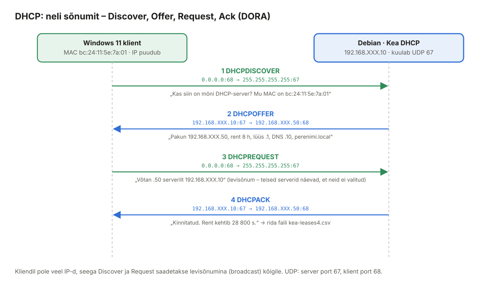
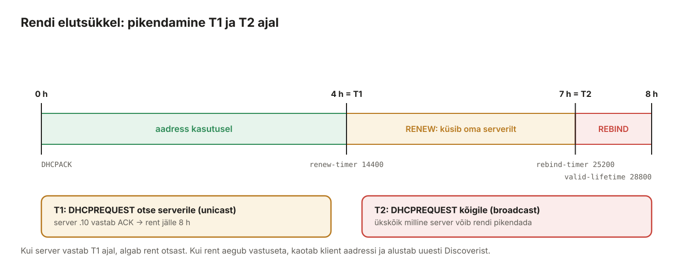
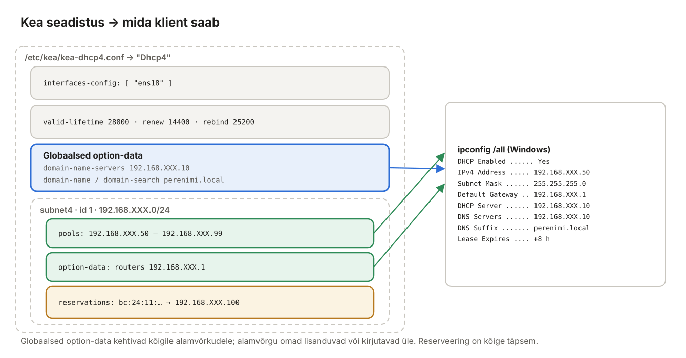

## 4. DHCP ja Kea (Debian)

DHCP (*Dynamic Host Configuration Protocol*) annab võrku ühendatud seadmele automaatselt IP-aadressi ja kõik muu, mida see võrgus töötamiseks vajab: võrgumaski, lüüsi, nimeserveri ja domeeni. Ilma DHCP-ta peaks iga sülearvuti, telefoni ja printeri võrgu käsitsi seadistama. Selles peatükis paneme Debianis tööle DHCP-serveri **Kea**, mis jagab Windowsi kliendile aadressi vahemikust `192.168.XXX.50–99`.

> **Miks Kea, mitte isc-dhcp-server?** Pikka aega oli Linuxi standardne DHCP-server ISC DHCP (`isc-dhcp-server`, fail `dhcpd.conf`). Selle arendaja ISC lõpetas 2022. aastal tarkvara hoolduse ja soovitab asemele **Kead**. Debian 13-s on vana pakett küll veel olemas, kuid aegunuks märgitud ega saa turvauuendusi. Kea seadistus on JSON-vormingus. Internetist leiad palju vanu `dhcpd.conf` juhendeid – need Kea kohta ei kehti.

### 4.1 Mõisted

| Termin | Selgitus | Näide laboris |
| --- | --- | --- |
| DHCP-server | Jagab aadresse ja seadeid, peab arvet, kellele mida anti. | Kea Debianis |
| DHCP-klient | Küsib võrguseadeid. Windowsis on see sisse ehitatud (teenus *DHCP Client*). | Windows 11 |
| Rent (*lease*) | Aadressi kasutusõigus kindlaks ajaks. Klient peab seda enne aegumist pikendama. | 8 h |
| Vahemik (*pool*) | Aadressid, mida server võib jagada. | `.50 – .99` |
| Alamvõrk (*subnet*) | Võrk, mida server teenindab. Windows Serveri DHCP-s nimetatakse seda *scope*. | `192.168.XXX.0/24` |
| DHCP valik (*option*) | Lisainfo, mis antakse koos aadressiga. Igal valikul on number. | 3 = lüüs, 6 = DNS |
| Reserveering (*reservation*) | Kindel aadress kindlale seadmele, MAC-aadressi järgi. | `bc:24:11:…` → `.100` |
| MAC-aadress | Võrgukaardi füüsiline aadress (48 bitti). Proxmoxi VM-ide MAC algab tavaliselt `BC:24:11`. | `bc:24:11:5e:7a:01` |
| Levisõnum (*broadcast*) | Pakett kõigile võrgu seadmetele: `255.255.255.255`, MAC `ff:ff:ff:ff:ff:ff`. | DHCPDISCOVER |
| Pordid | Server kuulab **UDP 67**, klient **UDP 68**. | |
| APIPA | Kui DHCP-server ei vasta, paneb Windows endale aadressi `169.254.x.x` – sellega võrgus midagi ei tööta. | `169.254.17.3` |
| *authoritative* | Server on selle võrgu ametlik DHCP-server: kui klient küsib vale aadressi (nt teisest võrgust kaasa toodud), vastab server kohe DHCPNAK ja klient alustab otsast. | `"authoritative": true` |
| DHCP relay | Ruuter edastab DHCP levisõnumid teise võrgu DHCP-serverile. Laboris pole vaja – server ja klient on samas võrgus. | |

### 4.2 DORA: kuidas klient aadressi saab



*Joonis 4.1: Neli DHCP-sõnumit*

| # | Sõnum | Kellelt → kellele | Sisu |
| --- | --- | --- | --- |
| 1 | **D**ISCOVER | klient → kõik (broadcast) | „Mul pole aadressi, kas keegi annab?“ + kliendi MAC ja nimi |
| 2 | **O**FFER | server → klient | pakutav aadress + valikud (lüüs, DNS, domeen, rendi aeg) |
| 3 | **R**EQUEST | klient → kõik (broadcast) | „Võtan selle pakkumise serverilt X.“ Levisõnum annab teistele serveritele teada, et nende pakkumist ei võetud. |
| 4 | **A**CK | server → klient | kinnitus; server kirjutab rendi oma andmebaasi |

Lisaks: **DHCPNAK** (server keeldub, nt klient küsib võõrast aadressi), **DHCPRELEASE** (klient loobub aadressist, `ipconfig /release`), **DHCPDECLINE** (klient avastas, et aadress on juba kellegi teise käes), **DHCPINFORM** (kliendil on aadress, küsib ainult valikuid).

### 4.3 Rendi pikendamine



*Joonis 4.2: T1 ja T2*

| Aeg | Mis toimub |
| --- | --- |
| **T1** (vaikimisi 50% rendist) | Klient saadab DHCPREQUEST-i **otse oma serverile**. Kui server vastab ACK, algab rent otsast. Kasutaja ei märka midagi. |
| **T2** (vaikimisi 87,5%) | Oma server pole vastanud – klient küsib levisõnumiga **ükskõik milliselt serverilt**. |
| Rendi lõpp | Keegi pole vastanud – klient loobub aadressist ja alustab uuesti DISCOVER-ist. |

Lühike rent (nt 1 h) sobib kohvikusse, kus seadmed vahetuvad tihti; pikk rent (päevad) sobib kontorisse. Laboris kasutame 8 tundi.

### 4.4 Proxmox SDN: ainult üks DHCP-server!

Proxmoxi SDN-i **Simple** tsoon oskab ise DHCP-d jagada (sisseehitatud dnsmasq), kui alamvõrgule on määratud *DHCP Range*. Kui see on sees, on võrgus **kaks DHCP-serverit** ja klient võtab selle pakkumise, mis jõuab enne kohale – vahel Kea oma, vahel Proxmoxi oma.

Kontrolli (või palu õpetajal kontrollida) Proxmoxis: *Datacenter → SDN → VNets → sinu vnet → Subnets → 192.168.XXX.0/24 → Edit*: väli **DHCP Ranges** peab olema **tühi**. Muudatuse järel *SDN → Apply*.

Kuidas aru saada, et teine server on võrgus? Windowsis `ipconfig /all` → rida **DHCP Server** ei ole `192.168.XXX.10`.

### 4.5 Paigaldus

**Debian:**

```bash
sudo apt install -y kea-dhcp4-server
systemctl status kea-dhcp4-server
```

Debian 13-s on Kea **2.6**. Teenuse nimi on `kea-dhcp4-server`, seadistusfail `/etc/kea/kea-dhcp4.conf`, rendid failis `/var/lib/kea/kea-leases4.csv`.

### 4.6 Seadistus



*Joonis 4.3: Seadistuse osad ja nende tulemus kliendis*

Paketi näidisfail on pikk ja täis kommentaare. Tee sellest koopia ja kirjuta fail üle.

**Debian:**

```bash
sudo cp /etc/kea/kea-dhcp4.conf /etc/kea/kea-dhcp4.conf.orig
sudo nano /etc/kea/kea-dhcp4.conf
```

```json
// /etc/kea/kea-dhcp4.conf – labori DHCP-server (Debian)
{
  "Dhcp4": {
    // Millisel võrguliidesel DHCP päringuid kuulatakse
    "interfaces-config": {
      "interfaces": [ "ens18" ]
    },

    // Rendid hoitakse failis /var/lib/kea/kea-leases4.csv
    "lease-database": {
      "type": "memfile",
      "persist": true,
      "lfc-interval": 3600
    },

    // Rendi kestus 8 h; pikendamist alustatakse poole aja pealt
    "valid-lifetime": 28800,
    "renew-timer": 14400,
    "rebind-timer": 25200,

    // See server on selle võrgu ainus ja ametlik DHCP-server
    "authoritative": true,

    // Kõigile klientidele: DNS-server ja domeen
    "option-data": [
      { "name": "domain-name-servers", "data": "192.168.XXX.10" },
      { "name": "domain-name",         "data": "perenimi.local" },
      { "name": "domain-search",       "data": "perenimi.local" }
    ],

    "subnet4": [
      {
        "id": 1,
        "subnet": "192.168.XXX.0/24",
        "pools": [ { "pool": "192.168.XXX.50 - 192.168.XXX.99" } ],
        "option-data": [
          { "name": "routers", "data": "192.168.XXX.1" }
        ]
      }
    ]
  }
}
```

| Seade | Selgitus |
| --- | --- |
| `interfaces` | Liidese nimi (`ip -br link`). Kui nimi on vale, käivitub Kea, kuid ei kuula kuskil. |
| `lease-database` → `memfile` | Rendid hoitakse mälus ja kirjutatakse CSV-faili. Suurtes võrkudes kasutatakse MySQL-i või PostgreSQL-i. |
| `lfc-interval` | Iga tunni tagant koristatakse rendifailist vanad read (*Lease File Cleanup*). |
| `valid-lifetime` / `renew-timer` / `rebind-timer` | Rent, T1 ja T2 sekundites. |
| `option-data` (globaalne) | Valikud kõigile alamvõrkudele. |
| `domain-name-servers` | Valik 6: DNS-server. **Ilma selleta saab klient aadressi, kuid ei leia ühtki nime.** |
| `domain-name` / `domain-search` | Valikud 15 ja 119: `ping mail` → `mail.perenimi.local`. |
| `subnet4` → `id` | Alamvõrgu unikaalne number; Kea seob rendid selle järgi. |
| `pools` | Jagatavad aadressid. **Serverite staatilised aadressid (.1, .10, .20) peavad jääma vahemikust välja**, muidu võib server need kliendile anda. |
| `routers` | Valik 3: vaikelüüs. Alamvõrgu tasemel, sest igal alamvõrgul on oma lüüs. |

> **JSON-i lõksud.** Kea lubab `//` kommentaare, kuid muus osas on JSON range: iga element on komaga eraldatud, **viimase elemendi järel koma ei tohi olla**, nimed ja tekstid on jutumärkides. Üks puuduv koma = Kea ei käivitu. Kontrolli alati (4.7).

### 4.7 Kontroll ja käivitamine

**Debian:**

```bash
sudo kea-dhcp4 -t /etc/kea/kea-dhcp4.conf      # süntaksi kontroll, viga koos rea numbriga
sudo systemctl restart kea-dhcp4-server
sudo systemctl status kea-dhcp4-server
sudo journalctl -u kea-dhcp4-server -n 20
sudo ss -ulnp | grep ':67'                      # 192.168.XXX.10:67 ... kea-dhcp4
```

Logis peab olema rida `DHCPSRV_CFGMGR_ADD_IFACE listening on interface ens18`.

### 4.8 Tulemüür

**Debian:**

```bash
sudo ufw allow in on ens18 to any port 67 proto udp
```

Kea kasutab vaikimisi **raw-soklit** – see näeb DHCP-pakette enne Linuxi tulemüüri, sest kliendil pole veel IP-aadressi, millega tavalist ühendust luua. Seepärast töötab DHCP sageli ka ilma selle reeglita. Lisa reegel siiski: see dokumenteerib, et port on teadlikult avatud, ja on vajalik, kui hiljem seadistad Kea kasutama UDP-soklit (`"dhcp-socket-type": "udp"`, nt DHCP relay korral).

### 4.9 Windowsi klient saab aadressi

**Windowsi klient** (PowerShell või cmd):

```powershell
ipconfig /release        # loobu praegusest aadressist (DHCPRELEASE)
ipconfig /renew          # küsi uus (DORA)
ipconfig /all
```

Kontrolli väärtusi peatüki 2.11 tabeli järgi: aadress vahemikus `.50–.99`, *DHCP Server* `192.168.XXX.10`, *DNS Servers* `192.168.XXX.10`, *Connection-specific DNS Suffix* `perenimi.local`, *Lease Obtained / Lease Expires* 8 tunni vahega.

```powershell
Get-NetIPConfiguration                        # lühem ülevaade
nslookup mail.perenimi.local                  # DNS töötab (Server: debian.perenimi.local)
ping wp                                       # otsingudomeen lisatakse ise → wp.perenimi.local
```

GUI-s: *Settings → Network & internet → Ethernet* → näed IPv4 aadressi, DNS-servereid ja *IP assignment: Automatic (DHCP)*.

**Debianis** vaata, kellele aadress anti:

```bash
sudo cat /var/lib/kea/kea-leases4.csv
sudo journalctl -u kea-dhcp4-server | grep -E "DHCP4_LEASE_ALLOC|DHCP4_RELEASE"
```

Rendifaili näide:

```text
address,hwaddr,client_id,valid_lifetime,expire,subnet_id,fqdn_fwd,fqdn_rev,hostname,state,user_context,pool_id
192.168.XXX.50,bc:24:11:5e:7a:01,01:bc:24:11:5e:7a:01,28800,1794508242,1,0,0,DESKTOP-AB12,0,,0
```

| Veerg | Tähendus |
| --- | --- |
| `address` / `hwaddr` | antud aadress / kliendi MAC |
| `valid_lifetime` / `expire` | rendi pikkus / aegumise aeg (Unix aeg; `date -d @1794508242`) |
| `hostname` | kliendi saadetud arvutinimi |
| `state` | 0 = kehtiv, 1 = tagasi lükatud (*declined*), 2 = aegunud ja vabastatud |

> Fail on „ainult lisatav“: iga pikendamine või vabastamine lisab uue rea. Kehtiv on aadressi **viimane** rida. Kord tunnis (`lfc-interval`) koristab Kea vanad read ära.

### 4.10 Reserveering: alati sama aadress

Serveritele, printeritele ja õpetaja arvutile tahetakse sageli alati sama aadressi, kuid ikkagi DHCP kaudu (et seadeid saaks muuta ühest kohast). Selleks on **reserveering**.

1. Leia Windowsi kliendi MAC: `ipconfig /all` → *Physical Address* `BC-24-11-5E-7A-01` (või Proxmoxis VM → *Hardware → Network Device*).
2. Kea tahab MAC-i kujul **`bc:24:11:5e:7a:01`** – kooloniga, väiketähtedega.
3. Lisa `subnet4` alamvõrgu sisse `option-data` järele (pane eelmise rea lõppu koma!):

```json
        "option-data": [
          { "name": "routers", "data": "192.168.XXX.1" }
        ],
        "reservations": [
          {
            "hw-address": "bc:24:11:5e:7a:01",
            "ip-address": "192.168.XXX.100",
            "hostname": "win11"
          }
        ]
```

Reserveeritud aadress on **vahemikust väljas** (`.100`), et Kea ei annaks seda kogemata kellelegi teisele.

```bash
sudo kea-dhcp4 -t /etc/kea/kea-dhcp4.conf && sudo systemctl restart kea-dhcp4-server
```

Windowsis `ipconfig /release` ja `ipconfig /renew` → aadress `192.168.XXX.100`. Kontrollitud: sama seadistusega sai testklient MAC-iga `aa:bb:cc:00:00:01` aadressi `.100` ja hostinime `win11`.

Lisa ka DNS-i kirje, et masinat saaks nime järgi leida (peatükk 3.11): `win11 IN A 192.168.XXX.100`.

### 4.11 Tõrkeotsing

| Sümptom | Põhjus | Lahendus |
| --- | --- | --- |
| Windowsi aadress `169.254.x.x` | ükski DHCP-server ei vastanud | `systemctl status kea-dhcp4-server`; õige liides `interfaces`-is; VM on õiges vnetis |
| Kea ei käivitu: `syntax error … line N` | JSON viga (koma, jutumärk, sulg) | `sudo kea-dhcp4 -t /etc/kea/kea-dhcp4.conf` näitab rea |
| Kea töötab, logis pole `listening on interface ens18` | vale liidese nimi | `ip -br link`, paranda `interfaces` |
| *DHCP Server* on mõni muu aadress | teine DHCP-server võrgus (Proxmox SDN DHCP) | 4.4 |
| Aadress on, aga nimed ei lahendu | `domain-name-servers` puudub või BIND maas | `ipconfig /all` → *DNS Servers*; peatükk 3 |
| Aadress on, aga internet ei tööta | `routers` puudub/vale | `ipconfig /all` → *Default Gateway* `192.168.XXX.1` |
| Logis `DHCP4_ALLOC_ENGINE_V4_ALLOC_FAIL` | vahemik on otsas | suurenda `pools` või lühenda renti |
| Reserveering ei rakendu | MAC vales kujul või vana rent veel kehtib | `bc:24:11:…` väiketähtedega; `ipconfig /release` + `/renew` |
| Klient sai serveri staatilise aadressi | vahemik kattub serverite aadressidega | `pools` peab olema `.50 - .99` |

### 4.12 Lisateema: DHCP ja DNS koostöö (DDNS)

Praegu teab BIND ainult neid nimesid, mis tsoonifaili käsitsi kirjutasid. Suuremates võrkudes uuendab DHCP-server ise DNS-kirjeid: kui klient saab aadressi, lisatakse tsooni `DESKTOP-AB12.perenimi.local A 192.168.XXX.57` (*Dynamic DNS*). Kea-s teeb seda eraldi teenus `kea-dhcp-ddns-server`, mis saadab BIND-ile TSIG-võtmega allkirjastatud uuendusi. Windows Serveri AD-DNS teeb sama automaatselt. Repo varasem juhend [DDNS-DHCP](../Epost_DNS/DDNS-DHCP.md) kirjeldab põhimõtet.

> **Interaktiivne harjutus:** [DHCP simulaator](../interaktiivne/dhcp-simulaator.html) – vaata DORA pakette, rendi pikendamist ja tüüpilisi rikkeid (teine DHCP-server, vale liides, vahemik otsas, reserveering).
