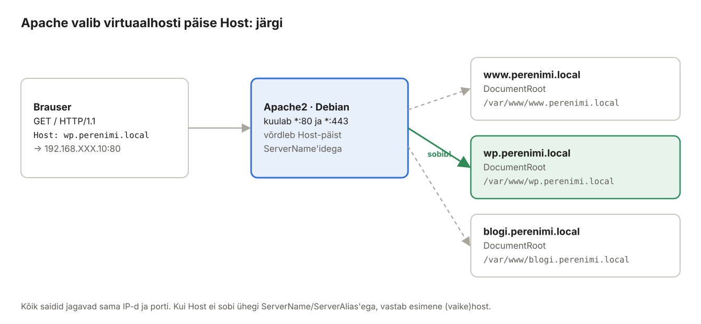
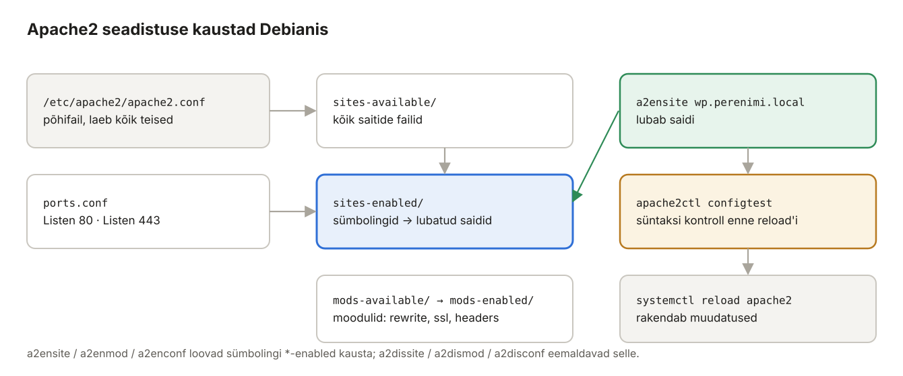

## 5. Apache2 ja virtuaalhostid (Debian)

Apache2 on üks levinumaid veebiservereid. Üks Apache võib teenindada sadu saite ühe IP-aadressi pealt – iga saidi kohta tehakse **virtuaalhost** (*virtual host*, *vhost*). Selles peatükis paneme Debian-le püsti kolm saiti: `www.perenimi.local`, `wp.perenimi.local` ja `blogi.perenimi.local`.



*Joonis 5.1: Nimepõhine virtuaalhost*

### 5.1 Mõisted

| Termin | Selgitus | Näide laboris |
| --- | --- | --- |
| HTTP päring | Brauseri küsimus serverile: meetod, tee, päised. | `GET /index.html HTTP/1.1` |
| `Host:` päis | Millist saiti brauser tahab. Selle järgi valib Apache vhosti. | `Host: wp.perenimi.local` |
| Virtuaalhost | `<VirtualHost>` plokk: millistele nimedele vastata ja kust failid võtta. | `wp.perenimi.local.conf` |
| `ServerName` / `ServerAlias` | Saidi põhinimi / lisanimed. | `ServerAlias perenimi.local` |
| `DocumentRoot` | Kaust, mille sisu veebis näidatakse. | `/var/www/wp.perenimi.local` |
| Vaikehost | Kui `Host:` ei sobi ühegi vhostiga, vastab **esimene laetud** vhost (tähestiku järjekorras sites-enabled kaustas). | `000-vaike.conf` |
| Moodul | Apache lisavõimekus. | `rewrite`, `ssl`, `headers`, `php8.4` |
| `.htaccess` | Kaustapõhine seadistusfail; töötab ainult, kui `AllowOverride` lubab. | WordPressi püsiviited |
| HTTP olekukood | 200 OK · 301/302 suunamine · 403 keelatud · 404 ei leitud · 500 serveri viga | |
| `www-data` | Kasutaja, kelle õigustes Apache töötab. | failide omanik |

### 5.2 Paigaldus

**Debian:**

```bash
sudo apt install -y apache2
sudo systemctl enable --now apache2
sudo ufw allow 80/tcp
sudo ufw allow 443/tcp
```

Windowsi kliendis ava `http://192.168.XXX.10` – näed lehte „Apache2 Debian Default Page“.

### 5.3 Seadistuse kaustad



*Joonis 5.2: Apache2 kaustad ja abikäsud*

| Käsk | Mida teeb |
| --- | --- |
| `a2ensite nimi` / `a2dissite nimi` | lubab / keelab saidi (sümbolink `sites-enabled/`) |
| `a2enmod rewrite` / `a2dismod` | lubab / keelab mooduli |
| `a2enconf` / `a2disconf` | lubab / keelab üldise seadistusfaili |
| `apache2ctl configtest` | kontrollib süntaksit – **käivita alati enne reload'i** |
| `apache2ctl -S` | näitab kõiki vhoste, nende järjekorda ja vaikehosti |
| `apache2ctl -M` | näitab laetud mooduleid |

### 5.4 Saitide kaustad ja testlehed

Iga sait vajab oma kausta, kust Apache faile võtab. Seda kausta nimetatakse **DocumentRoot**: kui brauser küsib `http://wp.perenimi.local/`, saadab Apache faili `/var/www/wp.perenimi.local/index.html`. Teeme kolm kausta ja igasse lihtsa testlehe. Nii näeme hiljem kohe, millise saidi Apache valis.

| Sait | Kaust (DocumentRoot) | Testlehe fail |
| --- | --- | --- |
| `www.perenimi.local` | `/var/www/www.perenimi.local` | `index.html` |
| `wp.perenimi.local` | `/var/www/wp.perenimi.local` | `index.html` (hiljem asendab WordPress) |
| `blogi.perenimi.local` | `/var/www/blogi.perenimi.local` | `index.html` (hiljem asendab WordPress) |

Kausta nimi on sama mis saidi nimi. See ei ole Apache'i nõue, aga see on hea tava: kaustast on kohe näha, millise saidi failid seal on.

#### Variant A – käsud ükshaaval

Kõige selgem on teha iga sait eraldi. Kopeeri ja käivita **Debiani terminalis** järgmised käsud. Need on tavalised käsud, mitte skriptifail.

**Debian:**

```bash
sudo mkdir -p /var/www/www.perenimi.local
echo "<h1>www.perenimi.local</h1><p>Debian · Apache2 vhost töötab.</p>" | sudo tee /var/www/www.perenimi.local/index.html

sudo mkdir -p /var/www/wp.perenimi.local
echo "<h1>wp.perenimi.local</h1><p>Debian · Apache2 vhost töötab.</p>" | sudo tee /var/www/wp.perenimi.local/index.html

sudo mkdir -p /var/www/blogi.perenimi.local
echo "<h1>blogi.perenimi.local</h1><p>Debian · Apache2 vhost töötab.</p>" | sudo tee /var/www/blogi.perenimi.local/index.html

sudo chown -R www-data:www-data /var/www
```

#### Variant B – sama asi tsükliga

Kolm plokki on peaaegu ühesugused, erineb ainult saidi nimi. Sellisel juhul kasutatakse Linuxis **`for`-tsüklit**. Tsükkel on samuti tavaline käsk: kopeeri kõik read korraga terminali ja vajuta Enter. Shell näitab rea alguses `>` märki, kuni tsükkel on lõpetatud sõnaga `done`, ja käivitab siis kogu tsükli.

**Debian:**

```bash
for s in www wp blogi; do
  sudo mkdir -p /var/www/$s.perenimi.local
  echo "<h1>$s.perenimi.local</h1><p>Debian · Apache2 vhost töötab.</p>" \
    | sudo tee /var/www/$s.perenimi.local/index.html
done
sudo chown -R www-data:www-data /var/www
```

Variandid A ja B annavad **täpselt sama tulemuse**. Tee ainult üks neist.

**Mida iga rida teeb:**

| Rida | Selgitus |
| --- | --- |
| `for s in www wp blogi; do` | Muutuja `s` saab järjest väärtused `www`, `wp` ja `blogi`. Iga väärtusega täidetakse `do` ja `done` vahel olevad read üks kord, kokku kolm korda. |
| `$s` | Asendatakse muutuja väärtusega. Esimesel ringil muutub `/var/www/$s.perenimi.local` kujule `/var/www/www.perenimi.local`, teisel `/var/www/wp.perenimi.local` jne. |
| `sudo mkdir -p /var/www/$s.perenimi.local` | Loob kausta. `-p` tähendab, et käsk ei anna viga, kui kaust on juba olemas. Kausta `/var/www` tohib muuta ainult root, seepärast `sudo`. |
| `echo "<h1>…</h1><p>…</p>"` | Trükib ühe rea HTML-i: pealkiri saidi nimega ja lause. |
| `\` rea lõpus | Käsk jätkub järgmisel real. See on ainult loetavuse jaoks, sest pikk käsk ei mahuks ühele reale. |
| `\| sudo tee /var/www/…/index.html` | Toru `\|` annab `echo` väljundi käsule `tee`, mis kirjutab selle faili. Miks mitte `sudo echo "…" > fail`? Sest `>` suunamise teeb **sinu** shell tavakasutajana, mitte `sudo`, ja tulemuseks oleks `Permission denied`. `sudo tee` kirjutab faili root'i õigustes. `tee` näitab kirjutatud teksti ka ekraanil. |
| `done` | Tsükli lõpp. |
| `sudo chown -R www-data:www-data /var/www` | Teeb kõigi failide omanikuks kasutaja ja grupi `www-data`. Selle kasutajana töötab Apache. `-R` tähendab rekursiivselt ehk kõik alamkaustad ja failid. |

**Miks omanik `www-data`?** Apache peab faile **lugema**. Seda saaks ka siis, kui omanik oleks root. WordPress (peatükk 6) peab aga oma kausta ka **kirjutama**: üles laaditud pildid, pluginad ja uuendused. Seepärast anname omandi kohe veebiserveri kasutajale. Tootmisserveris antakse kirjutusõigus tavaliselt ainult kaustadele, mis seda tõesti vajavad (nt `wp-content/uploads`).

**Kontrolli tulemust:**

```bash
ls -l /var/www/
cat /var/www/wp.perenimi.local/index.html
```

```text
drwxr-xr-x 2 www-data www-data 4096 Nov 12 10:15 blogi.perenimi.local
drwxr-xr-x 2 www-data www-data 4096 Nov 12 10:15 html
drwxr-xr-x 2 www-data www-data 4096 Nov 12 10:15 wp.perenimi.local
drwxr-xr-x 2 www-data www-data 4096 Nov 12 10:15 www.perenimi.local
<h1>wp.perenimi.local</h1><p>Debian · Apache2 vhost töötab.</p>
```

Kaust `html` on Apache'i vaikesaidi kaust ja jäi paigaldusest alles. Seda me edaspidi ei kasuta.

Brauserist neid lehti veel avada ei saa: Apache ei tea veel, et nimi `wp.perenimi.local` kuulub kausta `/var/www/wp.perenimi.local`. Selle seose teevad virtuaalhostid (5.6).

### 5.5 Vaikehost (püüab kinni tundmatud nimed)

Kui keegi pöördub serveri poole IP-aadressiga või tundmatu nimega, ei tohiks ta juhuslikult näha ühte sinu saitidest. Teeme eraldi vaikehosti.

**Debian:**

```bash
sudo mkdir -p /var/www/vaike
echo "<h1>Tundmatu sait</h1>" | sudo tee /var/www/vaike/index.html
sudo nano /etc/apache2/sites-available/000-vaike.conf
```

Esimesed kaks käsku teevad vaikehostile kausta ja testlehe samamoodi nagu 5.4-s. Kolmas avab redaktoris uue seadistusfaili. Faili nimi algab `000-`, sest Apache loeb kausta `sites-enabled` failid **tähestiku järjekorras** ja **esimene** `*:80` virtuaalhost saab vaikehostiks. Sinna jõuavad kõik päringud, mille nimi ei sobi ühegi teise vhostiga. Kirjuta faili:

```apache
# Esimene laetud vhost = vaikehost
<VirtualHost *:80>
    ServerName debian.perenimi.local
    DocumentRoot /var/www/vaike
    ErrorLog  ${APACHE_LOG_DIR}/vaike_error.log
    CustomLog ${APACHE_LOG_DIR}/vaike_access.log combined
</VirtualHost>
```

### 5.6 Saitide virtuaalhostid

**Debian:**

```bash
sudo nano /etc/apache2/sites-available/www.perenimi.local.conf
```

```apache
<VirtualHost *:80>
    ServerName  www.perenimi.local
    ServerAlias perenimi.local
    ServerAdmin admin@perenimi.local
    DocumentRoot /var/www/www.perenimi.local

    <Directory /var/www/www.perenimi.local>
        # -Indexes: ära näita failide nimekirja, kui index-faili pole
        Options -Indexes +FollowSymLinks
        # staatiline sait, .htaccess faile ei loeta
        AllowOverride None
        Require all granted
    </Directory>

    ErrorLog  ${APACHE_LOG_DIR}/www.perenimi.local_error.log
    CustomLog ${APACHE_LOG_DIR}/www.perenimi.local_access.log combined
</VirtualHost>
```

`wp.perenimi.local.conf` ja `blogi.perenimi.local.conf` on samasugused, kuid WordPress vajab `.htaccess` faili, seega **`AllowOverride All`**:

```bash
sudo nano /etc/apache2/sites-available/wp.perenimi.local.conf
```

```apache
<VirtualHost *:80>
    ServerName  wp.perenimi.local
    ServerAdmin admin@perenimi.local
    DocumentRoot /var/www/wp.perenimi.local

    <Directory /var/www/wp.perenimi.local>
        Options -Indexes +FollowSymLinks
        # WordPressi .htaccess (püsiviited) peab töötama
        AllowOverride All
        Require all granted
    </Directory>

    ErrorLog  ${APACHE_LOG_DIR}/wp.perenimi.local_error.log
    CustomLog ${APACHE_LOG_DIR}/wp.perenimi.local_access.log combined
</VirtualHost>
```

Tee `blogi.perenimi.local.conf` kopeerides ja asendades nime:

```bash
sudo sed 's/wp\.perenimi/blogi.perenimi/g' /etc/apache2/sites-available/wp.perenimi.local.conf \
  | sudo tee /etc/apache2/sites-available/blogi.perenimi.local.conf
```

See üks käsk asendab käsitsi kopeerimise ja muutmise:

- `sed 's/wp\.perenimi/blogi.perenimi/g' fail` loeb faili `wp.perenimi.local.conf` ja asendab igal real teksti `wp.perenimi` tekstiga `blogi.perenimi`. `s/otsi/asenda/` on asendamise käsk, `g` (*global*) asendab rea kõik esinemised, mitte ainult esimese. `\.` tähendab päris punkti, sest `sed`-is tähistab üksik `.` „mis tahes märki“.
- Originaalfaili `sed` **ei muuda**. Tulemus läheb toruga (`|`) käsule `sudo tee`, mis kirjutab selle uude faili `blogi.perenimi.local.conf`.

Kontrolli, et asendus õnnestus: `grep perenimi /etc/apache2/sites-available/blogi.perenimi.local.conf`. Kõigis ridades peab olema `blogi`, mitte `wp`. Kui see tundub keeruline, võid sama teha ka käsitsi: kopeeri fail (`sudo cp /etc/apache2/sites-available/wp.perenimi.local.conf /etc/apache2/sites-available/blogi.perenimi.local.conf`) ja muuda `nano`-ga kõik viis kohta, kus on `wp.perenimi` (ServerName, DocumentRoot, Directory, ErrorLog, CustomLog).

> Apache seadistuses peab `#` kommentaar olema **eraldi real**. Rea lõppu kirjutatud kommentaar (`AllowOverride All # selgitus`) annab `configtest`-il vea, sest Apache loeb `#` ja sellele järgnevad sõnad direktiivi argumentideks.

### 5.7 Lubamine ja kontroll

**Debian:**

```bash
sudo a2dissite 000-default
sudo a2ensite 000-vaike www.perenimi.local wp.perenimi.local blogi.perenimi.local
sudo a2enmod rewrite headers
sudo apache2ctl configtest            # Syntax OK
sudo systemctl reload apache2
sudo apache2ctl -S
```

`apache2ctl -S` väljund:

```text
VirtualHost configuration:
*:80                   is a NameVirtualHost
         default server debian.perenimi.local (/etc/apache2/sites-enabled/000-vaike.conf:2)
         port 80 namevhost debian.perenimi.local (/etc/apache2/sites-enabled/000-vaike.conf:2)
         port 80 namevhost blogi.perenimi.local (/etc/apache2/sites-enabled/blogi.perenimi.local.conf:1)
         port 80 namevhost wp.perenimi.local (/etc/apache2/sites-enabled/wp.perenimi.local.conf:1)
         port 80 namevhost www.perenimi.local (/etc/apache2/sites-enabled/www.perenimi.local.conf:1)
                 alias perenimi.local
```

### 5.8 Testimine

Käsurealt saab vhosti valikut testida ka **ilma DNS-ita**, saates `Host:` päise käsitsi:

**Debian:**

```bash
curl -s -H "Host: wp.perenimi.local"   http://127.0.0.1/
curl -s -H "Host: blogi.perenimi.local" http://127.0.0.1/
curl -s -H "Host: olematu.ee"          http://127.0.0.1/     # Tundmatu sait
curl -sI http://127.0.0.1/                                    # ainult päised
```

**Windowsi klient:** ava brauseris `http://www.perenimi.local`, `http://wp.perenimi.local`, `http://blogi.perenimi.local`, `http://perenimi.local` ja `http://192.168.XXX.10`.

> **Kui DNS veel ei tööta**, saab nimed ajutiselt lisada Windowsi faili `C:\Windows\System32\drivers\etc\hosts` (Notepad administraatorina): `192.168.XXX.10 wp.perenimi.local`. Pärast DNS-i valmimist **kustuta need read**, muidu otsid hiljem viga valest kohast.

### 5.9 Serveri info peitmine

Vaikimisi ütleb Apache igas vastuses oma versiooni ja OS-i (`Server: Apache/2.4.65 (Debian)`), mis aitab ründajal sobivat haavatavust valida.

**Debian:**

```bash
sudo nano /etc/apache2/conf-available/security.conf
```

```apache
ServerTokens Prod
ServerSignature Off
TraceEnable Off
```

```bash
sudo apache2ctl configtest && sudo systemctl reload apache2
curl -sI http://127.0.0.1/ | grep Server        # Server: Apache
```

### 5.10 Logid

| Fail | Sisu |
| --- | --- |
| `/var/log/apache2/<sait>_access.log` | iga päring: IP, aeg, URL, olekukood, brauser |
| `/var/log/apache2/<sait>_error.log` | vead: PHP vead, keelatud ligipääs, puuduvad failid |
| `/var/log/apache2/error.log` | Apache enda vead (käivitus, moodulid) |

```bash
sudo tail -f /var/log/apache2/wp.perenimi.local_access.log
```

Ava samal ajal Windowsis leht ja vaata, kuidas päring logisse ilmub.

> Varasem juhend: [Veebiserveri Apache ja Wordpressi paigaldus](../Veebiserver/1.%20Veebiserveri%20Apache%20ja%20Wordpressi%20paigaldus.md).
