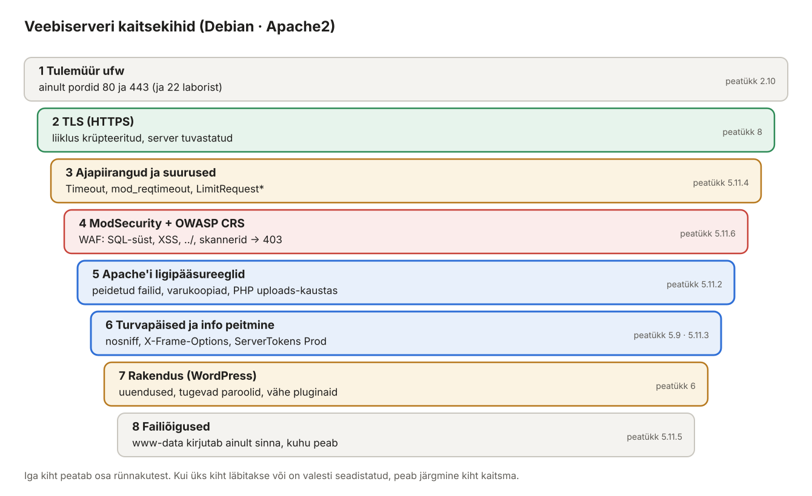

## 5. Apache2 ja virtuaalhostid (Debian)

Apache2 on üks levinumaid veebiservereid. Üks Apache võib teenindada sadu saite ühe IP-aadressi pealt – iga saidi kohta tehakse **virtuaalhost** (*virtual host*, *vhost*). Selles peatükis paneme Debian-le püsti kolm saiti: `www.perenimi.local`, `wp.perenimi.local` ja `blogi.perenimi.local`.


*Joonis 5.1: Nimepõhine virtuaalhost*

### 5.1 Mõisted

| Termin | Selgitus | Näide laboris |
| --- | --- | --- |
| HTTP päring | Brauseri küsimus serverile: meetod, tee, päised. | `GET /index.html HTTP/1.1` |
| `Host:` päis | Millist saiti brauser tahab. Selle järgi valib Apache vhosti. | `Host: wp.perenimi.local` |
| Virtuaalhost | `<VirtualHost>` plokk: millistele nimedele vastata ja kust failid võtta. | `wp.perenimi.local.conf` |
| `ServerName` / `ServerAlias` | Saidi põhinimi / lisanimed. | `ServerAlias perenimi.local` |
| `DocumentRoot` | Kaust, mille sisu veebis näidatakse. | `/var/www/wp.perenimi.local` |
| Vaikehost | Kui `Host:` ei sobi ühegi vhostiga, vastab **esimene laetud** vhost (tähestiku järjekorras sites-enabled kaustas). | `000-vaike.conf` |
| Moodul | Apache lisavõimekus. | `rewrite`, `ssl`, `headers`, `php8.4` |
| `.htaccess` | Kaustapõhine seadistusfail; töötab ainult, kui `AllowOverride` lubab. | WordPressi püsiviited |
| HTTP olekukood | 200 OK · 301/302 suunamine · 403 keelatud · 404 ei leitud · 500 serveri viga | |
| `www-data` | Kasutaja, kelle õigustes Apache töötab. | failide omanik |

### 5.2 Paigaldus

**Debian:**

```bash
sudo apt install -y apache2
sudo systemctl enable --now apache2
sudo ufw allow 80/tcp
sudo ufw allow 443/tcp
```

Windowsi kliendis ava `http://192.168.XXX.10` – näed lehte „Apache2 Debian Default Page“.

### 5.3 Seadistuse kaustad


*Joonis 5.2: Apache2 kaustad ja abikäsud*

| Käsk | Mida teeb |
| --- | --- |
| `a2ensite nimi` / `a2dissite nimi` | lubab / keelab saidi (sümbolink `sites-enabled/`) |
| `a2enmod rewrite` / `a2dismod` | lubab / keelab mooduli |
| `a2enconf` / `a2disconf` | lubab / keelab üldise seadistusfaili |
| `apache2ctl configtest` | kontrollib süntaksit – **käivita alati enne reload'i** |
| `apache2ctl -S` | näitab kõiki vhoste, nende järjekorda ja vaikehosti |
| `apache2ctl -M` | näitab laetud mooduleid |

### 5.4 Saitide kaustad ja testlehed

Iga sait vajab oma kausta, kust Apache faile võtab. Seda kausta nimetatakse **DocumentRoot**: kui brauser küsib `http://wp.perenimi.local/`, saadab Apache faili `/var/www/wp.perenimi.local/index.html`. Teeme kolm kausta ja igasse lihtsa testlehe. Nii näeme hiljem kohe, millise saidi Apache valis.

| Sait | Kaust (DocumentRoot) | Testlehe fail |
| --- | --- | --- |
| `www.perenimi.local` | `/var/www/www.perenimi.local` | `index.html` |
| `wp.perenimi.local` | `/var/www/wp.perenimi.local` | `index.html` (hiljem asendab WordPress) |
| `blogi.perenimi.local` | `/var/www/blogi.perenimi.local` | `index.html` (hiljem asendab WordPress) |

Kausta nimi on sama mis saidi nimi. See ei ole Apache'i nõue, aga see on hea tava: kaustast on kohe näha, millise saidi failid seal on.

#### Variant A – käsud ükshaaval

Kõige selgem on teha iga sait eraldi. Kopeeri ja käivita **Debiani terminalis** järgmised käsud. Need on tavalised käsud, mitte skriptifail.

**Debian:**

```bash
sudo mkdir -p /var/www/www.perenimi.local
echo "<h1>www.perenimi.local</h1><p>Debian · Apache2 vhost töötab.</p>" | sudo tee /var/www/www.perenimi.local/index.html

sudo mkdir -p /var/www/wp.perenimi.local
echo "<h1>wp.perenimi.local</h1><p>Debian · Apache2 vhost töötab.</p>" | sudo tee /var/www/wp.perenimi.local/index.html

sudo mkdir -p /var/www/blogi.perenimi.local
echo "<h1>blogi.perenimi.local</h1><p>Debian · Apache2 vhost töötab.</p>" | sudo tee /var/www/blogi.perenimi.local/index.html

sudo chown -R www-data:www-data /var/www
```

#### Variant B – sama asi tsükliga

Kolm plokki on peaaegu ühesugused, erineb ainult saidi nimi. Sellisel juhul kasutatakse Linuxis **`for`-tsüklit**. Tsükkel on samuti tavaline käsk: kopeeri kõik read korraga terminali ja vajuta Enter. Shell näitab rea alguses `>` märki, kuni tsükkel on lõpetatud sõnaga `done`, ja käivitab siis kogu tsükli.

**Debian:**

```bash
for s in www wp blogi; do
  sudo mkdir -p /var/www/$s.perenimi.local
  echo "<h1>$s.perenimi.local</h1><p>Debian · Apache2 vhost töötab.</p>" \
    | sudo tee /var/www/$s.perenimi.local/index.html
done
sudo chown -R www-data:www-data /var/www
```

Variandid A ja B annavad **täpselt sama tulemuse**. Tee ainult üks neist.

**Mida iga rida teeb:**

| Rida | Selgitus |
| --- | --- |
| `for s in www wp blogi; do` | Muutuja `s` saab järjest väärtused `www`, `wp` ja `blogi`. Iga väärtusega täidetakse `do` ja `done` vahel olevad read üks kord, kokku kolm korda. |
| `$s` | Asendatakse muutuja väärtusega. Esimesel ringil muutub `/var/www/$s.perenimi.local` kujule `/var/www/www.perenimi.local`, teisel `/var/www/wp.perenimi.local` jne. |
| `sudo mkdir -p /var/www/$s.perenimi.local` | Loob kausta. `-p` tähendab, et käsk ei anna viga, kui kaust on juba olemas. Kausta `/var/www` tohib muuta ainult root, seepärast `sudo`. |
| `echo "<h1>…</h1><p>…</p>"` | Trükib ühe rea HTML-i: pealkiri saidi nimega ja lause. |
| `\` rea lõpus | Käsk jätkub järgmisel real. See on ainult loetavuse jaoks, sest pikk käsk ei mahuks ühele reale. |
| `\| sudo tee /var/www/…/index.html` | Toru `\|` annab `echo` väljundi käsule `tee`, mis kirjutab selle faili. Miks mitte `sudo echo "…" > fail`? Sest `>` suunamise teeb **sinu** shell tavakasutajana, mitte `sudo`, ja tulemuseks oleks `Permission denied`. `sudo tee` kirjutab faili root'i õigustes. `tee` näitab kirjutatud teksti ka ekraanil. |
| `done` | Tsükli lõpp. |
| `sudo chown -R www-data:www-data /var/www` | Teeb kõigi failide omanikuks kasutaja ja grupi `www-data`. Selle kasutajana töötab Apache. `-R` tähendab rekursiivselt ehk kõik alamkaustad ja failid. |

**Miks omanik `www-data`?** Apache peab faile **lugema**. Seda saaks ka siis, kui omanik oleks root. WordPress (peatükk 6) peab aga oma kausta ka **kirjutama**: üles laaditud pildid, pluginad ja uuendused. Seepärast anname omandi kohe veebiserveri kasutajale. Tootmisserveris antakse kirjutusõigus tavaliselt ainult kaustadele, mis seda tõesti vajavad (nt `wp-content/uploads`).

**Kontrolli tulemust:**

```bash
ls -l /var/www/
cat /var/www/wp.perenimi.local/index.html
```

```text
drwxr-xr-x 2 www-data www-data 4096 Nov 12 10:15 blogi.perenimi.local
drwxr-xr-x 2 www-data www-data 4096 Nov 12 10:15 html
drwxr-xr-x 2 www-data www-data 4096 Nov 12 10:15 wp.perenimi.local
drwxr-xr-x 2 www-data www-data 4096 Nov 12 10:15 www.perenimi.local
<h1>wp.perenimi.local</h1><p>Debian · Apache2 vhost töötab.</p>
```

Kaust `html` on Apache'i vaikesaidi kaust ja jäi paigaldusest alles. Seda me edaspidi ei kasuta.

Brauserist neid lehti veel avada ei saa: Apache ei tea veel, et nimi `wp.perenimi.local` kuulub kausta `/var/www/wp.perenimi.local`. Selle seose teevad virtuaalhostid (5.6).

### 5.5 Vaikehost (püüab kinni tundmatud nimed)

Kui keegi pöördub serveri poole IP-aadressiga või tundmatu nimega, ei tohiks ta juhuslikult näha ühte sinu saitidest. Teeme eraldi vaikehosti.

**Debian:**

```bash
sudo mkdir -p /var/www/vaike
echo "<h1>Tundmatu sait</h1>" | sudo tee /var/www/vaike/index.html
sudo nano /etc/apache2/sites-available/000-vaike.conf
```

Esimesed kaks käsku teevad vaikehostile kausta ja testlehe samamoodi nagu 5.4-s. Kolmas avab redaktoris uue seadistusfaili. Faili nimi algab `000-`, sest Apache loeb kausta `sites-enabled` failid **tähestiku järjekorras** ja **esimene** `*:80` virtuaalhost saab vaikehostiks. Sinna jõuavad kõik päringud, mille nimi ei sobi ühegi teise vhostiga. Kirjuta faili:

```apache
# Esimene laetud vhost = vaikehost
<VirtualHost *:80>
    ServerName debian.perenimi.local
    DocumentRoot /var/www/vaike
    ErrorLog  ${APACHE_LOG_DIR}/vaike_error.log
    CustomLog ${APACHE_LOG_DIR}/vaike_access.log combined
</VirtualHost>
```

### 5.6 Saitide virtuaalhostid

**Debian:**

```bash
sudo nano /etc/apache2/sites-available/www.perenimi.local.conf
```

```apache
<VirtualHost *:80>
    ServerName  www.perenimi.local
    ServerAlias perenimi.local
    ServerAdmin admin@perenimi.local
    DocumentRoot /var/www/www.perenimi.local

    <Directory /var/www/www.perenimi.local>
        # -Indexes: ära näita failide nimekirja, kui index-faili pole
        Options -Indexes +FollowSymLinks
        # staatiline sait, .htaccess faile ei loeta
        AllowOverride None
        Require all granted
    </Directory>

    ErrorLog  ${APACHE_LOG_DIR}/www.perenimi.local_error.log
    CustomLog ${APACHE_LOG_DIR}/www.perenimi.local_access.log combined
</VirtualHost>
```

`wp.perenimi.local.conf` ja `blogi.perenimi.local.conf` on samasugused, kuid WordPress vajab `.htaccess` faili, seega **`AllowOverride All`**:

```bash
sudo nano /etc/apache2/sites-available/wp.perenimi.local.conf
```

```apache
<VirtualHost *:80>
    ServerName  wp.perenimi.local
    ServerAdmin admin@perenimi.local
    DocumentRoot /var/www/wp.perenimi.local

    <Directory /var/www/wp.perenimi.local>
        Options -Indexes +FollowSymLinks
        # WordPressi .htaccess (püsiviited) peab töötama
        AllowOverride All
        Require all granted
    </Directory>

    ErrorLog  ${APACHE_LOG_DIR}/wp.perenimi.local_error.log
    CustomLog ${APACHE_LOG_DIR}/wp.perenimi.local_access.log combined
</VirtualHost>
```

Tee `blogi.perenimi.local.conf` kopeerides ja asendades nime:

```bash
sudo sed 's/wp\.perenimi/blogi.perenimi/g' /etc/apache2/sites-available/wp.perenimi.local.conf \
  | sudo tee /etc/apache2/sites-available/blogi.perenimi.local.conf
```

See üks käsk asendab käsitsi kopeerimise ja muutmise:

- `sed 's/wp\.perenimi/blogi.perenimi/g' fail` loeb faili `wp.perenimi.local.conf` ja asendab igal real teksti `wp.perenimi` tekstiga `blogi.perenimi`. `s/otsi/asenda/` on asendamise käsk, `g` (*global*) asendab rea kõik esinemised, mitte ainult esimese. `\.` tähendab päris punkti, sest `sed`-is tähistab üksik `.` „mis tahes märki“.
- Originaalfaili `sed` **ei muuda**. Tulemus läheb toruga (`|`) käsule `sudo tee`, mis kirjutab selle uude faili `blogi.perenimi.local.conf`.

Kontrolli, et asendus õnnestus: `grep perenimi /etc/apache2/sites-available/blogi.perenimi.local.conf`. Kõigis ridades peab olema `blogi`, mitte `wp`. Kui see tundub keeruline, võid sama teha ka käsitsi: kopeeri fail (`sudo cp /etc/apache2/sites-available/wp.perenimi.local.conf /etc/apache2/sites-available/blogi.perenimi.local.conf`) ja muuda `nano`-ga kõik viis kohta, kus on `wp.perenimi` (ServerName, DocumentRoot, Directory, ErrorLog, CustomLog).

> Apache seadistuses peab `#` kommentaar olema **eraldi real**. Rea lõppu kirjutatud kommentaar (`AllowOverride All # selgitus`) annab `configtest`-il vea, sest Apache loeb `#` ja sellele järgnevad sõnad direktiivi argumentideks.

### 5.7 Lubamine ja kontroll

**Debian:**

```bash
sudo a2dissite 000-default
sudo a2ensite 000-vaike www.perenimi.local wp.perenimi.local blogi.perenimi.local
sudo a2enmod rewrite headers
sudo apache2ctl configtest            # Syntax OK
sudo systemctl reload apache2
sudo apache2ctl -S
```

`apache2ctl -S` väljund:

```text
VirtualHost configuration:
*:80                   is a NameVirtualHost
         default server debian.perenimi.local (/etc/apache2/sites-enabled/000-vaike.conf:2)
         port 80 namevhost debian.perenimi.local (/etc/apache2/sites-enabled/000-vaike.conf:2)
         port 80 namevhost blogi.perenimi.local (/etc/apache2/sites-enabled/blogi.perenimi.local.conf:1)
         port 80 namevhost wp.perenimi.local (/etc/apache2/sites-enabled/wp.perenimi.local.conf:1)
         port 80 namevhost www.perenimi.local (/etc/apache2/sites-enabled/www.perenimi.local.conf:1)
                 alias perenimi.local
```

### 5.8 Testimine

Käsurealt saab vhosti valikut testida ka **ilma DNS-ita**, saates `Host:` päise käsitsi:

**Debian:**

```bash
curl -s -H "Host: wp.perenimi.local"   http://127.0.0.1/
curl -s -H "Host: blogi.perenimi.local" http://127.0.0.1/
curl -s -H "Host: olematu.ee"          http://127.0.0.1/     # Tundmatu sait
curl -sI http://127.0.0.1/                                    # ainult päised
```

**Windowsi klient:** ava brauseris `http://www.perenimi.local`, `http://wp.perenimi.local`, `http://blogi.perenimi.local`, `http://perenimi.local` ja `http://192.168.XXX.10`.

> **Kui DNS veel ei tööta**, saab nimed ajutiselt lisada Windowsi faili `C:\Windows\System32\drivers\etc\hosts` (Notepad administraatorina): `192.168.XXX.10 wp.perenimi.local`. Pärast DNS-i valmimist **kustuta need read**, muidu otsid hiljem viga valest kohast.

### 5.9 Serveri info peitmine

Vaikimisi ütleb Apache igas vastuses oma versiooni ja OS-i (`Server: Apache/2.4.65 (Debian)`), mis aitab ründajal sobivat haavatavust valida.

**Debian:**

```bash
sudo nano /etc/apache2/conf-available/security.conf
```

```apache
ServerTokens Prod
ServerSignature Off
TraceEnable Off
```

```bash
sudo apache2ctl configtest && sudo systemctl reload apache2
curl -sI http://127.0.0.1/ | grep Server        # Server: Apache
```

### 5.10 Logid

| Fail | Sisu |
| --- | --- |
| `/var/log/apache2/<sait>_access.log` | iga päring: IP, aeg, URL, olekukood, brauser |
| `/var/log/apache2/<sait>_error.log` | vead: PHP vead, keelatud ligipääs, puuduvad failid |
| `/var/log/apache2/error.log` | Apache enda vead (käivitus, moodulid) |

```bash
sudo tail -f /var/log/apache2/wp.perenimi.local_access.log
```

Ava samal ajal Windowsis leht ja vaata, kuidas päring logisse ilmub.

### 5.11 Veebiserveri turvalisemaks tegemine

Veebiserver on kogu labori kõige avatum masin: port 80 (hiljem 443) on avatud kõigile ja internetis proovivad automaatsed skannerid iga avalikku IP-aadressi juba mõne minuti jooksul pärast käivitamist. Need otsivad kogemata avalikuks jäänud faile (`.git`, `.env`, `backup.sql`), vanu haavatavaid tarkvaraversioone ja võimalust laadida üles ning käivitada oma PHP-faili.

Ühtegi „turvanuppu“ pole. Turvalisus tuleb **mitmest kihist**: iga kiht peatab osa rünnakutest ja kui üks kiht läbitakse, peab järgmine vastu pidama. Seda nimetatakse süvakaitseks (*defense in depth*).



*Joonis 5.3: Veebiserveri kaitsekihid ja peatükid, kus neid seadistame*

| Oht | Näide | Meede | Jaotis |
| --- | --- | --- | --- |
| Teadaolev turvaviga vanas tarkvaras | Apache'i, PHP või WordPressi vana versioon | uuendused | 5.11.1 |
| Avalikuks jäänud failid | `https://sait/.git/config`, `/.env`, `/backup.sql` | ligipääsureeglid | 5.11.2 |
| Üles laaditud pahatahtlik PHP-fail | „pilt“ `shell.php` WordPressi meediasse | PHP keelamine `uploads`-kaustas | 5.11.2 |
| Teise saidi raamis näitamine, MIME-trikid | *clickjacking* | turvapäised | 5.11.3 |
| Serveri kinnihoidmine aeglaste ühendustega | *Slowloris* | ajapiirangud | 5.11.4 |
| Liiga palju õigusi | ründaja muudab staatilise saidi faile | moodulid ja failiõigused | 5.11.5 |
| SQL-süst, XSS, `../../etc/passwd` | `?id=1' OR 1=1--` | veebirakenduse tulemüür ModSecurity | 5.11.6 |

Juba tehtud: tulemüür (2.10), kataloogide sisukorra keelamine `Options -Indexes` (5.6), vaikehost tundmatutele nimedele (5.5) ja serveri versiooni peitmine (5.9). HTTPS tuleb peatükis 8.

#### 5.11.1 Uuendused

Kõige rohkem murtakse sisse **teadaolevate ja juba parandatud** vigade kaudu. Parandus on olemas, aga serverisse on see jäänud paigaldamata.

**Debian:**

```bash
sudo apt update && sudo apt upgrade -y
sudo apt install -y unattended-upgrades
sudo dpkg-reconfigure -plow unattended-upgrades      # vasta „Yes“
```

`unattended-upgrades` paigaldab Debiani **turvauuendused** iga päev automaatselt. Apache'i uuenduse järel taaskäivitab pakett teenuse ise. Kontrolli logi: `cat /var/log/unattended-upgrades/unattended-upgrades.log`. WordPressi uuendusi see ei puuduta, neid tehakse WordPressi halduspaneelis (peatükk 6).

#### 5.11.2 Ligipääsureeglid failidele

Kõik turvaseaded kirjutame **ühte faili** kausta `conf-available`. Nii kehtivad need kõigile saitidele korraga ja sa ei pea igat vhosti eraldi muutma. Fail lülitatakse sisse käsuga `a2enconf` ja välja käsuga `a2disconf`.

**Debian:**

```bash
sudo nano /etc/apache2/conf-available/turvalisus.conf
```

```apache
# --- Labori veebiserveri turvaseaded (peatükk 5.11) ---

# 1. Peidetud failid ja kaustad (.git, .env, .svn …) – vastus 404.
#    Erand: .well-known (Let's Encrypt, security.txt)
RedirectMatch 404 "/\.(?!well-known/)"

# 2. Varukoopiad ja andmebaasitõmmised, mis on kogemata veebikausta jäänud
<FilesMatch "(\.(bak|old|orig|save|swp|sql|sql\.gz|tar|tar\.gz|zip|log|ini)|~)$">
    Require all denied
</FilesMatch>

# 3. Turvapäised kõigile saitidele
<IfModule mod_headers.c>
    Header always set X-Content-Type-Options "nosniff"
    Header always set X-Frame-Options "SAMEORIGIN"
    Header always set Referrer-Policy "strict-origin-when-cross-origin"
    Header always set Permissions-Policy "camera=(), microphone=(), geolocation=()"
    Header always unset X-Powered-By
    Header unset X-Powered-By
</IfModule>

# 4. Ajapiirangud: aeglased ühendused ei tohi serverit kinni hoida
Timeout 60
KeepAliveTimeout 5

# 5. Päringu päiste piirangud
LimitRequestFields 50
LimitRequestFieldSize 8190

# 6. Üleslaaditud failide kaustas ei tohi PHP käivituda
<Directory "/var/www/*/wp-content/uploads">
    <FilesMatch "\.(php|phtml|phar|php\d)$">
        Require all denied
    </FilesMatch>
</Directory>
```

```bash
sudo a2enmod headers
sudo a2enconf turvalisus
sudo apache2ctl configtest && sudo systemctl reload apache2
```

Selles jaotises on lahti seletatud plokid 1, 2 ja 6. Plokid 3–5 on järgmistes jaotistes.

**Plokk 1 – peidetud failid.** Linuxis algavad punktiga failid ja kaustad, mis ei ole mõeldud avalikuks: `.git` (versioonihaldus koos kogu koodi ajalooga), `.env` (andmebaasi paroolid, API-võtmed), `.htpasswd`, `.svn`. Kui arendaja laadib saidi üles koos `.git` kaustaga, saab igaüks sealt kogu lähtekoodi alla laadida, sageli koos paroolidega. Selliseid lekkeid leitakse internetist igal aastal kümneid tuhandeid.

- `RedirectMatch 404 "regulaaravaldis"` vastab koodiga **404 Not Found** igale aadressile, mis sobib avaldisega.
- `/\.` – aadressis on kaldkriips ja selle järel punkt, ehk faili või kausta nimi algab punktiga.
- `(?!well-known/)` – erand: `/.well-known/` kaust on avalik standardkaust (Let's Encrypti kontroll, `security.txt`).
- Miks 404, mitte 403? Kood 403 (*Forbidden*) ütleb ründajale, et fail **on olemas**. 404 ei ütle midagi.

**Plokk 2 – varukoopiad.** Klassikaline viga: administraator teeb enne muudatust koopia `wp-config.php.bak` või andmebaasist tõmmise `backup.sql` ja jätab selle veebikausta. Fail `wp-config.php` on ohutu, sest PHP käivitab selle ja brauser näeb tühja lehte. Fail `wp-config.php.bak` aga **ei ole** PHP-fail ja Apache saadab selle sisu koos andmebaasi parooliga otse brauserisse.

- `<FilesMatch "avaldis">` kehtib failidele, mille **nimi** sobib avaldisega. `$` tähendab nime lõppu.
- `Require all denied` keelab ligipääsu (vastus 403).
- `~` nime lõpus: paljud redaktorid (nt `nano -B`, `vim`) teevad varukoopia `fail~`.

**Plokk 6 – PHP üleslaadimiskaustas.** WordPress salvestab kasutajate üles laaditud pildid kausta `wp-content/uploads`. Kui WordPressis või mõnes pluginas on viga, võib ründaja laadida sinna pildi asemel faili `shell.php`. Kui ta seejärel avab `https://wp.perenimi.local/wp-content/uploads/shell.php`, käivitab Apache selle PHP-koodi ja ründajal on serveris käsurida. Reegel keelab `uploads`-kaustas **kõigi PHP-failide** käivitamise. Pildid, PDF-id jms töötavad edasi.

- `<Directory "/var/www/*/wp-content/uploads">` – `*` sobib iga saidi kaustaga, seega kehtib reegel nii `wp` kui ka `blogi` saidile.
- `php\d` – ka `.php5`, `.php7` jne, millega mõnikord filtreid petetakse.

**Test.** Tee mõned „ohtlikud“ testfailid ja kontrolli `curl`-iga, mida Apache vastab:

```bash
S=/var/www/www.perenimi.local
sudo mkdir -p $S/.git $S/wp-content/uploads
echo "parool=salajane" | sudo tee $S/.git/config $S/.env $S/backup.sql $S/index.html.bak >/dev/null
echo '<?php echo "PAHA";' | sudo tee $S/wp-content/uploads/shell.php >/dev/null
echo "pilt"               | sudo tee $S/wp-content/uploads/pilt.jpg  >/dev/null

for p in / /.git/config /.env /backup.sql /index.html.bak /.htaccess \
         /wp-content/uploads/shell.php /wp-content/uploads/pilt.jpg; do
  printf "%-32s %s\n" "$p" "$(curl -s -o /dev/null -w '%{http_code}' -H 'Host: www.perenimi.local' http://127.0.0.1$p)"
done
```

Oodatav tulemus:

```text
/                                200
/.git/config                     404
/.env                            404
/backup.sql                      403
/index.html.bak                  403
/.htaccess                       404
/wp-content/uploads/shell.php    403
/wp-content/uploads/pilt.jpg     200
```

`curl -w '%{http_code}'` trükib ainult HTTP vastuse koodi ja `-o /dev/null` viskab lehe sisu ära. Lülita korraks `sudo a2disconf turvalisus && sudo systemctl reload apache2` välja ja korda testi: kõik failid annavad `200` ja `curl` näitab ka nende sisu. Siis lülita uuesti sisse.

**Kustuta testfailid:**

```bash
sudo rm -rf $S/.git $S/.env $S/backup.sql $S/index.html.bak $S/wp-content
```

#### 5.11.3 Turvapäised

Turvapäised on HTTP vastuse päised, mis käsivad **brauseril** käituda turvalisemalt. Need ei kaitse serverit, vaid saidi **külastajat**.

| Päis | Mida teeb | Mille vastu |
| --- | --- | --- |
| `X-Content-Type-Options: nosniff` | Brauser usaldab serveri öeldud failitüüpi ega hakka seda ise „ära arvama“. | Üles laaditud „pilt“, mis tegelikult sisaldab skripti. |
| `X-Frame-Options: SAMEORIGIN` | Saiti tohib `<iframe>`-is näidata ainult sama sait. | *Clickjacking*: ründaja paneb su panga või halduspaneeli nähtamatuna oma lehe peale ja kasutaja klõpsab teadmata sinu nuppudele. |
| `Referrer-Policy: strict-origin-when-cross-origin` | Teistele saitidele saadetakse lingil klõpsates ainult domeen, mitte terve aadress. | Lekked aadressist, nt `?token=…` või `?parool_reset=…`. |
| `Permissions-Policy: camera=(), …` | Leht ei saa küsida kaamerat, mikrofoni ega asukohta. | Pahatahtlik reklaam või kolmanda osapoole skript. |
| `X-Powered-By` eemaldamine | PHP ei ütle oma versiooni. | Info kogumine (sama mõte nagu 5.9). |

- `Header always set` lisab päise **igale** vastusele, ka veateadetele (403, 404, 500). Ilma sõnata `always` lisatakse päis ainult edukatele vastustele.
- `X-Powered-By` eemaldatakse kahe reaga, sest PHP lisab päise teise tabelisse kui Apache ise. Üks rida eemaldaks selle ainult osadest vastustest.
- **HSTS** (`Strict-Transport-Security`) lisame alles peatükis 8 HTTPS-vhostile. Üle HTTP see päis ei tööta ja HTTPS-i puudumisel teeks selle lisamine saidi kättesaamatuks.

Kontrolli:

```bash
curl -sI -H "Host: www.perenimi.local" http://127.0.0.1/
```

```text
HTTP/1.1 200 OK
Server: Apache
X-Content-Type-Options: nosniff
X-Frame-Options: SAMEORIGIN
Referrer-Policy: strict-origin-when-cross-origin
Permissions-Policy: camera=(), microphone=(), geolocation=()
Content-Type: text/html
```

Windowsis näed sama brauseris: `F12` → *Network* → vali päring → *Headers → Response Headers*. Hiljem saad päiseid kontrollida ka avalikus testis [securityheaders.com](https://securityheaders.com), aga see töötab ainult internetist kättesaadava saidi puhul, mitte laboris.

#### 5.11.4 Ajapiirangud ja päringu suurus

**Slowloris** on rünnak, mis ei vaja suurt võrguühendust. Ründaja avab sadu ühendusi ja saadab igaühes päringu päiseid väga aeglaselt, näiteks ühe rea iga 10 sekundi tagant. Apache ootab viisakalt päringu lõppu ja hoiab iga ühenduse jaoks töötajat kinni. Varsti on kõik töötajad hõivatud ja tavalised külastajad ei saa enam ühendust.

| Seade | Väärtus | Selgitus |
| --- | --- | --- |
| `Timeout 60` | 60 s | Kaua Apache ootab andmeid kliendilt või vastust PHP-lt. Debiani vaikeväärtus on 300 s, mis on liiga helde. NB! Kui mõni PHP-skript töötab päriselt kauem (suure faili import), tõsta väärtust ainult selle saidi vhostis. |
| `KeepAliveTimeout 5` | 5 s | Kaua jäetakse ühendus pärast vastust lahti järgmise päringu jaoks. See on Debianis juba vaikeväärtus, kirjutame selle selguse mõttes välja. |
| `LimitRequestFields 50` | 50 | Päringu päiste maksimaalne arv. Tavaline brauser saadab 10–20. |
| `LimitRequestFieldSize 8190` | 8 KB | Ühe päise maksimaalne pikkus. |

Lisaks on Debianis vaikimisi sisse lülitatud moodul **`mod_reqtimeout`** (`apache2ctl -M | grep reqtimeout`). See nõuab, et klient saadaks päised 20–40 sekundi jooksul ja kiirusega vähemalt 500 baiti sekundis. Just see moodul peatab Slowlorise. Ära lülita seda välja.

#### 5.11.5 Mittevajalikud moodulid ja failiõigused

**Vähima õiguse põhimõte:** mida vähem on serveris sisse lülitatud, seda vähem on, mida rünnata.

```bash
apache2ctl -M                         # kõik laetud moodulid
sudo a2dismod status                  # /server-status leht
sudo a2dismod -f autoindex            # kataloogide sisukord
sudo apache2ctl configtest && sudo systemctl restart apache2
```

- **`status`** näitab lehel `/server-status` kõiki käimasolevaid päringuid koos klientide IP-de ja aadressidega. Debianis on see lubatud ainult `localhost`-ist, aga kui seda ei kasuta, pole seda vaja.
- **`autoindex`** genereerib kataloogi sisukorra, kui kaustas pole `index.html`-i. Meil on see niikuinii keelatud (`Options -Indexes`), nüüd kaob ka moodul. `a2dismod` küsib siin kinnitust (*„essential module“*), sest Debiani vaikeseadistus viitab sellele moodulile. `-f` (*force*) kinnitab, et tead, mida teed.
- Moodulite muutmise järel tee **`restart`**, mitte `reload`.

**Failiõigused.** Jaotises 5.4 tegime kõigi saitide omanikuks `www-data`, sest WordPress peab saama kirjutada. Staatiline sait `www.perenimi.local` aga kirjutamist **ei vaja**. Kui ründaja leiab Apache'is või PHP-s vea ja saab käivitada koodi kasutajana `www-data`, saab ta kõiki `www-data` faile ka muuta ehk saidi lehti oma lehtedega asendada (*defacement*). Seepärast teeme staatilise saidi omanikuks root'i:

```bash
sudo chown -R root:root /var/www/www.perenimi.local
sudo find /var/www/www.perenimi.local -type d -exec chmod 755 {} \;
sudo find /var/www/www.perenimi.local -type f -exec chmod 644 {} \;
ls -l /var/www/
```

- `755` kaustal: omanik kirjutab, kõik saavad sisse minna ja lugeda.
- `644` failil: omanik kirjutab, kõik saavad lugeda. Apache (`www-data`) loeb faile „kõik“ õigustega.
- `find … -type d` / `-type f` valib eraldi kaustad ja failid, sest kaust vajab `x` õigust sisenemiseks, fail aga mitte.

WordPressi saitide õigused seame peatükis 6 (`wp-config.php` 640 jne).

#### 5.11.6 ModSecurity: veebirakenduse tulemüür

Seni kaitsesime **faile**. Rünnakud käivad aga sageli läbi päringu **sisu**: ründaja saadab vormi välja või aadressi parameetrisse SQL-käsu, JavaScripti või failitee ja loodab, et rakendus (WordPress, plugin, sinu PHP-kood) seda korralikult ei kontrolli.

**ModSecurity** on Apache'i moodul, mis vaatab enne rakendust **iga päringu** läbi ja võrdleb seda reeglitega. Reeglistik on **OWASP Core Rule Set (CRS)**: tasuta, avatud lähtekoodiga ja tuhandeid veebirünnakute mustreid. Sellist lahendust nimetatakse **veebirakenduse tulemüüriks** (WAF, *Web Application Firewall*). Tavaline tulemüür (ufw) vaatab ainult porte ja IP-aadresse, WAF loeb päringu sisu.

| Rünnak | Näide päringust | Mida ründaja tahab |
| --- | --- | --- |
| SQL-süst (*SQL injection*) | `?id=1' OR 1=1--` | lugeda või muuta andmebaasi, mööda minna sisselogimisest |
| XSS (*cross-site scripting*) | `?q=<script>…</script>` | käivitada oma JavaScripti teise kasutaja brauseris, varastada sessiooni |
| Kataloogist väljumine (*path traversal*) | `?fail=../../../../etc/passwd` | lugeda serveri faile väljaspool veebikausta |
| Skanner | `User-Agent: Nikto` | leida automaatselt haavatavusi |

**Kuidas CRS otsustab – punktisüsteem.** CRS ei blokeeri esimese kahtlase märgi peale. Iga sobinud reegel lisab päringule **punkte** (kriitiline 5, viga 4, hoiatus 3). Kui päringu summa jõuab **piirini 5**, vastab ModSecurity koodiga **403 Forbidden** ja päring ei jõua kunagi WordPressini. Nii ei blokeerita tavalist päringut, kus on juhuslikult üks kahtlane märk.

**Paigaldus (Debian):**

```bash
sudo apt install -y libapache2-mod-security2 modsecurity-crs
sudo cp /etc/modsecurity/modsecurity.conf-recommended /etc/modsecurity/modsecurity.conf
apache2ctl -M | grep security          # security2_module (shared)
```

Paketid teevad ise ära mooduli lubamise (`a2enmod security2`) ja CRS-i reeglite ühendamise. Fail `/etc/apache2/mods-enabled/security2.conf` laeb kõik failid `/etc/modsecurity/*.conf` (sh meie `modsecurity.conf`) ja CRS-i `/usr/share/modsecurity-crs/owasp-crs.load`. Debian 13-s on CRS-i versioon 3.3.

**1. samm – ainult jälgimine.** Vaikimisi on failis rida `SecRuleEngine DetectionOnly`: ModSecurity hindab päringuid ja logib, mida ta **oleks** blokeerinud, aga ei blokeeri midagi. Nii toimitakse ka päris serveris: lase saidil mõni päev jälgimisrežiimis töötada ja vaata, kas tavalised kasutajad tekitavad valehäireid.

```bash
grep ^SecRuleEngine /etc/modsecurity/modsecurity.conf     # SecRuleEngine DetectionOnly
sudo systemctl restart apache2
curl -s -o /dev/null -w '%{http_code}\n' -H "Host: www.perenimi.local" "http://127.0.0.1/?id=1%27%20OR%201=1--"
                                                           # 200 – läbi lastud, aga logitud
sudo grep -o '\[msg "[^"]*"\]' /var/log/apache2/error.log | tail -4
```

`%27` on URL-i kodeeritud ülakoma `'` ja `%20` tühik. Logis näed näiteks `[msg "SQL Injection Attack Detected via libinjection"]` ja `[msg "Inbound Anomaly Score Exceeded (Total Score: 5)"]`: päring oleks blokeeritud, kui režiim oleks `On`.

**2. samm – blokeerimine.** Kui jälgimine on tehtud:

```bash
sudo sed -i 's/^SecRuleEngine DetectionOnly/SecRuleEngine On/' /etc/modsecurity/modsecurity.conf
sudo apache2ctl configtest && sudo systemctl restart apache2
```

**Test:**

```bash
H="Host: www.perenimi.local"
curl -s -o /dev/null -w '%{http_code}  tavaline\n'   -H "$H" "http://127.0.0.1/"
curl -s -o /dev/null -w '%{http_code}  SQL-süst\n'   -H "$H" "http://127.0.0.1/?id=1%27%20OR%201=1--"
curl -s -o /dev/null -w '%{http_code}  XSS\n'        -H "$H" "http://127.0.0.1/?q=<script>alert(1)</script>"
curl -s -o /dev/null -w '%{http_code}  ../passwd\n'  -H "$H" "http://127.0.0.1/?f=../../../../etc/passwd"
curl -s -o /dev/null -w '%{http_code}  skanner\n'    -H "$H" -A "Nikto" "http://127.0.0.1/"
```

```text
200  tavaline
403  SQL-süst
403  XSS
403  ../passwd
403  skanner
```

Proovi sama **Windowsi brauseris**: `http://www.perenimi.local/?id=1' OR 1=1--` → *Forbidden*.

**Logid.** Iga blokeeritud päring jätab jälje kahte kohta:

```bash
sudo grep ModSecurity /var/log/apache2/error.log | tail -3            # lühike: reegli id ja põhjus
sudo tail -50 /var/log/apache2/modsec_audit.log                       # kogu päring ja vastus
```

Veateate olulised osad:

```text
ModSecurity: Warning. detected SQLi using libinjection … [id "942100"]
   [msg "SQL Injection Attack Detected via libinjection"] [data "Matched Data: s&1c found within ARGS:id: 1' OR 1=1--"]
ModSecurity: Access denied with code 403 (phase 2). … [id "949110"] [msg "Inbound Anomaly Score Exceeded (Total Score: 5)"]
```

Esimene rida on reegel, mis rünnaku leidis (`id 942100`, punkte 5). Teine on CRS-i otsus: summa jõudis 5-ni, seega 403.

**WordPress ja valehäired.** WordPressi halduspaneel saadab vahel päringuid, mis näevad CRS-i jaoks kahtlased välja: näiteks postituse sisus on HTML või JavaScripti koodi. CRS-is on WordPressi jaoks valmis erandid, aga need tuleb sisse lülitada. Teeme seda ainult WordPressi saitidele:

```bash
sudo nano /etc/modsecurity/crs/REQUEST-900-EXCLUSION-RULES-BEFORE-CRS.conf
```

Lisa faili lõppu:

```apache
# WordPressi saitidel lülita sisse CRS-i WordPressi erandid (vähem valehäireid)
SecRule REQUEST_HEADERS:Host "@rx ^(wp|blogi)\.perenimi\.local(:\d+)?$" \
    "id:1000,phase:1,pass,nolog,t:none,t:lowercase,setvar:tx.crs_exclusions_wordpress=1"
```

- `SecRule MUUTUJA "operaator" "toimingud"` on ModSecurity reegli üldkuju.
- `REQUEST_HEADERS:Host "@rx …"` – kui päise `Host` väärtus sobib regulaaravaldisega (wp või blogi sait)…
- `id:1000` – igal reeglil peab olema unikaalne number. Vahemik 1–99 999 on jäetud kohalikele reeglitele.
- `phase:1` – kontroll tehakse kohe päiste saabudes, enne CRS-i põhireegleid.
- `pass,nolog` – päringut ei blokeerita ega logita…
- `setvar:tx.crs_exclusions_wordpress=1` – …aga lülitatakse sisse CRS-i WordPressi erandite fail `REQUEST-903.9002-WORDPRESS-EXCLUSION-RULES.conf`.

**Kui mõni reegel ikka segab.** Kui WordPressis mõni tegevus annab 403, leia logist reegli number ja lülita see reegel välja **ainult selle saidi vhostis**, mitte kogu serveris:

```bash
sudo grep ModSecurity /var/log/apache2/wp.perenimi.local_error.log | grep -o 'id "[0-9]*"' | sort | uniq -c
```

```apache
# /etc/apache2/sites-available/wp.perenimi.local.conf, <VirtualHost> sees
<IfModule security2_module>
    # 941160 annab valehäire postituse redigeerimisel
    SecRuleRemoveById 941160
</IfModule>
```

Ära lülita kunagi ModSecurity't või CRS-i tervikuna välja selleks, et üks valehäire kaoks. Reegli kaupa erandid jätavad ülejäänud kaitse alles.

> **Piirid.** WAF ei asenda uuendusi ega korralikku koodi. Rünnakuid saab kodeerida viisil, mida reeglid ei tunne, ja CRS tunneb ainult **mustreid**. Täpselt sinu WordPressi pluginale kirjutatud rünnakut ta tõenäoliselt ei tunne. ModSecurity on üks kiht teiste seas (joonis 5.3), mitte kogu kaitse.

> **Päringu keha suurus.** ModSecurity lükkab tagasi päringud, mille keha on üle 12,5 MB (`SecRequestBodyLimit 13107200` failis `modsecurity.conf`). Kui WordPressi üles laaditav fail on suurem, tõsta seda väärtust ja PHP piiranguid (`upload_max_filesize`, `post_max_size`) koos.

#### 5.11.7 Kontrollnimekiri

```bash
sudo apache2ctl configtest                                     # Syntax OK
apache2ctl -M | grep -E "security2|headers|reqtimeout"         # kõik kolm olemas
apache2ctl -M | grep -E "status|autoindex"                     # tühi
curl -sI -H "Host: www.perenimi.local" http://127.0.0.1/ | grep -E "Server|X-|Referrer|Permissions"
curl -s -o /dev/null -w '%{http_code}\n' -H "Host: www.perenimi.local" http://127.0.0.1/.env            # 404
curl -s -o /dev/null -w '%{http_code}\n' -H "Host: www.perenimi.local" "http://127.0.0.1/?id=1%27%20OR%201=1--"   # 403
ls -ld /var/www/www.perenimi.local                             # root root
sudo unattended-upgrades --dry-run 2>&1 | tail -2              # töötab vigadeta
```

| Kontroll | Oodatav |
| --- | --- |
| Server versiooni ei ütle | `Server: Apache` |
| Turvapäised | `X-Content-Type-Options`, `X-Frame-Options`, `Referrer-Policy`, `Permissions-Policy` |
| Peidetud failid | 404 |
| Varukoopiad | 403 |
| PHP `uploads`-kaustas | 403 |
| SQL-süst / XSS | 403 (ModSecurity) |
| `/server-status`, kataloogi sisukord | puuduvad |
| Staatilise saidi failid | omanik root |
| Turvauuendused | `unattended-upgrades` töötab |


> Varasem juhend: [Veebiserveri Apache ja Wordpressi paigaldus](../Veebiserver/1.%20Veebiserveri%20Apache%20ja%20Wordpressi%20paigaldus.md).
