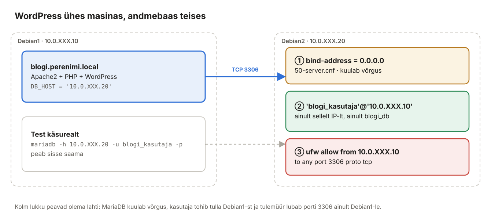

## 6. WordPress kaugandmebaasiga (Debian1 + Debian2)

Suuremates süsteemides on veebiserver ja andmebaas **eri masinates**: andmebaasi saab eraldi varundada, skaleerida ja kaitsta ning mitu veebiserverit saab kasutada sama andmebaasi. Selles peatükis paigaldame teise WordPressi saidile `blogi.perenimi.local` (Debian1), mille andmebaas on **Debian2-s**.



*Joonis 6.1: Kolm lukku, mis peavad olema lahti*

### 6.1 Mõisted

| Termin | Selgitus |
| --- | --- |
| `bind-address` | Millisel IP-aadressil MariaDB ühendusi ootab. `127.0.0.1` = ainult kohalikud, `0.0.0.0` = kõik liidesed. |
| Port 3306 | MariaDB/MySQL vaikeport (TCP). |
| `'kasutaja'@'host'` | Host näitab, **kust** kasutaja tohib ühenduda: `'%'` = igalt poolt (väldi!), `'10.0.XXX.10'` = ainult Debian1-st. |
| Vähima õiguse põhimõte | Iga konto saab ainult need õigused, mida tal on vaja – üks andmebaas, üks lähte-IP. |

Kõik kolm lukku peavad olema lahti, et ühendus töötaks – ja ainult Debian1 jaoks:

1. **MariaDB kuulab võrgus** (`bind-address`);
2. **kasutaja tohib tulla Debian1 IP-lt** (`'blogi_kasutaja'@'10.0.XXX.10'`);
3. **tulemüür lubab pordi 3306** ainult Debian1-st.

### 6.2 MariaDB paigaldus Debian2-le

**Debian2:**

```bash
sudo apt install -y mariadb-server
sudo systemctl enable --now mariadb
sudo mariadb-secure-installation        # vastused nagu peatükis 5.3
```

### 6.3 Lukk 1: kuula võrgus

**Debian2:**

```bash
sudo nano /etc/mysql/mariadb.conf.d/50-server.cnf
```

Leia rida `bind-address = 127.0.0.1` ja muuda:

```ini
bind-address            = 0.0.0.0
```

```bash
sudo systemctl restart mariadb
sudo ss -tlnp | grep 3306          # 0.0.0.0:3306 ... mariadbd
```

Turvalisem variant on `bind-address = 10.0.XXX.20` – siis kuulab MariaDB ainult labori võrgu liidesel.

### 6.4 Lukk 2: andmebaas ja kaugkasutaja

**Debian2:**

```bash
sudo mariadb
```

```sql
CREATE DATABASE blogi_db CHARACTER SET utf8mb4 COLLATE utf8mb4_unicode_ci;
CREATE USER 'blogi_kasutaja'@'10.0.XXX.10' IDENTIFIED BY 'BlogiParool.2026!';
GRANT ALL PRIVILEGES ON blogi_db.* TO 'blogi_kasutaja'@'10.0.XXX.10';
FLUSH PRIVILEGES;
SELECT user, host FROM mysql.user;
EXIT;
```

### 6.5 Lukk 3: tulemüür

**Debian2:**

```bash
sudo ufw allow from 10.0.XXX.10 to any port 3306 proto tcp
sudo ufw status
```

### 6.6 Ühenduse test Debian1-st

Enne WordPressi testi ühendust käsurealt – nii näed vea kohe ja selge tekstina.

**Debian1:**

```bash
mariadb -h 10.0.XXX.20 -u blogi_kasutaja -p blogi_db -e "SELECT CURRENT_USER(), @@hostname;"
```

Oodatav vastus:

```text
+------------------------------+------------+
| CURRENT_USER()               | @@hostname |
+------------------------------+------------+
| blogi_kasutaja@10.0.XXX.10   | debian2    |
+------------------------------+------------+
```

| Viga | Mis lukk on kinni |
| --- | --- |
| `Can't connect to server on '10.0.XXX.20' (115)` / ajalõpp | tulemüür (lukk 3) või MariaDB ei kuula võrgus (lukk 1) |
| `Can't connect … (111) Connection refused` | MariaDB kuulab ainult 127.0.0.1 (lukk 1) |
| `Host '10.0.XXX.10' is not allowed to connect` | kasutaja on loodud teise hosti jaoks (lukk 2) |
| `Access denied for user 'blogi_kasutaja'@'10.0.XXX.10'` | vale parool või puudub GRANT (lukk 2) |

Proovi sama käsku Ubuntust – peab **ebaõnnestuma**. Nii kontrollid, et ligipääs on tõesti piiratud.

### 6.7 WordPress saidile blogi.perenimi.local

Vhost on peatükis 4 juba tehtud.

**Debian1:**

```bash
sudo rm -f /var/www/blogi.perenimi.local/index.html
sudo cp -a /tmp/wordpress/. /var/www/blogi.perenimi.local/
cd /var/www/blogi.perenimi.local
sudo cp wp-config-sample.php wp-config.php
sudo nano wp-config.php
```

```php
define( 'DB_NAME', 'blogi_db' );
define( 'DB_USER', 'blogi_kasutaja' );
define( 'DB_PASSWORD', 'BlogiParool.2026!' );
define( 'DB_HOST', '10.0.XXX.20' );       // <-- andmebaas teises masinas
define( 'DB_CHARSET', 'utf8mb4' );
```

Lisa uued turvavõtmed (`curl -s https://api.wordpress.org/secret-key/1.1/salt/`) ning `FS_METHOD` ja `DISALLOW_FILE_EDIT` read nagu peatükis 5.6. Õigused:

```bash
sudo chown -R www-data:www-data /var/www/blogi.perenimi.local
sudo find /var/www/blogi.perenimi.local -type d -exec chmod 755 {} \;
sudo find /var/www/blogi.perenimi.local -type f -exec chmod 644 {} \;
sudo chmod 640 /var/www/blogi.perenimi.local/wp-config.php
```

**Windowsi klient:** `http://blogi.perenimi.local` → paigalda nagu peatükis 5.8.

### 6.8 Kontroll: andmed on tõesti Debian2-s

**Debian2:**

```bash
sudo mariadb -e "SHOW TABLES FROM blogi_db;"
sudo mariadb -e "SELECT post_title FROM blogi_db.wp_posts WHERE post_status='publish';"
```

Tee WordPressis uus postitus ja käivita päring uuesti – postitus ilmub Debian2 andmebaasi.

**Debian1:** `sudo mariadb -e "SHOW DATABASES;"` – `blogi_db` siin **ei ole**.

### 6.9 Mida veel tootmises teeks

- **TLS andmebaasiühendusele** – praegu liigub parool ja andmed võrgus krüptimata. MariaDB toetab TLS-i (`require_secure_transport = ON`, WordPressis `MYSQL_CLIENT_FLAGS`).
- **Eraldi andmebaasivõrk** – veebi- ja andmebaasiserver suhtlevad eraldi VLAN-is, kuhu kliendid ei pääse.
- **Varundus** – `mariadb-dump blogi_db > blogi_db.sql` igal ööl ja koopia teise masinasse.

> Varasem juhend (teiste IP-dega): [Wordpressi paigaldus teisele serverile](../Veebiserver/Iseseisevt%C3%B6%C3%B6/Wordpressi%20paigaldus%20teisele%20serverile.md).
