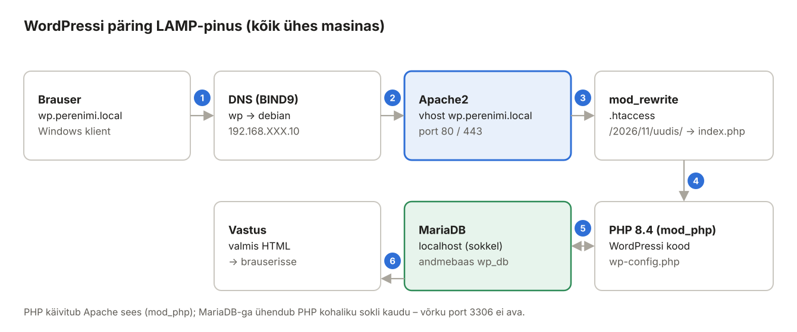

## 6. WordPress samas masinas (LAMP, Debian)

**LAMP** = **L**inux + **A**pache + **M**ariaDB/MySQL + **P**HP. See on klassikaline veebirakenduse pinu: Apache võtab päringu vastu, PHP käivitab rakenduse koodi ja koodi andmed on MariaDB andmebaasis. Selles peatükis paigaldame WordPressi saidile `wp.perenimi.local` nii, et andmebaas on **samas masinas** (Debian).



*Joonis 6.1: Ühe WordPressi päringu teekond*

### 6.1 Mõisted

| Termin | Selgitus | Näide laboris |
| --- | --- | --- |
| PHP | Serveripoolne skriptikeel; WordPress on PHP-s kirjutatud. | PHP 8.4 |
| `mod_php` (`libapache2-mod-php`) | PHP töötab Apache protsessi sees. Alternatiiv on PHP-FPM (eraldi teenus). | |
| PHP laiendus | Lisamoodul: `php-mysql` (andmebaas), `php-gd` (pildid), `php-xml`, `php-mbstring`, `php-zip`, `php-intl`. | |
| MariaDB | MySQL-iga ühilduv andmebaasiserver. | 11.8 |
| Andmebaas | Tabelite kogum ühe rakenduse jaoks. | `wp_db` |
| Andmebaasi kasutaja | Konto kujul `'nimi'@'host'` – **host on osa nimest**: `'wp'@'localhost'` ja `'wp'@'192.168.XXX.10'` on kaks eri kasutajat. | `'wp_kasutaja'@'localhost'` |
| `GRANT` | Õiguste andmine. Anna ainult oma andmebaasile, mitte `*.*`. | `GRANT ALL ON wp_db.*` |
| unix_socket autentimine | MariaDB `root` logib sisse ilma paroolita, kui oled Linuxis root (`sudo mariadb`). | |
| `wp-config.php` | WordPressi seadistus: andmebaasi andmed, turvavõtmed. | |
| Püsiviide (*permalink*) | Ilus URL `/2026/11/uudis/` asemel `/?p=123`; vajab `mod_rewrite` ja `.htaccess`. | |

### 6.2 PHP ja MariaDB paigaldus

**Debian:**

```bash
sudo apt install -y mariadb-server \
  php libapache2-mod-php php-mysql php-curl php-gd php-mbstring \
  php-xml php-zip php-intl php-imagick
sudo systemctl enable --now mariadb
php -v                                  # PHP 8.4.x
sudo systemctl restart apache2
```

Kontrolli, et PHP töötab Apache all:

```bash
echo "<?php phpinfo();" | sudo tee /var/www/wp.perenimi.local/info.php
curl -s -H "Host: wp.perenimi.local" http://127.0.0.1/info.php | grep -o "PHP Version [0-9.]*" | head -1
sudo rm /var/www/wp.perenimi.local/info.php       # ära jäta phpinfo lehte serverisse!
```

### 6.3 MariaDB turvamine

**Debian:**

```bash
sudo mariadb-secure-installation
```

| Küsimus | Vastus | Miks |
| --- | --- | --- |
| Enter current password for root | Enter | root kasutab unix_socket'it, parooli pole |
| Switch to unix_socket authentication | n | juba kasutusel |
| Change the root password | n | `sudo mariadb` on turvalisem kui parool |
| Remove anonymous users | **Y** | |
| Disallow root login remotely | **Y** | |
| Remove test database | **Y** | |
| Reload privilege tables | **Y** | |

### 6.4 Andmebaas ja kasutaja

**Debian:**

```bash
sudo mariadb
```

```sql
CREATE DATABASE wp_db CHARACTER SET utf8mb4 COLLATE utf8mb4_unicode_ci;
CREATE USER 'wp_kasutaja'@'localhost' IDENTIFIED BY 'WpParool.2026!';
GRANT ALL PRIVILEGES ON wp_db.* TO 'wp_kasutaja'@'localhost';
FLUSH PRIVILEGES;
SHOW GRANTS FOR 'wp_kasutaja'@'localhost';
EXIT;
```

- `utf8mb4` – toetab kõiki Unicode'i märke, sh täpitähed ja emotikonid.
- Kasutaja saab ühenduda **ainult** samast masinast (`localhost`) ja näeb **ainult** andmebaasi `wp_db`. Kui sait häkitakse, ei pääse ründaja teiste saitide andmetele ligi.

Kontroll: `mariadb -u wp_kasutaja -p wp_db -e "SELECT 1;"`.

### 6.5 WordPressi failid

**Debian:**

```bash
cd /tmp
wget https://wordpress.org/latest.tar.gz
tar -xzf latest.tar.gz
sudo rm -f /var/www/wp.perenimi.local/index.html
sudo cp -a wordpress/. /var/www/wp.perenimi.local/
```

`wordpress/.` (punktiga) kopeerib ka peidetud failid. Kui laboris internetti pole, too `latest.tar.gz` õpetaja kaustast või Windowsi kliendist `scp`-ga.

### 6.6 wp-config.php

**Debian:**

```bash
cd /var/www/wp.perenimi.local
sudo cp wp-config-sample.php wp-config.php
sudo nano wp-config.php
```

Muuda andmebaasi read:

```php
define( 'DB_NAME', 'wp_db' );
define( 'DB_USER', 'wp_kasutaja' );
define( 'DB_PASSWORD', 'WpParool.2026!' );
define( 'DB_HOST', 'localhost' );
define( 'DB_CHARSET', 'utf8mb4' );
```

**Turvavõtmed (salts).** Failis on 8 rida `define( 'AUTH_KEY', 'put your unique phrase here' );`. Need allkirjastavad sisselogimise küpsiseid. Võta unikaalsed väärtused:

```bash
curl -s https://api.wordpress.org/secret-key/1.1/salt/
```

Kustuta failist 8 `put your unique phrase here` rida ja kleebi nende asemele väljund.

Lisa enne rida `/* That's all, stop editing! */`:

```php
/* Pluginad ja uuendused otse failisüsteemi, ilma FTP-d küsimata */
define( 'FS_METHOD', 'direct' );
/* Halduspaneelist failide muutmine keelatud (turvalisus) */
define( 'DISALLOW_FILE_EDIT', true );
```

### 6.7 Failiõigused

**Debian:**

```bash
sudo chown -R www-data:www-data /var/www/wp.perenimi.local
sudo find /var/www/wp.perenimi.local -type d -exec chmod 755 {} \;
sudo find /var/www/wp.perenimi.local -type f -exec chmod 644 {} \;
sudo chmod 640 /var/www/wp.perenimi.local/wp-config.php
```

| Õigus | Kellele | Tähendus |
| --- | --- | --- |
| 755 kaustadel | omanik rwx, teised r-x | kausta saab avada, aga mitte sinna kirjutada |
| 644 failidel | omanik rw-, teised r-- | |
| 640 `wp-config.php` | omanik rw-, rühm r--, teised --- | parooli ei näe teised kasutajad |

**Mitte kunagi `chmod 777`** – siis saab iga protsess serveris faile muuta.

### 6.8 Paigaldus brauseris

**Windowsi klient:** ava `http://wp.perenimi.local`.

1. Vali keel **Eesti**.
2. Saidi pealkiri, administraatori kasutajanimi (mitte `admin`!), tugev parool, e-post `admin@perenimi.local`.
3. *Paigalda WordPress* → logi sisse.
4. *Seaded → Püsiviited* → vali **Postituse nimi** → *Salvesta*. WordPress kirjutab `.htaccess` faili.
5. Tee postitus ja ava see – URL on kujul `http://wp.perenimi.local/minu-postitus/`.

### 6.9 Kontroll

**Debian:**

```bash
sudo mariadb -e "SHOW TABLES FROM wp_db;"           # wp_posts, wp_users, wp_options …
sudo mariadb -e "SELECT option_value FROM wp_db.wp_options WHERE option_name='siteurl';"
cat /var/www/wp.perenimi.local/.htaccess            # # BEGIN WordPress …
sudo ss -tlnp | grep 3306                           # 127.0.0.1:3306 – ainult kohalik
```

MariaDB kuulab vaikimisi ainult `127.0.0.1` – väljastpoolt ei pääse andmebaasile keegi ligi. Järgmises peatükis muudame selle teadlikult teises masinas.

> Levinumad vead ja lahendused: [Veebiserveri ja Wordpressi paigalduse peamised vead](../1a.%20Veebiserveri%20ja%20Wordpressi%20paigalduse%20peamised%20vead%20ja%20nende%20lahendus.md) ning peatükk 15.
