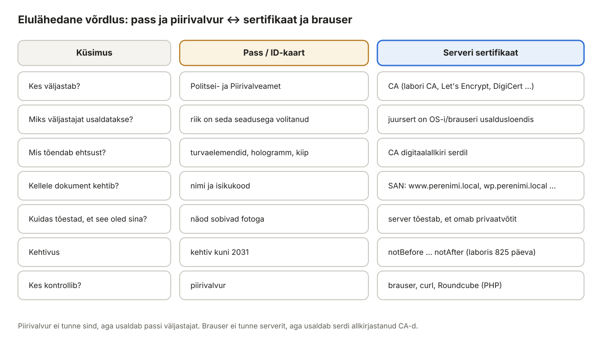
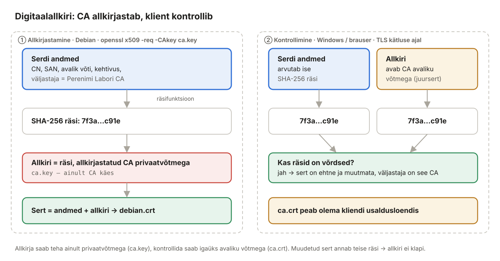
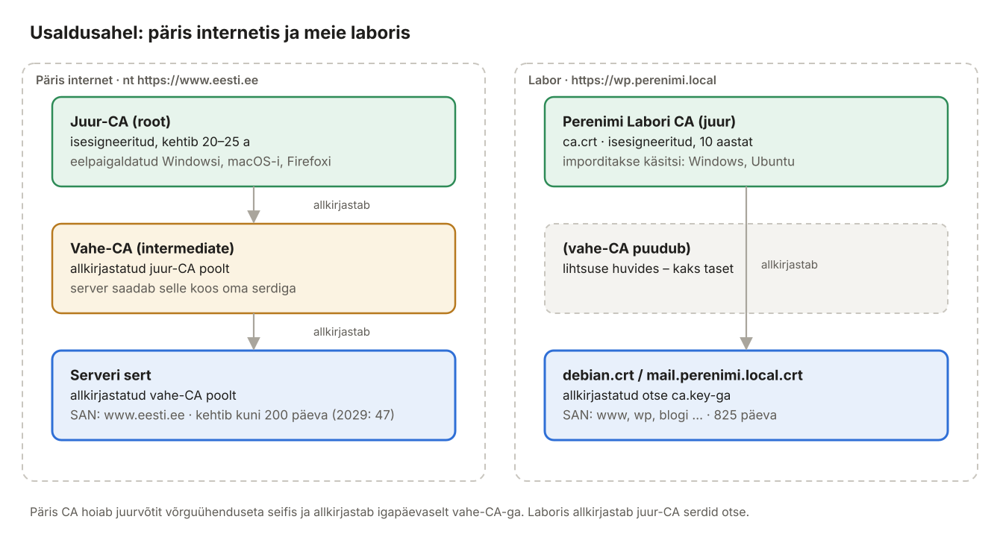
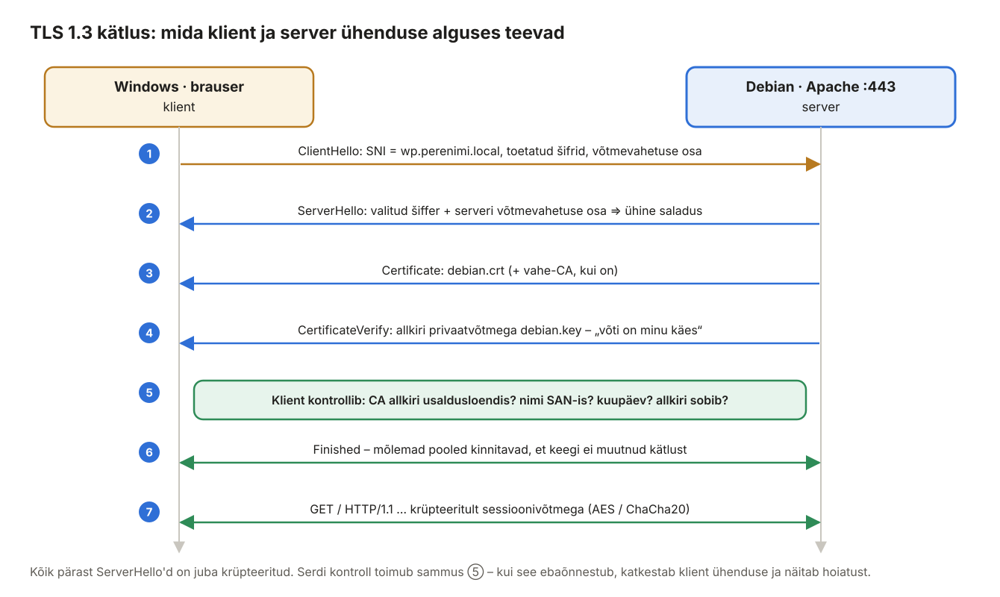

## 8. Labori CA ja HTTPS

Siiani on kõik meie saidid töötanud üle **HTTP**. See tähendab, et iga bait liigub võrgus avatekstina: kui logid WordPressi halduspaneeli või Roundcube'i, liigub su parool võrgus täpselt sellisena, nagu selle sisestasid. Iga masin samas võrgus, iga Wi-Fi tugijaam ja iga ruuter teel saab seda lugeda ja isegi muuta.

**HTTPS** on sama HTTP, aga **TLS**-i (*Transport Layer Security*) tunnelis. TLS-i jaoks on serveril vaja **sertifikaati** (lühidalt **sert**). Päris internetis ostetakse sert või saadakse see tasuta Let's Encryptilt. Meie laboris on domeen `perenimi.local` olemas ainult meie DNS-serveris ja ükski avalik sertifikaadiasutus seda kontrollida ei saa. Seepärast teeme **oma sertifikaadiasutuse (CA)**, täpselt nagu ettevõtted teevad oma sisevõrgu jaoks.

Peatüki esimene pool (8.1–8.7) selgitab, **miks** see kõik töötab: mis on sert, kuidas töötab digitaalallkiri ja usaldusahel ning mida brauser ühenduse alguses kontrollib. Teine pool (8.8–8.16) on praktiline: loome CA, väljastame serdid ja paneme HTTPS-i tööle Apache'is, Postfixis ja Dovecotis.


*Joonis 8.1: Labori CA ülevaade – mida teeme selles peatükis*

> 🧪 **Interaktiivne harjutus:** [Labori CA ja HTTPS simulaator](https://valdonolvak.github.io/meili--ja_veebiserverite_haldus/interaktiivne/ca-simulaator.html) – tee selle peatüki sammud nuppudega läbi (CA, serdid, juursert Windowsi ja Ubuntusse) ja ava saite Edge'i, Firefoxi, `curl`-i ja Roundcube'iga. Näed iga kontrolli eraldi: usaldus, kuupäev, nimi SAN-is. Kümme ülesannet tüüpiliste vigadega: SAN puudub, avad IP-ga, sert aegus, CA loodi uuesti, võti ei sobi serdiga, Firefox ei usalda Windowsi juursertide hoidlat.

### 8.1 Milleks HTTPS? Kolm lubadust

TLS annab kolm asja ja kõik kolm on vajalikud:

| Lubadus | Mida see tähendab | Mis juhtub ilma selleta |
| --- | --- | --- |
| **Konfidentsiaalsus** | Liiklus on krüpteeritud, kõrvaline näeb ainult mürana näivaid baite. | Kohviku Wi-Fis istuja näeb su Roundcube'i parooli ja kirjade sisu. |
| **Terviklus** | Iga krüpteeritud kirje kannab kontrollkoodi. Kui keegi muudab teel kasvõi ühe baidi, märkab vastuvõtja seda ja katkestab ühenduse. | Ründaja ruuteris lisab lehele pahatahtliku skripti või vahetab allalaaditava faili. |
| **Autentimine** | Sert tõestab, et räägid **just selle serveriga**, kelle nime aadressiribale kirjutasid. | Ründaja suunab su DNS-i võltsimisega enda serverisse. Krüpteerimine töötab, aga sa räägid krüpteeritult **valele osapoolele**. |

Kolmas punkt on kõige olulisem ja kõige vähem mõistetud. Krüpteerimine üksi ei aita, kui sa ei tea, kellega krüpteeritud ühenduse lõid. Seda probleemi lahendavadki sertifikaadid ja CA-d. Selle peatüki teooriaosa räägib peamiselt autentimisest.

### 8.2 Eluline näide: pass, ID-kaart ja piirivalvur

Kujuta ette lennujaama passikontrolli. Piirivalvur näeb sind esimest korda elus, ometi laseb ta su üle piiri. Miks?

1. Sa näitad **passi**. Selles on su nimi, foto, kehtivusaeg ja väljastaja.
2. Piirivalvur **ei usalda sind**, vaid **usaldab passi väljastajat** – Politsei- ja Piirivalveametit. Riik on PPA-le andnud õiguse passe väljastada ja piirivalvur teab seda.
3. Ta kontrollib, et pass on **ehtne** (turvaelemendid, hologramm, kiip), **kehtiv** (kuupäev) ja et **sina oled passi omanik** (nägu sobib fotoga).

Sertifikaadiga käib täpselt sama loogika.



*Joonis 8.2: Passikontroll ja serdi kontroll on sama loogikaga*

Pane tähele viimast rida: passi võib leida tänavalt või varastada, aga sellega ei saa sinuna piiri ületada, sest nägu ei sobi. Serdiga on sama lugu: **sert on avalik**, iga külastaja saab selle koopia. Kopeeritud serdiga ei saa aga keegi sinu serverit teeselda, sest tal pole **privaatvõtit** (vt 8.3).

**Eesti ID-kaart on päriselt sertifikaatidega dokument.** ID-kaardi kiibis on kaks serti: üks isikutuvastuseks (PIN1) ja teine digiallkirjastamiseks (PIN2). Nende usaldusahel on täpselt selline, nagu selles peatükis kirjeldame: riigi juur-CA **EE-GovCA2018** on allkirjastanud vahe-CA **ESTEID2018** ja see omakorda sinu isikliku serdi. Kui logid ID-kaardiga sisse eesti.ee-sse, kontrollib server sinu serti samamoodi, nagu brauser kontrollib serveri serti. Kui oled ID-kaardiga sisse loginud, oled TLS-i kasutanud mõlemas suunas.

ID-kaardi lugu näitab ka, et **dokument ja sert on eri asjad**. 2017. aastal leiti ID-kaardi kiibist turvaviga (ROCA) ja PPA peatas ligi 750 000 kaardi serdid. Kaart kehtis isikut tõendava dokumendina edasi, aga e-teenustesse sellega sisse logida ega digiallkirja anda ei saanud enne, kui sert uuendati. Täpselt sama juhtub serveriga: veebileht ja server töötavad, aga kui sert on aegunud või tühistatud, ei usalda kliendid seda enam.

### 8.3 Võtmepaar ja digitaalallkiri

Sertifikaadid põhinevad **asümmeetrilisel krüptograafial**. Iga osapool genereerib **võtmepaari**:

- **Privaatvõti** (*private key*) on salajane ega lahku kunagi serverist. Meie failid `ca.key`, `debian.key` ja `mail.perenimi.local.key`.
- **Avalik võti** (*public key*) arvutatakse privaatvõtmest ja seda võib näidata kõigile. See pannakse serti.

Neil kahel on matemaatiline seos, millel on kaks kasulikku omadust:

| Tegevus | Mis võtmega | Kes saab kontrollida |
| --- | --- | --- |
| **Allkirjastamine** | privaatvõtmega | igaüks, kellel on avalik võti |
| **Krüpteerimine** | avaliku võtmega | ainult privaatvõtme omanik saab lahti teha |

Privaatvõtit avalikust võtmest tagasi arvutada ei saa: 2048-bitise RSA-võtme korral kuluks selleks praeguste arvutitega rohkem aega, kui universum on olemas olnud.

**Kuidas CA serti allkirjastab:**



*Joonis 8.3: CA allkirjastab serdi oma privaatvõtmega, klient kontrollib CA avaliku võtmega*

1. CA võtab serdi kõik andmed (nimi, SAN, avalik võti, kehtivus, väljastaja) ja arvutab nendest **räsi** (SHA-256). Räsi on lühike „sõrmejälg“: sama sisend annab alati sama räsi, aga muuda ühte tähte ja räsi on täiesti teine.
2. CA allkirjastab räsi **oma privaatvõtmega** (`ca.key`). Tulemus ongi **allkiri**, mis lisatakse serdi lõppu.
3. Klient (brauser) arvutab serdi andmetest ise räsi, kontrollib allkirja **CA avaliku võtmega** (see on juurserdis `ca.crt`) ja võrdleb tulemusi.
4. Kui räsid ühtivad, on kaks asja kindel: sert on **muutmata** ja selle allkirjastas **just see CA**, kelle avalik võti kliendil on. Mitte keegi teine, sest kellelgi teisel pole `ca.key`-d.

Siit tuleneb ka, miks `ca.key` on kogu labori kõige tundlikum fail. Kes selle kätte saab, saab allkirjastada usaldatud serdi **suvalisele nimele**: näiteks `mail.perenimi.local` või laboris isegi `www.google.com` (kui kliendid usaldavad labori CA-d).

### 8.4 Mis on serdi sees

Sertifikaat (vorming **X.509**) on lihtsalt allkirjastatud andmestruktuur. Vaata seda ise. Kui sert on juba olemas (8.9), siis:

```bash
openssl x509 -in debian.crt -noout -text
```

Väljund (lühendatud, kommentaarid lisatud):

```text
Certificate:
    Data:
        Version: 3 (0x2)
        Serial Number: 4c:1e:…                       ← unikaalne number selle CA piires
        Signature Algorithm: sha256WithRSAEncryption  ← kuidas allkiri tehti
        Issuer: C = EE, O = Perenimi labor, CN = Perenimi Labori CA   ← KES allkirjastas
        Validity
            Not Before: Nov 12 13:29:21 2026 GMT       ← kehtib alates
            Not After : Feb 14 13:29:21 2029 GMT       ← kehtib kuni (825 päeva)
        Subject: C = EE, O = Perenimi labor, CN = www.perenimi.local  ← KELLELE
        Subject Public Key Info:
            Public Key Algorithm: rsaEncryption
                Public-Key: (2048 bit)                ← serveri AVALIK võti
        X509v3 extensions:
            X509v3 Basic Constraints:
                CA:FALSE                              ← see sert EI tohi teisi allkirjastada
            X509v3 Key Usage:
                Digital Signature, Key Encipherment
            X509v3 Extended Key Usage:
                TLS Web Server Authentication         ← ainult veebiserverile
            X509v3 Subject Alternative Name:          ← nimed, millele sert kehtib
                DNS:www.perenimi.local, DNS:wp.perenimi.local, DNS:blogi.perenimi.local, …
            X509v3 Authority Key Identifier:
                5F:D5:94:…                             ← viide CA võtmele (ahela ehitamiseks)
    Signature Algorithm: sha256WithRSAEncryption
    Signature Value: 8a:2c:…                          ← CA allkiri kõigele ülaltoodule
```

Kõige olulisemad väljad:

- **Issuer** ja **Subject** – kes väljastas ja kellele. Juurserdil on need võrdsed: juur-CA on ise enda serdi allkirjastanud (*self-signed*).
- **Validity** – kehtivusaeg. Klient võrdleb seda **oma** kellaga. Vale kellaga arvutis ütleb brauser, et sert on aegunud või pole veel kehtiv.
- **Subject Alternative Name (SAN)** – nimekiri nimedest, millele sert kehtib. **Tänapäeva brauserid vaatavad ainult SAN-i.** Väli `CN` (*Common Name*) on ajalooline ja Chrome ei arvesta seda alates 2017. aastast. Sert ilma SAN-ita ei kehti brauseris ühelegi nimele.
- **Basic Constraints: CA:FALSE** – serveri sert ei tohi ise teisi serte allkirjastada. Muidu saaks iga serdi omanik hakata ise CA-ks.

### 8.5 Usaldusahel ja usaldusloend

Kust brauser teab, milliseid CA-sid usaldada? Igas operatsioonisüsteemis ja brauseris on **usaldusloend** (*trust store*, *root store*): umbes 150 juur-CA serti, mille Microsoft, Apple, Google ja Mozilla on üle kontrollinud. Et CA sinna pääseks, peab ta läbima iga-aastase sõltumatu auditi ja täitma CA/Browser Forumi nõudeid.

Vaata Windowsis ise: `Win+R` → `certlm.msc` → *Trusted Root Certification Authorities → Certificates*. Sealt leiad näiteks *Microsoft Root Certificate Authority 2011* ja *DigiCert Global Root G2*. Windows ei hoia kõiki juurserte kohe kettal: kui brauser kohtab Microsofti programmi kuuluvat juurt, mida arvutis veel pole, laadib Windows selle automaatselt alla. Seepärast on nimekiri igas arvutis veidi erinev. Ubuntus on juursertid kaustas `/etc/ssl/certs/` (pakett `ca-certificates`, mis põhineb Mozilla nimekirjal).

**Päris internetis on ahelas tavaliselt kolm lüli:**



*Joonis 8.4: Kolmetasemeline ahel päris internetis, kahetasemeline meie laboris*

1. **Juur-CA** (*root CA*) on ise enda serdi allkirjastanud ja kehtib 20–25 aastat. Selle privaatvõti on **võrguühenduseta** riistvaralises turvamoodulis (HSM) seifis ja seda kasutatakse vaid paar korda aastas.
2. **Vahe-CA** (*intermediate CA*) on juur-CA allkirjastatud ja allkirjastab igapäevaselt serveriserte. Kui vahe-CA võti lekib, tühistab juur-CA selle ja teeb uue. Juur-CA ise jääb puutumata ja usaldusloendeid ei pea uuendama.
3. **Serveri sert** (*leaf*) on vahe-CA allkirjastatud.

Server saadab kätluse ajal **oma serdi koos vahe-CA serdiga**, sest vahesertifikaate usaldusloendis pole. Klient ehitab ahela ülespoole: serveri serdi allkirjastaja on vahe-CA, vahe-CA allkirjastaja on juur-CA ja see on usaldusloendis. Ahel on suletud ja sert on usaldatud.

> **Proovi ise:** ava Windowsi brauseris mõni Eesti sait, näiteks `https://www.eesti.ee` või oma panga leht. Klõpsa aadressiriba vasakul olevale ikoonile → *Connection is secure* → *Certificate is valid* → kaart **Details**. Ülal on **Certificate Hierarchy**: kolm rida juurest serverini. Vaata iga lüli välju *Issued To*, *Issued By*, *Valid From/To* ja *Subject Alternative Name*. Võrdle hiljem oma laboriserdiga.

**Meie laboris** on ahelas kaks lüli: Perenimi Labori CA allkirjastab serveriserdid otse. Vahe-CA-d lihtsuse huvides ei tee. Meie juurserti pole üheski usaldusloendis, seega **paigaldame selle ise** igale kliendile (8.13 ja 8.14). Nii toimivad ka ettevõtted: Windowsi domeenis on oma CA (Active Directory Certificate Services) ja selle juursert jagatakse grupipoliitikaga (GPO) automaatselt kõigi domeeniarvutite usaldusloendisse. Kasutaja ei näe sisevõrgu saitidel ühtegi hoiatust.

**Miks on usaldus nii habras – päris juhtum:** 2011. aastal murti sisse Hollandi CA-sse **DigiNotar**. Ründajad väljastasid sealt usaldatud serdid muu hulgas nimele `*.google.com` ja kasutasid neid Iraanis kasutajate Gmaili-liikluse pealtkuulamiseks. Brauserite jaoks oli kõik korras: allkiri oli usaldatud CA-lt ja nimi klappis. Kui juhtum avastati, eemaldasid Microsoft, Mozilla, Google ja Apple DigiNotari oma usaldusloenditest ja firma läks samal aastal pankrotti. Õppetund: **CA privaatvõti on võti kõigi selle CA kasutajate usalduse juurde.** Meie `ca.key` on väike koopia samast probleemist, seega hoiame seda ainult root'ile loetavas kaustas.

### 8.6 TLS-i kätlus: mis juhtub, kui avad https:// lehe

Kui sisestad brauserisse `https://wp.perenimi.local`, juhtub enne lehe laadimist kätlus (*handshake*). See võtab mõni millisekund.



*Joonis 8.5: TLS 1.3 kätlus lihtsustatult*

1. **ClientHello** – brauser saadab toetatud krüptoalgoritmid, oma osa võtmevahetusest ja **SNI**-välja (*Server Name Indication*) nimega `wp.perenimi.local`. SNI järgi valib Apache, millist virtuaalhosti ja serti kasutada. Nii saab ühel IP-aadressil olla mitu HTTPS-saiti.
2. **ServerHello** – server valib algoritmi ja saadab oma osa võtmevahetusest. Nüüd arvutavad mõlemad pooled **sama saladuse**, ilma et see oleks kunagi võrgus liikunud (Diffie-Hellmani võtmevahetus). Edasine liiklus on krüpteeritud.
3. **Certificate** – server saadab oma serdi (ja vahe-CA serdi, kui see on).
4. **CertificateVerify** – server allkirjastab kogu senise kätluse **oma privaatvõtmega** `debian.key`. See on hetk, kus server tõestab, et sert on **tema oma**, mitte kopeeritud. Ilma privaatvõtmeta seda allkirja teha ei saa.
5. **Klient kontrollib** (8.15): kas sert on usaldatud CA allkirjaga, kas nimi on SAN-is, kas kuupäev sobib ja kas CertificateVerify allkiri klapib serdis oleva avaliku võtmega. **Kui midagi ei klapi, katkestab brauser ühenduse ja näitab hoiatust.**
6. **Finished** – mõlemad kinnitavad, et kätlust pole teel muudetud.
7. Edasi liigub tavaline HTTP, aga krüpteeritult **sümmeetrilise sessioonivõtmega** (AES või ChaCha20). Sümmeetriline krüpteerimine on tuhandeid kordi kiirem kui asümmeetriline, seepärast kasutatakse võtmepaare ainult kätluses.

Täpselt sama kätlus toimub, kui Thunderbird või Roundcube ühendub Dovecotiga (IMAPS, port 993) või kui Postfix võtab kirja vastu pordil 587 ja klient annab käsu `STARTTLS`.

> **Mõtle järele:** miks ei piisa sellest, et server saadab serdi? Sest sert on avalik. Iga külastaja saab selle salvestada (`openssl s_client … > sert.pem`) ja oma serverisse panna. Alles 4. samm, allkiri privaatvõtmega, eristab ehtsat serverit koopiast.

### 8.7 Mõisted kokkuvõtlikult

| Termin | Selgitus |
| --- | --- |
| Võtmepaar | Privaatvõti (salajane, jääb serverisse) + avalik võti (serdis). Privaatvõtmega allkirjastatut saab kontrollida avaliku võtmega. Avaliku võtmega krüpteeritut saab lahti teha ainult privaatvõtmega. |
| Sertifikaat (X.509) | Avalik võti + omaniku nimed (SAN) + kehtivusaeg + väljastaja + **CA allkiri**. |
| CA (*Certificate Authority*) | Usaldatud osapool, kes kontrollib taotlejat ja allkirjastab tema serdi. |
| Juursertifikaat (*root CA*) | CA enda isesigneeritud sert. Usaldus algab sellest, et see on kliendi usaldusloendis. |
| Vahe-CA (*intermediate*) | Juur-CA allkirjastatud CA, mis allkirjastab igapäevaselt serveriserte. Laboris seda pole. |
| Usaldusloend (*trust store*) | Kliendi juursertide nimekiri: Windowsis *Trusted Root Certification Authorities*, Ubuntus `/etc/ssl/certs`. |
| CSR (*Certificate Signing Request*) | Taotlus CA-le: „palun allkirjasta see avalik võti nende nimedega“. Privaatvõtit CSR-is pole. |
| SAN (*Subject Alternative Name*) | Nimed, millele sert kehtib. **Brauserid vaatavad ainult SAN-i**, mitte CN-i. |
| Isesigneeritud sert | Sert, mille väljastaja on tema ise. Brauser hoiatab, kui see pole usaldusloendis. Labori CA juursert on isesigneeritud, aga me paigaldame selle usaldusloendisse. |
| TLS kätlus (*handshake*) | Ühenduse algus: võtmevahetus, server saadab serdi ja tõestab privaatvõtme olemasolu, klient kontrollib serti. |
| SNI | Klient ütleb kätluse alguses, millist nime ta tahab. Nii saab ühel IP-l olla mitu HTTPS-saiti eri sertidega. |
| HSTS | Päis, mis käsib brauseril seda saiti edaspidi avada ainult HTTPS-iga. |
| Tühistamine (*revocation*) | CA kuulutab serdi enne tähtaega kehtetuks (CRL-nimekiri või OCSP-päring). Laboris me seda ei kasuta. |

---

### 8.8 Labori CA loomine (Debian)

Teooria on käes, nüüd praktika. CA-ks saab Debian: see on meie „Politsei- ja Piirivalveamet“, kes hakkab serte väljastama. Hoiame CA faile kaustas `/root/labori-ca`, kuhu pääseb ainult root.

**Debian:**

```bash
sudo -i                                   # edasi root'ina
mkdir -p /root/labori-ca && cd /root/labori-ca
chmod 700 /root/labori-ca

openssl genrsa -out ca.key 4096
openssl req -x509 -new -key ca.key -sha256 -days 3650 -out ca.crt \
  -subj "/C=EE/O=Perenimi labor/CN=Perenimi Labori CA"

openssl x509 -in ca.crt -noout -subject -dates
```

Mida iga käsk teeb:

| Käsk / valik | Selgitus |
| --- | --- |
| `chmod 700` | Kausta saab lugeda ainult root. Teised kasutajad ei näe isegi failinimesid. |
| `openssl genrsa -out ca.key 4096` | Genereerib CA privaatvõtme, 4096-bitine RSA. CA võti on pikem kui serveri oma, sest see peab vastu pidama 10 aastat. |
| `openssl req -x509 -new` | `req` teeb tavaliselt serdi taotluse (CSR). `-x509` ütleb: ära tee taotlust, tee kohe **isesigneeritud sert**. |
| `-key ca.key` | Avalik võti arvutatakse sellest privaatvõtmest ja sellega ka allkirjastatakse. |
| `-sha256` | Räsialgoritm allkirja jaoks. SHA-1 on aegunud ja brauserid seda ei aktsepteeri. |
| `-days 3650` | Juursert kehtib 10 aastat. Kui see aegub, kaotavad kehtivuse ka kõik selle allkirjastatud serdid. |
| `-subj "/C=EE/O=…/CN=…"` | Serdi omaniku andmed: riik, organisatsioon ja nimi. Ilma `-subj`-ita küsib openssl neid interaktiivselt. |

OpenSSL lisab `-x509` korral automaatselt laienduse `CA:TRUE`: see sert **tohib** teisi allkirjastada. Kontrolli: `openssl x509 -in ca.crt -noout -ext basicConstraints`.

### 8.9 Serdi väljastamine

Serveriserdi tegemine käib kolmes sammus, nagu päris elus passi taotlemine:

1. **Võti** – server genereerib oma võtmepaari (`genrsa`).
2. **Taotlus (CSR)** – server teeb taotluse: „siin on minu avalik võti ja minu nimi, palun kinnita“ (`req -new`). Taotlus on allkirjastatud serveri enda võtmega, nii et CA teab, et taotlejal on privaatvõti olemas.
3. **Allkiri** – CA kontrollib taotlust, lisab laiendused (SAN jms), kehtivusaja ja **allkirjastab oma võtmega** (`x509 -req -CA … -CAkey …`). Tulemus on sert.

Päris CA kontrollib 3. sammus, kas taotleja **tõesti omab** seda domeeni. Näiteks Let's Encrypt palub panna saidile kindla faili või DNS-i kindla TXT-kirje. Meie laboris oleme ise nii CA kui ka taotleja, seega kontrollime „iseennast“.

Laiendused kirjutame eraldi faili. Tee Debiani jaoks **üks sert, mis kehtib kõigile tema saitidele** (www, wp, blogi). See on lihtsam kui kolm eraldi serti ja SNI-ga töötab ka eraldi sertidega.

**Debian (root, kaustas `/root/labori-ca`):**

```bash
cat > debian.ext <<EOF
basicConstraints = CA:FALSE
keyUsage = digitalSignature, keyEncipherment
extendedKeyUsage = serverAuth
subjectAltName = DNS:www.perenimi.local, DNS:wp.perenimi.local, DNS:blogi.perenimi.local, DNS:perenimi.local, DNS:debian.perenimi.local
EOF

openssl genrsa -out debian.key 2048
openssl req -new -key debian.key -out debian.csr -subj "/C=EE/O=Perenimi labor/CN=www.perenimi.local"
openssl x509 -req -in debian.csr -CA ca.crt -CAkey ca.key -CAcreateserial \
  -out debian.crt -days 825 -sha256 -extfile debian.ext

openssl verify -CAfile ca.crt debian.crt                 # debian.crt: OK
openssl x509 -in debian.crt -noout -ext subjectAltName
```

Laiendusfaili read:

| Rida | Tähendus |
| --- | --- |
| `basicConstraints = CA:FALSE` | Serveri sert ei tohi ise teisi serte allkirjastada. |
| `keyUsage = digitalSignature, keyEncipherment` | Võtmega tohib allkirjastada (CertificateVerify kätluses) ja võtmevahetust teha. |
| `extendedKeyUsage = serverAuth` | Sert on mõeldud **serveri** tuvastamiseks TLS-is. Kliendiserdil (nt ID-kaardil) oleks `clientAuth`. |
| `subjectAltName = DNS:…, DNS:…` | Kõik nimed, millega seda serverit avatakse. **Iga nimi, mida brauseris kasutad, peab siin olema.** `blogi` puudumisel annab `https://blogi.perenimi.local` serdivea, kuigi vhost on olemas. |

Väljastamiskäsu valikud:

| Valik | Selgitus |
| --- | --- |
| `-in debian.csr` | Allkirjastatav taotlus. |
| `-CA ca.crt -CAkey ca.key` | Kes allkirjastab: CA sert (sealt tuleb väli *Issuer*) ja CA privaatvõti (sellega tehakse allkiri). |
| `-CAcreateserial` | Loob faili `ca.srl`, kus hoitakse järgmise serdi seerianumbrit. Iga CA väljastatud sert peab saama unikaalse numbri. |
| `-days 825` | Serveriserdi kehtivus. |
| `-extfile debian.ext` | Lisab ülal kirjeldatud laiendused. **Ilma selleta jääb sert SAN-ita** ja brauser lükkab selle tagasi. |

`openssl verify` teeb sama kontrolli, mida brauser hiljem teeb: kas `debian.crt` allkiri klapib `ca.crt`-s oleva avaliku võtmega. `debian.csr` võib pärast väljastamist kustutada, sest seda enam vaja ei lähe.

Meiliserveri sert (Ubuntu) samamoodi:

```bash
cat > mail.ext <<EOF
basicConstraints = CA:FALSE
keyUsage = digitalSignature, keyEncipherment
extendedKeyUsage = serverAuth
subjectAltName = DNS:mail.perenimi.local, DNS:ubuntu.perenimi.local
EOF

openssl genrsa -out mail.perenimi.local.key 2048
openssl req -new -key mail.perenimi.local.key -out mail.perenimi.local.csr \
  -subj "/C=EE/O=Perenimi labor/CN=mail.perenimi.local"
openssl x509 -req -in mail.perenimi.local.csr -CA ca.crt -CAkey ca.key -CAcreateserial \
  -out mail.perenimi.local.crt -days 825 -sha256 -extfile mail.ext
openssl verify -CAfile ca.crt mail.perenimi.local.crt
```

Meiliserveri sert peab kehtima nimele, mida **kliendid ühendumisel kasutavad**: Roundcube'i seadetes, Thunderbirdis ja brauseris on see `mail.perenimi.local`. Sama serti kasutavad Apache (veebimeil), Postfix (SMTP) ja Dovecot (IMAP).

> **825 päeva** on suurim kehtivus, mida Apple'i seadmed **sisevõrgu CA** serdile lubavad. Avalike CA-de serdid on lühemad ja lühenevad veelgi: CA/Browser Forumi otsuse järgi kehtib alates 15. märtsist 2026 avalik sert kuni 200 päeva, 2027. aastast 100 päeva ja 2029. aastast 47 päeva. Käsitsi selliseid serte uuendada ei jõua, seepärast tehakse seda automaatselt ACME-protokolliga (nt Certbot ja Let's Encrypt).

> **Tootmises** tehakse võti ja CSR **sihtserveris** ning CA-le saadetakse ainult CSR. Privaatvõti ei liigu kunagi võrgus. Laboris teeme lihtsuse huvides kõik Debianis ja kopeerime Ubuntu failid üle SSH.

### 8.10 Failide paigutamine ja kopeerimine

CA ja veebiserver on samas masinas (Debian), seega Debiani serdi paigaldame kohe. Meiliserveri failid ja juursert kopeerime Ubuntule. Juursert läheb ka kodukausta, kust Windows selle ära toob.

**Debian (root, kaustas `/root/labori-ca`):**

```bash
install -m 644 debian.crt /etc/ssl/certs/debian.crt
install -m 600 debian.key /etc/ssl/private/debian.key
install -m 644 ca.crt /usr/local/share/ca-certificates/perenimi-labori-ca.crt
update-ca-certificates                                   # 1 added

scp ca.crt mail.perenimi.local.crt mail.perenimi.local.key opilane@192.168.XXX.20:/home/opilane/
cp ca.crt /home/opilane/ && chown opilane: /home/opilane/ca.crt     # Windowsi jaoks
exit
```

Miks just need õigused?

- **Sert** (`.crt`) on avalik, `644` (kõik loevad). Seda saadetakse niikuinii igale külastajale.
- **Privaatvõti** (`.key`) on `600` ja kaustas `/etc/ssl/private`, mida loeb ainult root. Apache loeb võtme käivitumisel root'ina ja alles siis loobub õigustest (töötab edasi kasutajana `www-data`).
- `install` kopeerib faili ja seab õigused ühe käsuga. See on kindlam kui `cp` + `chmod`, sest fail pole hetkekski vale õigustega.
- `/usr/local/share/ca-certificates/` + `update-ca-certificates` lisab labori CA **Debiani enda** usaldusloendisse. Pärast seda usaldavad seda `curl`, `wget`, PHP ja teised programmid. Fail peab lõppema laiendiga `.crt`, muidu käsk ei leia seda.

### 8.11 HTTPS vhostid Debianis

**Debian:**

```bash
sudo a2enmod ssl headers rewrite
```

- `ssl` – Apache'i TLS-moodul, ilma selleta ei tunne Apache direktiivi `SSLEngine`.
- `headers` – turvapäiste (HSTS jt) lisamiseks.
- `rewrite` – WordPressi püsiviidete jaoks (vt peatükk 6).

Asenda `wp.perenimi.local.conf` sisu. Iga sait saab nüüd **kaks** virtuaalhosti: port 80 suunab ainult HTTPS-ile, päris sait on pordil 443.

```bash
sudo nano /etc/apache2/sites-available/wp.perenimi.local.conf
```

```apache
<VirtualHost *:80>
    ServerName wp.perenimi.local
    Redirect permanent / https://wp.perenimi.local/
</VirtualHost>

<VirtualHost *:443>
    ServerName  wp.perenimi.local
    ServerAdmin admin@perenimi.local
    DocumentRoot /var/www/wp.perenimi.local

    SSLEngine on
    SSLCertificateFile    /etc/ssl/certs/debian.crt
    SSLCertificateKeyFile /etc/ssl/private/debian.key

    Header always set Strict-Transport-Security "max-age=31536000"
    Header always set X-Content-Type-Options "nosniff"
    Header always set X-Frame-Options "SAMEORIGIN"

    <Directory /var/www/wp.perenimi.local>
        Options -Indexes +FollowSymLinks
        AllowOverride All
        Require all granted
    </Directory>

    ErrorLog  ${APACHE_LOG_DIR}/wp.perenimi.local_error.log
    CustomLog ${APACHE_LOG_DIR}/wp.perenimi.local_access.log combined
</VirtualHost>
```

| Direktiiv | Selgitus |
| --- | --- |
| `Redirect permanent / https://…/` | Vastab HTTP-päringule koodiga **301** ja uue aadressiga. Brauser avab kohe HTTPS-i ja jätab suunamise meelde. Nii ei pea kasutaja `https://` ise kirjutama. |
| `SSLEngine on` | Selles vhostis räägitakse TLS-i. |
| `SSLCertificateFile` | Sert, mille Apache kätluses saadab (8.6, samm 3). |
| `SSLCertificateKeyFile` | Privaatvõti, millega Apache teeb CertificateVerify allkirja (samm 4). **Võti ja sert peavad olema paar**, muidu Apache ei käivitu (`AH02565: Certificate and private key … do not match`). |
| `Strict-Transport-Security` | **HSTS**: brauser jätab aastaks (31 536 000 sekundit) meelde, et seda saiti avatakse ainult HTTPS-iga. Edaspidi teeb brauser `http://` → `https://` ise, enne kui midagi võrku saadab. NB! HSTS-iga saidil ei lase brauser serdihoiatusest „edasi minna“. |
| `X-Content-Type-Options`, `X-Frame-Options` | Lisakaitse: brauser ei arva failitüüpi ja saiti ei saa teise saidi raami (iframe) panna. |

Tee sama `blogi.perenimi.local.conf` ja `www.perenimi.local.conf` jaoks (www-saidil `AllowOverride None` ja `ServerAlias perenimi.local` mõlemas plokis). Kiire viis blogi jaoks:

```bash
sudo sed 's/wp\.perenimi/blogi.perenimi/g' /etc/apache2/sites-available/wp.perenimi.local.conf \
  | sudo tee /etc/apache2/sites-available/blogi.perenimi.local.conf
sudo apache2ctl configtest && sudo systemctl reload apache2
sudo apache2ctl -S
```

`apache2ctl -S` näitab nüüd iga saiti kaks korda: `*:80` ja `*:443`.

Proovi käsurealt. Debian usaldab nüüd labori CA-d, seega `-k` (kontrolli vahelejätmine) pole vaja:

```bash
curl -sI http://wp.perenimi.local/          # 301 → https://wp.perenimi.local/
curl -sI https://wp.perenimi.local/         # 200 või 302 (WordPress)
openssl s_client -connect wp.perenimi.local:443 -servername wp.perenimi.local </dev/null 2>/dev/null | grep -E "subject=|issuer=|Verify return"
```

`openssl s_client` teeb TLS-kätluse nagu brauser ja näitab tulemust. `-servername` saadab SNI. `Verify return code: 0 (ok)` tähendab, et ahel on usaldatud. NB! `s_client` ei kontrolli vaikimisi nime: selleks lisa `-verify_hostname wp.perenimi.local`.

### 8.12 WordPress HTTPS-ile

WordPress mäletab oma aadressi andmebaasis (`siteurl`, `home`) ja kasutab seda kõigis linkides. Kui need on endiselt `http://`, tekib üks kahest probleemist:

- **suunamiste ring** – Apache suunab HTTPS-ile, WordPress suunab tagasi HTTP-le;
- **segasisu** (*mixed content*) – leht ise on HTTPS, aga pildid, stiilid ja skriptid laaditakse `http://` kaudu. Brauser blokeerib need ja leht näeb välja „lagunenud“.

**Windowsi klient** (pärast 8.13): `https://wp.perenimi.local/wp-admin` → *Seaded → Üldine* → **WordPressi aadress** ja **Saidi aadress** → `https://wp.perenimi.local` → *Salvesta*. Sama tee blogi saidil.

Kui halduspaneel ei avane, muuda käsurealt:

```bash
# Debian (wp_db on siin)
sudo mariadb -e "UPDATE wp_db.wp_options SET option_value='https://wp.perenimi.local' WHERE option_name IN ('siteurl','home');"
# Ubuntu (blogi_db on seal)
sudo mariadb -e "UPDATE blogi_db.wp_options SET option_value='https://blogi.perenimi.local' WHERE option_name IN ('siteurl','home');"
```

### 8.13 Juursert Windowsi usaldusväärseks

Nüüd tuleb Windowsile öelda: „usalda Perenimi Labori CA-d nagu PPA-d“. Ehk lisada `ca.crt` Windowsi usaldusloendisse.

> **Kopeeri ainult `ca.crt`, mitte `ca.key`!** Kliendil on vaja CA **avalikku** võtit allkirjade kontrollimiseks. Privaatvõti jääb Debiani.

Too `ca.crt` Windowsi (PowerShell):

```powershell
scp opilane@192.168.XXX.10:ca.crt $env:USERPROFILE\Downloads\
```

**Variant A – GUI:**

1. Topeltklõpsa `ca.crt`. Windows näitab: *„This CA Root certificate is not trusted…“* – see on õige, sest me pole seda veel paigaldanud. Vaata kaarti *Details*: *Issued To* ja *Issued By* on mõlemad „Perenimi Labori CA“ (isesigneeritud).
2. **Install Certificate…** → *Store Location*: **Local Machine** → *Next* (kinnita UAC).
3. **Place all certificates in the following store** → *Browse* → **Trusted Root Certification Authorities** → *OK* → *Next* → *Finish*.
4. Kontroll: `Win+R` → `certlm.msc` → *Trusted Root Certification Authorities → Certificates* → „Perenimi Labori CA“. Siin on see teiste juur-CA-de (ISRG, DigiCert, Microsoft …) kõrval võrdsel kohal.

**Variant B – PowerShell (administraatorina):**

```powershell
Import-Certificate -FilePath "$env:USERPROFILE\Downloads\ca.crt" -CertStoreLocation Cert:\LocalMachine\Root
Get-ChildItem Cert:\LocalMachine\Root | Where-Object Subject -like "*Labori CA*"
```

Miks **Local Machine** ja **Trusted Root**?

- *Local Machine* kehtib kõigile selle arvuti kasutajatele ja teenustele. *Current User* kehtiks ainult sinule.
- *Trusted Root Certification Authorities* on just usaldusloend. Kui paned serdi kogemata kausta *Personal* või *Intermediate Certification Authorities*, siis brauser seda juurena ei arvesta ja hoiatus jääb alles.

Sulge brauser **täielikult** ja ava uuesti (brauser loeb usaldusloendi käivitumisel). `https://wp.perenimi.local` avaneb nüüd lukuga ilma hoiatuseta. Klõpsa lukul ja vaata serti: *Certificate Hierarchy* näitab kahte rida – Perenimi Labori CA → www.perenimi.local. Võrdle seda 8.5 harjutuses nähtud kolmerealise ahelaga.

Edge ja Chrome kasutavad Windowsi usaldusloendit. **Firefoxil** on oma usaldusloend, aga Windowsis loeb ta vaikimisi ka Windowsi juurserte (`about:config` → `security.enterprise_roots.enabled = true`). Kui Firefox ikka hoiatab, impordi sert Firefoxi seadetes: *Privacy & Security → Certificates → View Certificates → Authorities → Import*.

> **Ettevõttes** ei käida arvuteid ükshaaval läbi. Sama sertifikaat lisatakse grupipoliitikasse: *Computer Configuration → Policies → Windows Settings → Security Settings → Public Key Policies → Trusted Root Certification Authorities → Import*. Järgmisel `gpupdate`-l on see kõigis domeeniarvutites.

### 8.14 Meiliserveri serdid (Ubuntu)

**Ubuntu:**

```bash
cd ~
sudo install -m 644 mail.perenimi.local.crt /etc/ssl/certs/mail.perenimi.local.crt
sudo install -m 640 -g ssl-cert mail.perenimi.local.key /etc/ssl/private/mail.perenimi.local.key
sudo install -m 644 ca.crt /usr/local/share/ca-certificates/perenimi-labori-ca.crt
sudo update-ca-certificates
rm mail.perenimi.local.key
```

- Võti on `640` ja grupiga `ssl-cert`. Apache, Postfix ja Dovecot loevad võtit käivitumisel root'ina. Grupp `ssl-cert` on Ubuntus mõeldud teenustele, mis töötavad mitte-root kasutajana ja peavad ise võtit lugema: sellise teenuse kasutaja lisatakse gruppi.
- `rm mail.perenimi.local.key` kustutab kodukaustas oleva **koopia**. Privaatvõtmest ei tohi olla vedelevaid koopiaid.
- Ubuntu peab **ise** labori CA-d usaldama, sest Roundcube (PHP) on Dovecoti ja Postfixi suhtes **klient**: ta ühendub nendega TLS-iga ja kontrollib nende serti nagu brauser (peatükk 12). Ilma selleta on Roundcube'i logis `certificate verify failed`.

Sama serti kasutavad Postfix (port 25/587/465), Dovecot (993) ja Apache (veebimeil 443). Kontrolli kõiki kolme:

```bash
openssl s_client -connect mail.perenimi.local:993 -servername mail.perenimi.local </dev/null 2>/dev/null | grep "Verify return"
openssl s_client -connect mail.perenimi.local:587 -starttls smtp </dev/null 2>/dev/null | grep "Verify return"
```

(Postfixi ja Dovecoti TLS-seadistus tehakse peatükis 10. Kui need teenused pole veel paigaldatud, tule nende käskude juurde hiljem tagasi.)

### 8.15 Mida klient kontrollib

Iga TLS-klient (brauser, `curl`, Roundcube, Thunderbird, Outlook) teeb kätluse 5. sammus samad kontrollid. Kui mõni ebaõnnestub, saad vastava veateate:

| Kontroll | Kui ebaõnnestub (Chrome/Edge) | Tüüpiline põhjus laboris |
| --- | --- | --- |
| Sert on allkirjastatud usaldusloendis oleva CA poolt | `NET::ERR_CERT_AUTHORITY_INVALID` | CA pole Windowsi juursertide hulgas (8.13) või CA loodi uuesti ja serdid on vana CA omad |
| Aadressiriba nimi on SAN-is | `NET::ERR_CERT_COMMON_NAME_INVALID` | SAN puudub, nimi on SAN-ist puudu või avad saidi **IP-aadressiga** |
| Sert kehtib (kuupäevad) | `NET::ERR_CERT_DATE_INVALID` | sert aegus või **kliendi kell on vale** |
| Server omab privaatvõtit | ühendus katkeb | sert ja võti ei ole paar (Apache ei käivitu üldse) |
| Sert pole tühistatud | `NET::ERR_CERT_REVOKED` | laboris CRL-i/OCSP-d pole, kontrolli ei toimu |

Teised kliendid kirjutavad sama asja teisiti: Firefox `SEC_ERROR_UNKNOWN_ISSUER` / `SSL_ERROR_BAD_CERT_DOMAIN`, curl `SSL certificate problem: unable to get local issuer certificate`, PHP `certificate verify failed`.

Neid kontrolle saab järele proovida [CA simulaatoris](https://valdonolvak.github.io/meili--ja_veebiserverite_haldus/interaktiivne/ca-simulaator.html): lülita sisse rike, ava aadress ja vaata, milline kontroll ebaõnnestub ja mida näitab brauser, `curl` või `openssl s_client`.

> **Miks mitte lihtsalt „Advanced → Proceed anyway“?** Sest siis kaotad kolmest lubadusest (8.1) kõige olulisema: autentimise. Ühendus on krüpteeritud, aga sa ei tea, kellega. Kasutaja, kes on harjunud hoiatusi mööda klõpsama, klõpsab neist mööda ka siis, kui keegi päriselt ühendust pealt kuulab. Seepärast teeme laboris asja korralikult ära.

### 8.16 Serdi uuendamine ja CA hoidmine

- **Serdi uuendamine** (825 päeva pärast või kui SAN-i on vaja nimi juurde lisada): korda 8.9 sama CA-ga ja paigalda uus sert (8.10/8.14). Kliente pole vaja puutuda, sest nad usaldavad juba CA-d, mitte konkreetset serti. Uuenduse võib teha ka sama võtmega: `openssl req -new -key debian.key …`.
- **Ära loo CA-d uuesti „igaks juhuks“.** Uus `ca.key` tähendab uut CA-d, isegi kui nimi on sama. Vanad serdid töötavad edasi, kuni kliendid usaldavad vana CA-d, aga uued serdid nõuavad uue `ca.crt` paigaldamist **igale kliendile**. Simulaatori 7. ülesanne näitab seda.
- **Kui CA võti lekib**, on kõik selle väljastatud serdid ja kogu usaldus kahtluse all (vt DigiNotar, 8.5). Siis tuleb eemaldada vana `ca.crt` kõigist klientidest, luua uus CA ja väljastada kõik serdid uuesti.
- **Varunda** `/root/labori-ca` (eriti `ca.key` ja `ca.srl`) turvalisse kohta. Ilma `ca.key`-ta ei saa uusi serte väljastada ja tuleks alustada otsast.

### 8.17 Kontrollküsimused

1. Mis vahe on krüpteerimisel ja autentimisel? Miks ei piisa TLS-is ainult krüpteerimisest?
2. Kuidas on passikontroll sarnane serdi kontrolliga? Mis vastab passis „näole ja fotole“?
3. Miks ei saa ründaja kasutada sinu serveri serti, mille ta on endale kopeerinud?
4. Mis on räsi ja milleks seda allkirjastamisel vaja on?
5. Miks on päris CA-del vahe-CA? Mis juhtuks, kui juur-CA võti oleks igapäevases kasutuses ja lekiks?
6. Mida tähendab `CA:FALSE` serveri serdis? Mis võiks juhtuda, kui see puuduks?
7. Miks annab `https://192.168.XXX.10/` serdivea, kuigi `https://www.perenimi.local/` töötab?
8. Kasutaja arvuti kell on 3 aastat taga. Mida ta brauseris näeb ja miks?
9. Miks peab ka Ubuntu labori CA-d usaldama, kuigi Ubuntu ise on server?
10. Kuidas jõuaks labori CA juursert ettevõttes 500 Windowsi arvutisse ilma neid ükshaaval läbi käimata?

> Varasem juhend: [Apache2 ja Wordpressi turvalisuse tõstmine koos HTTPS seadistusega](../Turvalisus/Apache2%20ja%20Wordpressi%20turvalisuse%20t%C3%B5stmine%20koos%20HTTPS%20seadistusega.md).
