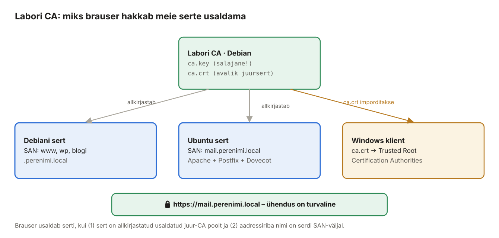

## 8. Labori CA ja HTTPS

HTTP liigub võrgus avatekstina: WordPressi parool, Roundcube'i parool ja kõik kirjad oleksid võrgus pealtkuulatavad. **TLS** (*Transport Layer Security*) krüpteerib ühenduse ja **sertifikaat** tõestab, et räägid õige serveriga. Laboris pole avalikku domeeni, seega ei saa kasutada Let's Encrypti – teeme oma **sertifikaadiasutuse (CA)**, nagu ettevõtted sisevõrgus teevad.



*Joonis 8.1: Usaldusahel*

> 🧪 **Interaktiivne harjutus:** [Labori CA ja HTTPS simulaator](https://valdonolvak.github.io/meili--ja_veebiserverite_haldus/interaktiivne/ca-simulaator.html) – tee selle peatüki sammud nuppudega läbi (CA, serdid, juursert Windowsi ja Ubuntusse) ja ava saite Edge'i, Firefoxi, `curl`-i ja Roundcube'iga. Näed iga kontrolli eraldi: usaldus, kuupäev, nimi SAN-is. Kümme ülesannet tüüpiliste vigadega: SAN puudub, avad IP-ga, sert aegus, CA loodi uuesti, võti ei sobi serdiga, Firefox ei usalda Windowsi juursertide hoidlat.

### 8.1 Mõisted

| Termin | Selgitus |
| --- | --- |
| Võtmepaar | Privaatvõti (salajane, jääb serverisse) + avalik võti (sertifikaadis). Privaatvõtmega krüpteeritut saab avada ainult avaliku võtmega ja vastupidi. |
| Sertifikaat (X.509) | Avalik võti + omaniku nimi + kehtivusaeg + **CA allkiri**. |
| CA (*Certificate Authority*) | Usaldatud osapool, kes allkirjastab teiste sertifikaate. |
| Juursertifikaat (*root CA*) | CA enda sertifikaat, mille ta on ise allkirjastanud. Usaldus algab sellest, et klient on selle paigaldanud. |
| CSR (*Certificate Signing Request*) | Taotlus: „palun allkirjasta minu avalik võti selle nimega“. |
| SAN (*Subject Alternative Name*) | Nimed, millele sert kehtib. **Brauserid vaatavad ainult SAN-i**, mitte CN-i. |
| Isesigneeritud sert | Sert, millel pole CA-d – brauser näitab alati hoiatust. Labori CA lahendab selle. |
| TLS kätlus (*handshake*) | Ühenduse alguses: server saadab serdi, klient kontrollib allkirja ja nime, lepitakse kokku sessioonivõti. |
| SNI | Klient ütleb kätluse alguses, millist nime ta tahab – nii saab ühel IP-l olla mitu HTTPS-saiti eri sertidega. |
| HSTS | Päis, mis käsib brauseril seda saiti edaspidi avada ainult HTTPS-iga. |

### 8.2 Labori CA loomine (Debian)

CA privaatvõti on kogu labori kõige tundlikum fail: kes selle saab, saab teha **usaldatud serdi mistahes nimele**. Hoiame seda ainult root'ile loetavas kaustas.

**Debian:**

```bash
sudo -i                                   # edasi root'ina
mkdir -p /root/labori-ca && cd /root/labori-ca
chmod 700 /root/labori-ca

openssl genrsa -out ca.key 4096
openssl req -x509 -new -key ca.key -sha256 -days 3650 -out ca.crt \
  -subj "/C=EE/O=Perenimi labor/CN=Perenimi Labori CA"

openssl x509 -in ca.crt -noout -subject -dates
```

### 8.3 Serdi väljastamine

Iga serveriserdi jaoks on vaja laiendusfaili, kus on **SAN-nimed**. Tee Debiani jaoks üks sert, mis kehtib kõigile tema saitidele.

**Debian (root, kaustas `/root/labori-ca`):**

```bash
cat > debian.ext <<EOF
basicConstraints = CA:FALSE
keyUsage = digitalSignature, keyEncipherment
extendedKeyUsage = serverAuth
subjectAltName = DNS:www.perenimi.local, DNS:wp.perenimi.local, DNS:blogi.perenimi.local, DNS:perenimi.local, DNS:debian.perenimi.local
EOF

openssl genrsa -out debian.key 2048
openssl req -new -key debian.key -out debian.csr -subj "/C=EE/O=Perenimi labor/CN=www.perenimi.local"
openssl x509 -req -in debian.csr -CA ca.crt -CAkey ca.key -CAcreateserial \
  -out debian.crt -days 825 -sha256 -extfile debian.ext

openssl verify -CAfile ca.crt debian.crt                 # debian.crt: OK
openssl x509 -in debian.crt -noout -ext subjectAltName
```

Meiliserveri sert (Ubuntu) samamoodi:

```bash
cat > mail.ext <<EOF
basicConstraints = CA:FALSE
keyUsage = digitalSignature, keyEncipherment
extendedKeyUsage = serverAuth
subjectAltName = DNS:mail.perenimi.local, DNS:ubuntu.perenimi.local
EOF

openssl genrsa -out mail.perenimi.local.key 2048
openssl req -new -key mail.perenimi.local.key -out mail.perenimi.local.csr \
  -subj "/C=EE/O=Perenimi labor/CN=mail.perenimi.local"
openssl x509 -req -in mail.perenimi.local.csr -CA ca.crt -CAkey ca.key -CAcreateserial \
  -out mail.perenimi.local.crt -days 825 -sha256 -extfile mail.ext
openssl verify -CAfile ca.crt mail.perenimi.local.crt
```

> **825 päeva** on suurim kehtivus, mida Apple'i seadmed sisevõrgu serdile lubavad. Avalikud serdid kehtivad tänapäeval kuni 398 päeva ja see aeg lüheneb aastatega veelgi – seepärast automatiseeritakse uuendamist (ACME/Certbot).

> Tootmises tehakse võti ja CSR **sihtserveris** ning CA-le saadetakse ainult CSR – privaatvõti ei liigu võrgus kunagi. Laboris teeme lihtsuse huvides kõik Debianis ja kopeerime Ubuntu failid üle SSH.

### 8.4 Failide paigutamine ja kopeerimine

CA ja veebiserver on samas masinas (Debian), seega Debiani serdi paigaldame kohe. Meiliserveri failid ja juursert kopeerime Ubuntule ning juurserdi ka kodukausta, kust Windows selle ära toob.

**Debian (root, kaustas `/root/labori-ca`):**

```bash
install -m 644 debian.crt /etc/ssl/certs/debian.crt
install -m 600 debian.key /etc/ssl/private/debian.key
install -m 644 ca.crt /usr/local/share/ca-certificates/perenimi-labori-ca.crt
update-ca-certificates                                   # 1 added

scp ca.crt mail.perenimi.local.crt mail.perenimi.local.key opilane@192.168.XXX.20:/home/opilane/
cp ca.crt /home/opilane/ && chown opilane: /home/opilane/ca.crt     # Windowsi jaoks
exit
```

### 8.5 HTTPS vhostid Debianis

**Debian:**

```bash
sudo a2enmod ssl headers rewrite
```

Asenda `wp.perenimi.local.conf` sisu – port 80 ainult suunab HTTPS-ile:

```bash
sudo nano /etc/apache2/sites-available/wp.perenimi.local.conf
```

```apache
<VirtualHost *:80>
    ServerName wp.perenimi.local
    Redirect permanent / https://wp.perenimi.local/
</VirtualHost>

<VirtualHost *:443>
    ServerName  wp.perenimi.local
    ServerAdmin admin@perenimi.local
    DocumentRoot /var/www/wp.perenimi.local

    SSLEngine on
    SSLCertificateFile    /etc/ssl/certs/debian.crt
    SSLCertificateKeyFile /etc/ssl/private/debian.key

    Header always set Strict-Transport-Security "max-age=31536000"
    Header always set X-Content-Type-Options "nosniff"
    Header always set X-Frame-Options "SAMEORIGIN"

    <Directory /var/www/wp.perenimi.local>
        Options -Indexes +FollowSymLinks
        AllowOverride All
        Require all granted
    </Directory>

    ErrorLog  ${APACHE_LOG_DIR}/wp.perenimi.local_error.log
    CustomLog ${APACHE_LOG_DIR}/wp.perenimi.local_access.log combined
</VirtualHost>
```

Tee sama `blogi.perenimi.local.conf` ja `www.perenimi.local.conf` jaoks (www-saidil `AllowOverride None` ja `ServerAlias perenimi.local` mõlemas plokis). Kiire viis blogi jaoks:

```bash
sudo sed 's/wp\.perenimi/blogi.perenimi/g' /etc/apache2/sites-available/wp.perenimi.local.conf \
  | sudo tee /etc/apache2/sites-available/blogi.perenimi.local.conf
sudo apache2ctl configtest && sudo systemctl reload apache2
sudo apache2ctl -S
```

Proovi käsurealt (Debian usaldab nüüd labori CA-d, seega `-k` pole vaja):

```bash
curl -sI http://wp.perenimi.local/          # 301 → https://wp.perenimi.local/
curl -sI https://wp.perenimi.local/         # 200 või 302 (WordPress)
openssl s_client -connect wp.perenimi.local:443 -servername wp.perenimi.local </dev/null 2>/dev/null | grep -E "subject=|issuer=|Verify return"
```

### 8.6 WordPress HTTPS-ile

WordPress mäletab oma aadressi andmebaasis (`siteurl`, `home`). Kui need on `http://`, tekib suunamiste ring või puuduvad pildid/stiilid (*mixed content*).

**Windowsi klient** (pärast 8.7): `https://wp.perenimi.local/wp-admin` → *Seaded → Üldine* → **WordPressi aadress** ja **Saidi aadress** → `https://wp.perenimi.local` → *Salvesta*. Sama tee blogi saidil.

Kui halduspaneel ei avane, muuda käsurealt:

```bash
# Debian (wp_db on siin)
sudo mariadb -e "UPDATE wp_db.wp_options SET option_value='https://wp.perenimi.local' WHERE option_name IN ('siteurl','home');"
# Ubuntu (blogi_db on seal)
sudo mariadb -e "UPDATE blogi_db.wp_options SET option_value='https://blogi.perenimi.local' WHERE option_name IN ('siteurl','home');"
```

### 8.7 Juursert Windowsi usaldusväärseks

Too `ca.crt` Windowsi (PowerShell):

```powershell
scp opilane@192.168.XXX.10:ca.crt $env:USERPROFILE\Downloads\
```

**Variant A – GUI:**

1. Topeltklõpsa `ca.crt` → **Install Certificate…**
2. *Store Location*: **Local Machine** → *Next* (kinnita UAC).
3. **Place all certificates in the following store** → *Browse* → **Trusted Root Certification Authorities** → *OK* → *Next* → *Finish*.
4. Kontroll: `Win+R` → `certlm.msc` → *Trusted Root Certification Authorities → Certificates* → „Perenimi Labori CA“.

**Variant B – PowerShell (administraatorina):**

```powershell
Import-Certificate -FilePath "$env:USERPROFILE\Downloads\ca.crt" -CertStoreLocation Cert:\LocalMachine\Root
Get-ChildItem Cert:\LocalMachine\Root | Where-Object Subject -like "*Labori CA*"
```

Sulge ja ava brauser uuesti. `https://wp.perenimi.local` avaneb lukuga ilma hoiatuseta. Edge ja Chrome kasutavad Windowsi serdihoidlat; **Firefox** kasutab Windowsis vaikimisi samuti Windowsi juurserte (`security.enterprise_roots.enabled = true`), kui ei, impordi sert Firefoxi seadetes (*Privacy & Security → Certificates → View Certificates → Authorities → Import*).

### 8.8 Meiliserveri serdid (Ubuntu)

**Ubuntu:**

```bash
cd ~
sudo install -m 644 mail.perenimi.local.crt /etc/ssl/certs/mail.perenimi.local.crt
sudo install -m 640 -g ssl-cert mail.perenimi.local.key /etc/ssl/private/mail.perenimi.local.key
sudo install -m 644 ca.crt /usr/local/share/ca-certificates/perenimi-labori-ca.crt
sudo update-ca-certificates
rm mail.perenimi.local.key
```

Ubuntu peab ise labori CA-d usaldama, sest Roundcube (PHP) ühendub Dovecoti ja Postfixiga TLS-iga ning kontrollib nende serti (peatükk 12). Sama serti kasutavad Postfix, Dovecot ja Apache.

### 8.9 Mida brauser kontrollib

| Kontroll | Kui ebaõnnestub |
| --- | --- |
| Sert on allkirjastatud usaldatud CA poolt | `NET::ERR_CERT_AUTHORITY_INVALID` – CA pole Windowsi juursertide hulgas |
| Aadressiriba nimi on SAN-is | `NET::ERR_CERT_COMMON_NAME_INVALID` – puudub SAN või avad IP-ga |
| Sert kehtib (kuupäevad) | `NET::ERR_CERT_DATE_INVALID` – vaata ka masina kellaaega! |
| Sert pole tühistatud | laboris CRL-i/OCSP-d pole, kontrolli ei toimu |

Neid kontrolle saab järele proovida [CA simulaatoris](https://valdonolvak.github.io/meili--ja_veebiserverite_haldus/interaktiivne/ca-simulaator.html): lülita sisse rike, ava aadress ja vaata, milline kontroll ebaõnnestub ja mida näitab brauser, `curl` või `openssl s_client`.

> Varasem juhend: [Apache2 ja Wordpressi turvalisuse tõstmine koos HTTPS seadistusega](../Turvalisus/Apache2%20ja%20Wordpressi%20turvalisuse%20t%C3%B5stmine%20koos%20HTTPS%20seadistusega.md).
