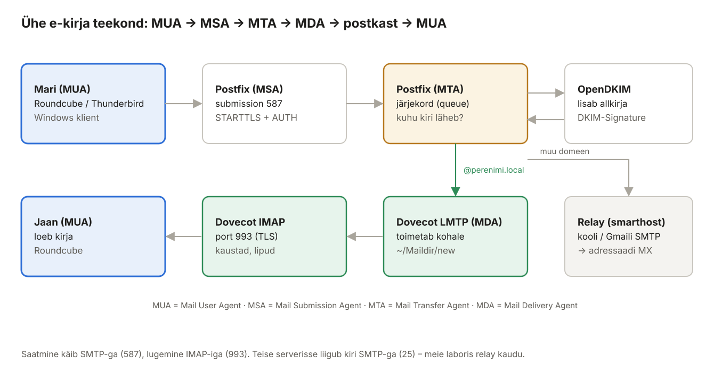
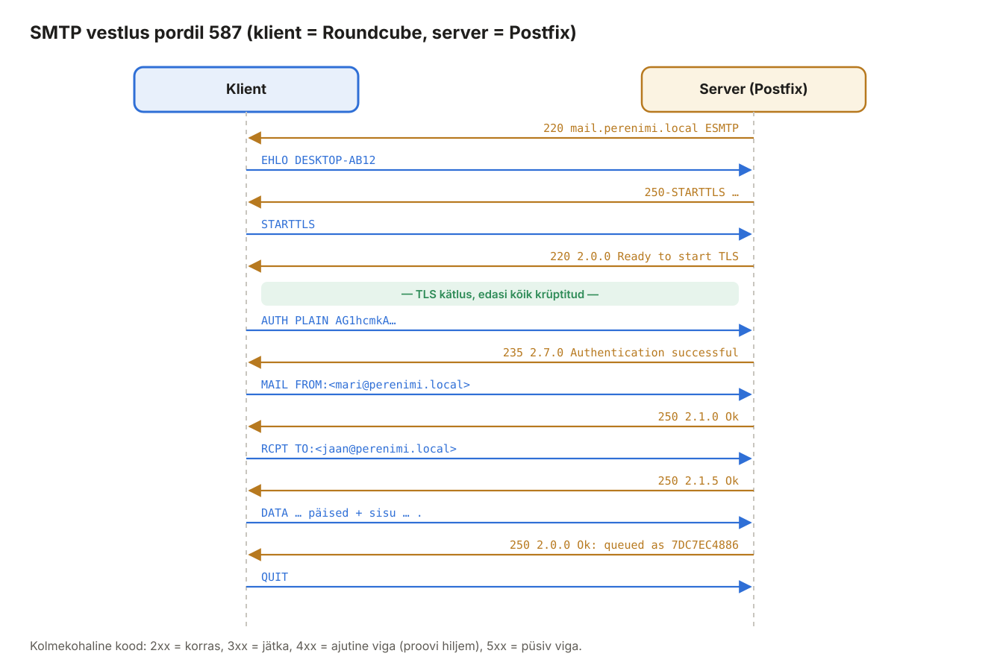

## 9. E-posti alused

Enne meiliserveri seadistamist on vaja aru saada, **kes mida teeb**. E-post ei ole üks programm, vaid mitme programmi koostöö – ja enamik vigu tekib nende vahelistes liidestes.



*Joonis 9.1: E-kirja teekond saatjalt saajani*

### 9.1 Rollid

| Lühend | Nimi | Ülesanne | Laboris |
| --- | --- | --- | --- |
| MUA | *Mail User Agent* | programm, millega inimene kirju kirjutab ja loeb | Roundcube, Thunderbird, Outlook |
| MSA | *Mail Submission Agent* | võtab vastu kliendi saadetud kirja; **nõuab autentimist** | Postfix, port 587/465 |
| MTA | *Mail Transfer Agent* | otsustab, kuhu kiri läheb, ja viib selle teise serverisse | Postfix |
| MDA | *Mail Delivery Agent* | paneb kirja kasutaja postkasti | Dovecot LMTP |
| IMAP/POP3 server | – | annab kliendile ligipääsu postkastile | Dovecot IMAP |
| Milter | *Mail filter* | väline filter, mida MTA kirja töötlemisel küsib | OpenDKIM |

### 9.2 Protokollid ja pordid

| Port | Protokoll | Suund | Krüpteerimine | Autentimine | Laboris |
| --- | --- | --- | --- | --- | --- |
| 25 | SMTP | server → server | STARTTLS võimalusel | ei | sees |
| 587 | SMTP *submission* | klient → server | STARTTLS **kohustuslik** | **jah** | sees |
| 465 | SMTPS (*submissions*) | klient → server | TLS kohe algusest (*implicit TLS*) | **jah** | sees |
| 143 | IMAP | klient ↔ server | STARTTLS | jah | **väljas** |
| 993 | IMAPS | klient ↔ server | TLS kohe algusest | jah | sees |
| 110 / 995 | POP3 / POP3S | klient ← server | | jah | ei kasuta |

- **SMTP** (*Simple Mail Transfer Protocol*) – ainult **saatmiseks ja edastamiseks**.
- **IMAP** (*Internet Message Access Protocol*) – kirjad jäävad serverisse, kaustad ja loetud/lugemata olek sünkroniseeritakse kõigi seadmete vahel.
- **POP3** – laadib kirjad ühte seadmesse ja (vaikimisi) kustutab serverist. Tänapäeval harva.
- **STARTTLS** – ühendus algab krüptimata ja klient palub sellel TLS-ile üle minna. **Implicit TLS** – TLS algab kohe (465, 993). RFC 8314 soovitab klientidele implicit TLS-i.

> **Miks port 25 ei nõua parooli?** Port 25 on teiste serverite jaoks, kes toovad **sinu domeeni** kirju. Nemad parooli ei tea. Seepärast tohib port 25 vastu võtta ainult kirju sinu enda domeeni aadressidele – muidu oleks server **avatud relee** (*open relay*), mida spämmerid kohe kasutama hakkavad.

### 9.3 Ümbrik ja päised

Kiri koosneb kahest osast – nagu paberkiri ümbrikus:

| | Ümbrik (*envelope*) | Päised (*headers*) |
| --- | --- | --- |
| Kus | SMTP käsud `MAIL FROM` ja `RCPT TO` | kirja sees: `From:`, `To:`, `Subject:` |
| Kes kasutab | serverid – kuhu kiri viia, kuhu tagastusteade saata | inimene – mida meiliprogramm näitab |
| Võib erineda? | **Jah.** BCC saaja on ainult ümbrikus; listiserver paneb `MAIL FROM`-iks enda aadressi | |
| Kontrollib | SPF (`MAIL FROM` domeen) | DKIM allkirjastab päiseid, DMARC võrdleb `From:` domeeni |

Ümbriku saatja nimetatakse ka *Return-Path*, *envelope sender*, *bounce address*. Saaja serveris lisatakse see päisena `Return-Path:`.

### 9.4 SMTP vestlus



*Joonis 9.2: SMTP käsud ja vastuskoodid*

| Kood | Tähendus | Näide |
| --- | --- | --- |
| 2xx | korras | `250 2.0.0 Ok: queued as 7DC7EC4886` |
| 3xx | jätka (oota andmeid) | `354 End data with <CR><LF>.<CR><LF>` |
| 4xx | **ajutine** viga – saatja proovib hiljem uuesti | `450 4.1.8 Sender address rejected: Domain not found` |
| 5xx | **püsiv** viga – kiri tagastatakse | `554 5.7.1 Relay access denied` |

Laiendatud kood (`5.7.1`) täpsustab: x.1.x = aadress, x.2.x = postkast, x.7.x = turvalisus/poliitika.

SMTP-d saab „rääkida“ ka käsitsi. Pärast peatükki 10 proovi Ubuntu peal:

```bash
openssl s_client -starttls smtp -connect mail.perenimi.local:587 -crlf -quiet
```

```text
EHLO test.perenimi.local
QUIT
```

`EHLO` vastuses näed serveri võimekusi (`250-AUTH PLAIN LOGIN`, `250-SIZE 26214400` …).

### 9.5 E-postiga seotud DNS-kirjed

| Kirje | Nimi | Näide | Milleks |
| --- | --- | --- | --- |
| MX | `perenimi.local` | `10 mail.perenimi.local.` | kuhu saata `@perenimi.local` kirjad |
| A | `mail.perenimi.local` | `192.168.XXX.20` | MX-i nime IP |
| PTR | `30.XXX.168.192.in-addr.arpa` | `mail.perenimi.local.` | IP → nimi; peab ühtima HELO-ga |
| TXT (SPF) | `perenimi.local` | `v=spf1 mx -all` | millised IP-d tohivad selle domeeni nimel saata |
| TXT (DKIM) | `s1._domainkey.perenimi.local` | `v=DKIM1; k=rsa; p=MIIB…` | avalik võti allkirjade kontrolliks |
| TXT (DMARC) | `_dmarc.perenimi.local` | `v=DMARC1; p=quarantine; …` | mida teha, kui SPF/DKIM ei klapi |

Kui saatev server tahab saata kirja aadressile `jaan@naaber.ee`:

1. küsib DNS-ist `naaber.ee MX` → `10 mx.naaber.ee.`;
2. küsib `mx.naaber.ee A` → IP;
3. avab TCP-ühenduse IP pordile 25 ja räägib SMTP-d.

Kui MX-kirjet pole, kasutatakse domeeni A-kirjet (*implicit MX*).

### 9.6 Postkasti vorming

| Vorming | Kuidas hoitakse | Laboris |
| --- | --- | --- |
| mbox | kõik kirjad ühes failis (`/var/mail/mari`) | ei – fail läheb suureks, lukustamine |
| **Maildir** | **iga kiri eraldi fail** kaustades `new/`, `cur/`, `tmp/`; alamkaustad `.Sent/`, `.Trash/` | **jah**: `/home/mari/Maildir/` |

### 9.7 Kasutajad

Meie laboris on meilikasutajad **Linuxi süsteemikasutajad** Ubuntu masinas: kasutaja `mari` → aadress `mari@perenimi.local`, postkast `/home/mari/Maildir`. Neil pole shelli (`/usr/sbin/nologin`) – SSH-ga nad sisse ei saa, ainult meili.

Suuremas süsteemis kasutatakse **virtuaalkasutajaid** (aadressid ja paroolid andmebaasis või failis, kõik postkastid ühe süsteemikasutaja `vmail` all). Repo varasem juhend [Meiliserveri paigaldus (MySQL, Postfix, Dovecot)](../Postfix-Dovecot/Meiliserveri%20paigaldus%20%28MySQL%2CPostfix%2CDovecot%29.md) näitab seda lähenemist – see sobib lisaülesandeks.
