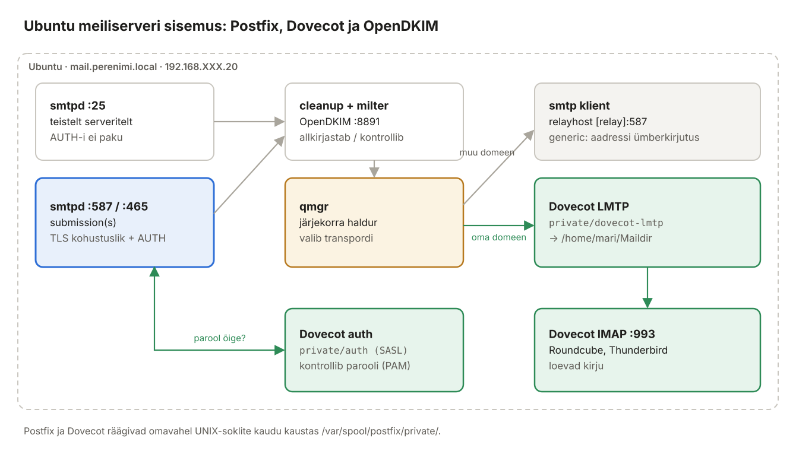

## 10. Postfix ja Dovecot (Ubuntu)

Selles peatükis ehitame Ubuntu masinasse töötava meiliserveri: **Postfix** võtab kirju vastu ja saadab, **Dovecot** hoiab postkaste, kontrollib paroole ja annab kirjad IMAP-iga klientidele. Kõik ühendused on TLS-iga ja saata saab ainult sisseloginud kasutaja.



*Joonis 10.1: Postfixi ja Dovecoti koostöö*

> **Eeldused:** Ubuntu hostinimi on `mail`, `hostname -f` annab `mail.perenimi.local` (2.6); DNS-is on `mail` A-, MX- ja PTR-kirje (3.6–3.7); serdid on paigaldatud (8.8). Kontrolli: `dig +short perenimi.local MX` → `10 mail.perenimi.local.`

### 10.1 Mõisted

| Termin | Selgitus |
| --- | --- |
| `main.cf` | Postfixi üldseaded (`nimi = väärtus`). Muudame käsuga `postconf -e`, mis asendab olemasoleva rea, mitte ei lisa duplikaati. |
| `master.cf` | Postfixi teenused (protsessid) ja nende pordid; `-o` read kirjutavad `main.cf` seadeid ühe teenuse jaoks üle. |
| `mydestination` | Domeenid, mille kirjad toimetatakse **selles serveris** kohale. |
| `mynetworks` | Võrgud, mida Postfix usaldab ilma paroolita. **Ainult `127.0.0.0/8`** – muidu oleks labori võrk avatud relee. |
| SASL | *Simple Authentication and Security Layer* – kuidas klient tõestab, kes ta on. Postfix küsib parooli kontrolli Dovecotilt. |
| LMTP | *Local Mail Transfer Protocol* – SMTP lihtsustatud variant, millega Postfix annab kirja Dovecotile kohaletoimetamiseks. |
| Järjekord (*queue*) | Kirjad, mida pole veel ära saadetud. `mailq` näitab. |
| `smtpd` / `smtp` | Postfixi **server**pool (võtab vastu) / **klient**pool (saadab teistesse serveritesse). Seepärast on seadetel eesliited `smtpd_` ja `smtp_`. |
| Piirangud (*restrictions*) | Reeglite loend, mida kontrollitakse vasakult paremale; esimene `permit` või `reject` otsustab. |

### 10.2 Paigaldus

**Ubuntu:**

```bash
sudo apt install -y postfix dovecot-imapd dovecot-lmtpd swaks mailutils
```

Postfixi paigaldusdialoog:

| Küsimus | Vastus |
| --- | --- |
| General mail configuration type | **Internet Site** |
| System mail name | **perenimi.local** |

Dialoogi saab hiljem uuesti käivitada: `sudo dpkg-reconfigure postfix`. `swaks` on SMTP testimise tööriist, `mailutils` annab käsu `mail`.

### 10.3 Postfix: põhiseaded

**Ubuntu:**

```bash
sudo cp /etc/postfix/main.cf /etc/postfix/main.cf.orig

sudo postconf -e \
  'myhostname = mail.perenimi.local' \
  'mydomain = perenimi.local' \
  'myorigin = $mydomain' \
  'mydestination = $myhostname, $mydomain, localhost.$mydomain, localhost' \
  'inet_interfaces = all' \
  'inet_protocols = ipv4' \
  'mynetworks = 127.0.0.0/8' \
  'home_mailbox = Maildir/' \
  'mailbox_transport = lmtp:unix:private/dovecot-lmtp' \
  'smtpd_banner = $myhostname ESMTP' \
  'disable_vrfy_command = yes' \
  'smtpd_helo_required = yes' \
  'message_size_limit = 26214400' \
  'smtputf8_enable = no'
```

| Seade | Selgitus |
| --- | --- |
| `myorigin = $mydomain` | kohalikult saadetud kirjad saavad aadressi `@perenimi.local` (mitte `@mail.perenimi.local`) |
| `mailbox_transport` | kohalike kasutajate kirjad antakse Dovecotile (LMTP sokkel) |
| `smtpd_banner` | ära ütle tervituses tarkvara nime ja versiooni |
| `disable_vrfy_command` | `VRFY mari` käsuga ei saa enam uurida, millised kasutajad on olemas |
| `message_size_limit` | kirja maksimumsuurus 25 MB |
| `smtputf8_enable = no` | Dovecot 2.3 LMTP ei toeta SMTPUTF8 laiendust. Ilma selle reata **lükatakse tagasi** kohalikud kirjad, mille pealkirjas on täpitähed ja mis on saadetud käsuga `mail`/`sendmail` (`status=bounced (SMTPUTF8 is required, but was not offered…)`). Roundcube ja Thunderbird kodeerivad pealkirja ise ega ole mõjutatud. |

### 10.4 Postfix: TLS

```bash
sudo postconf -e \
  'smtpd_tls_cert_file = /etc/ssl/certs/mail.perenimi.local.crt' \
  'smtpd_tls_key_file = /etc/ssl/private/mail.perenimi.local.key' \
  'smtpd_tls_security_level = may' \
  'smtpd_tls_auth_only = yes' \
  'smtpd_tls_protocols = >=TLSv1.2' \
  'smtpd_tls_mandatory_protocols = >=TLSv1.2' \
  'smtpd_tls_loglevel = 1' \
  'smtp_tls_security_level = may' \
  'smtp_tls_CApath = /etc/ssl/certs'
```

- `smtpd_tls_security_level = may` – pordil 25 pakutakse STARTTLS-i, kuid ei nõuta (internetis ei toeta kõik serverid TLS-i). Pordil 587 teeme selle kohustuslikuks (10.6).
- `smtpd_tls_auth_only = yes` – parooliga sisselogimist pakutakse **alles pärast TLS-i**.

### 10.5 Postfix: autentimine ja piirangud

```bash
sudo postconf -e \
  'smtpd_sasl_type = dovecot' \
  'smtpd_sasl_path = private/auth' \
  'smtpd_sasl_auth_enable = no' \
  'smtpd_helo_restrictions = permit_mynetworks, permit_sasl_authenticated, reject_invalid_helo_hostname, reject_non_fqdn_helo_hostname' \
  'smtpd_sender_restrictions = reject_non_fqdn_sender, reject_unknown_sender_domain' \
  'smtpd_relay_restrictions = permit_mynetworks, permit_sasl_authenticated, reject_unauth_destination' \
  'smtpd_recipient_restrictions = reject_non_fqdn_recipient, permit_mynetworks, reject_unauth_destination, reject_unknown_recipient_domain' \
  'smtpd_sender_login_maps = regexp:/etc/postfix/login_maps.regexp'
```

| Seade | Mida teeb |
| --- | --- |
| `smtpd_sasl_auth_enable = no` | pordil 25 autentimist **ei pakuta**; lülitame selle sisse ainult 587/465 jaoks |
| `smtpd_helo_restrictions` | võõras server peab end tutvustama korrektse FQDN-iga; **autenditud** kliente see ei puuduta (Windows saadab HELO-s nime nagu `DESKTOP-AB12`) |
| `reject_unknown_sender_domain` | saatja domeen peab DNS-is olemas olema |
| `reject_unauth_destination` | **relee keeld**: võõrast domeeni tohivad sihiks panna ainult `mynetworks` ja sisseloginud kasutajad |
| `smtpd_sender_login_maps` | milline sisseloginud kasutaja tohib millist saatja aadressi kasutada |

Saatja-kasutaja vastavus – kasutaja `mari` (või `mari@perenimi.local`) tohib saata ainult aadressilt `mari@perenimi.local`:

```bash
sudo nano /etc/postfix/login_maps.regexp
```

```text
# Saatja aadress                  -> kes tohib seda kasutada (SASL kasutajanimi)
/^([^@]+)@perenimi\.local$/       ${1}, ${1}@perenimi.local
```

```bash
postmap -q "mari@perenimi.local" regexp:/etc/postfix/login_maps.regexp     # mari, mari@perenimi.local
```

### 10.6 Postfix: master.cf – pordid 587 ja 465

Failis `/etc/postfix/master.cf` on read `#submission` ja `#submissions` välja kommenteeritud. Lisa faili **lõppu**:

```bash
sudo nano /etc/postfix/master.cf
```

```text
# --- Kirjade saatmine meiliklientidelt (port 587, STARTTLS + autentimine) ---
submission inet n       -       y       -       -       smtpd
  -o syslog_name=postfix/submission
  -o smtpd_tls_security_level=encrypt
  -o smtpd_sasl_auth_enable=yes
  -o smtpd_tls_auth_only=yes
  -o smtpd_client_restrictions=permit_sasl_authenticated,reject
  -o smtpd_sender_restrictions=reject_sender_login_mismatch,reject_non_fqdn_sender
  -o smtpd_relay_restrictions=permit_sasl_authenticated,reject
  -o smtpd_recipient_restrictions=reject_non_fqdn_recipient,permit_sasl_authenticated,reject
  -o milter_macro_daemon_name=ORIGINATING

# --- Sama, kuid TLS kohe algusest (port 465, "implicit TLS") ---
submissions inet n       -       y       -       -       smtpd
  -o syslog_name=postfix/submissions
  -o smtpd_tls_wrappermode=yes
  -o smtpd_sasl_auth_enable=yes
  -o smtpd_client_restrictions=permit_sasl_authenticated,reject
  -o smtpd_sender_restrictions=reject_sender_login_mismatch,reject_non_fqdn_sender
  -o smtpd_relay_restrictions=permit_sasl_authenticated,reject
  -o smtpd_recipient_restrictions=reject_non_fqdn_recipient,permit_sasl_authenticated,reject
  -o milter_macro_daemon_name=ORIGINATING
```

> **master.cf süntaks:** `-o` read peavad algama **tühikuga** (jätkurida). Real ei tohi olla kommentaari ega tühikut `=` ümber. Tühi rida plokkide vahel on lubatud.

Veerud: teenus, tüüp, privaatne, kasutaja-õigused, **chroot (`y`)**, ärkamisaeg, protsesse, käsk. `chroot = y` tähendab, et `smtpd` näeb ainult kausta `/var/spool/postfix` – seepärast on Dovecoti soklid kaustas `/var/spool/postfix/private/` ja nende tee on kirjas suhteliselt (`private/auth`).

```bash
sudo postfix check            # tühi väljund = OK
```

### 10.7 Dovecot

Ubuntu Dovecoti seadistus on jagatud ~20 failiks kaustas `/etc/dovecot/conf.d/`. Nende ükshaaval muutmise asemel paneme **kõik oma seaded ühte faili** `/etc/dovecot/local.conf` – põhifail `dovecot.conf` loeb selle viimasena ja selle väärtused kehtivad.

**Ubuntu:**

```bash
sudo nano /etc/dovecot/local.conf
```

```text
# /etc/dovecot/local.conf – labori meiliserveri seadistus (Dovecot 2.3)
# See fail loetakse dovecot.conf lõpus ja kirjutab vaikeväärtused üle.

protocols = imap lmtp

# --- Postkastide asukoht: iga kasutaja kodukaustas ~/Maildir ---
mail_location = maildir:~/Maildir
mail_privileged_group = mail

# --- Autentimine ---
disable_plaintext_auth = yes
auth_mechanisms = plain login
auth_username_format = %Ln

# --- TLS ---
ssl = required
ssl_cert = </etc/ssl/certs/mail.perenimi.local.crt
ssl_key  = </etc/ssl/private/mail.perenimi.local.key
ssl_min_protocol = TLSv1.2
ssl_prefer_server_ciphers = yes

# --- Postfix -> Dovecot: kirjade kohaletoimetamine (LMTP) ---
service lmtp {
  unix_listener /var/spool/postfix/private/dovecot-lmtp {
    mode = 0600
    user = postfix
    group = postfix
  }
}

# --- Postfix küsib Dovecotilt, kas parool on õige (SASL) ---
service auth {
  unix_listener /var/spool/postfix/private/auth {
    mode = 0660
    user = postfix
    group = postfix
  }
}

# --- Krüptimata IMAP (143) välja: kliendid kasutavad ainult IMAPS 993 ---
service imap-login {
  inet_listener imap {
    port = 0
  }
  inet_listener imaps {
    port = 993
    ssl = yes
  }
}

# --- Standardkaustad luuakse ja tellitakse automaatselt ---
namespace inbox {
  mailbox Drafts {
    special_use = \Drafts
    auto = subscribe
  }
  mailbox Sent {
    special_use = \Sent
    auto = subscribe
  }
  mailbox Junk {
    special_use = \Junk
    auto = subscribe
  }
  mailbox Trash {
    special_use = \Trash
    auto = subscribe
  }
}
```

| Seade | Selgitus |
| --- | --- |
| `ssl_cert = <…` | **`<` on oluline** – see tähendab „loe väärtus failist“. Ilma selleta proovib Dovecot failinime ennast serdiks lugeda. |
| `disable_plaintext_auth = yes` | parooli ei võeta vastu krüptimata ühenduse kaudu |
| `auth_username_format = %Ln` | `Mari@Perenimi.local` → `mari`: domeen eemaldatakse, väiketähed. Nii leiab Dovecot Linuxi kasutaja nii IMAP-i sisselogimisel kui ka LMTP kohaletoimetamisel. |
| `special_use` | ütleb klientidele, milline kaust on „Saadetud“, „Prügikast“ jne – Roundcube ja Thunderbird kasutavad neid automaatselt |

Kontrolli ja käivita:

```bash
sudo doveconf -n | head -40          # efektiivne seadistus; vead kuvatakse siin
sudo systemctl restart dovecot postfix
sudo ss -tlnp | grep -E ':(25|465|587|993)\b'
ls -l /var/spool/postfix/private/ | grep -E 'auth|dovecot-lmtp'
```

### 10.8 Kasutajad ja aliased

**Ubuntu:**

```bash
sudo adduser --shell /usr/sbin/nologin mari
sudo adduser --shell /usr/sbin/nologin jaan
```

Iga RFC-kohane meiliserver peab vastu võtma aadressi `postmaster@`. Suuname süsteemi aadressid päris inimesele:

```bash
sudo nano /etc/aliases
```

```text
postmaster:    root
abuse:         root
root:          mari
```

```bash
sudo newaliases
```

Testi Dovecoti autentimist:

```bash
sudo doveadm auth test mari              # passdb: mari auth succeeded
sudo doveadm user mari                   # home: /home/mari, mail: maildir:~/Maildir
```

### 10.9 Tulemüür

**Ubuntu:**

```bash
sudo ufw allow 25/tcp
sudo ufw allow 587/tcp
sudo ufw allow 465/tcp
sudo ufw allow 993/tcp
sudo ufw status
```

### 10.10 Testimine

Kõik testid tee **Ubuntus**. Logi jälgimiseks ava teine SSH-aken: `sudo tail -f /var/log/mail.log`.

**Test 1 – kohalik kiri:**

```bash
echo "Esimene kiri" | mail -s "Tere täpitähtedega õäöü" mari@perenimi.local
sudo ls /home/mari/Maildir/new/
```

**Test 2 – port 25 väljastpoolt (nagu teine server):**

```bash
swaks --server 192.168.XXX.20 --helo test.perenimi.local \
      --from jaan@perenimi.local --to mari@perenimi.local
```

Oodatav: `<-  250 2.0.0 Ok: queued as …`

**Test 3 – avatud relee test (PEAB ebaõnnestuma):**

```bash
swaks --server 192.168.XXX.20 --helo test.example.org \
      --from jaan@perenimi.local --to keegi@example.com
```

Oodatav: `<** 554 5.7.1 <keegi@example.com>: Relay access denied`

**Test 4 – saatmine pordilt 587 autentimisega:**

```bash
swaks --server mail.perenimi.local -p 587 -tls \
      --auth LOGIN --auth-user jaan --auth-password 'jaani-parool' \
      --from jaan@perenimi.local --to mari@perenimi.local --h-Subject "Test 587"
```

Oodatav: `235 2.7.0 Authentication successful` ja `250 2.0.0 Ok: queued`.

**Test 5 – võõra nimega saatmine (PEAB ebaõnnestuma):**

```bash
swaks --server mail.perenimi.local -p 587 -tls \
      --auth LOGIN --auth-user jaan --auth-password 'jaani-parool' \
      --from mari@perenimi.local --to mari@perenimi.local
```

Oodatav: `553 5.7.1 <mari@perenimi.local>: Sender address rejected: not owned by user jaan`

**Test 6 – autentimine ilma TLS-ita (PEAB ebaõnnestuma):**

```bash
swaks --server mail.perenimi.local -p 587 --auth LOGIN --auth-user jaan --auth-password 'x' \
      --from jaan@perenimi.local --to mari@perenimi.local
```

Oodatav: `*** Host did not advertise authentication` – enne STARTTLS-i AUTH-i ei pakuta.

**Test 7 – port 465:**

```bash
swaks --server mail.perenimi.local -p 465 -tlsc \
      --auth PLAIN --auth-user mari@perenimi.local --auth-password 'mari-parool' \
      --from mari@perenimi.local --to jaan@perenimi.local
```

**Test 8 – IMAP:**

```bash
curl -s --url "imaps://mail.perenimi.local/INBOX" -u mari -X "SEARCH ALL"
# * SEARCH 1 2 3
sudo doveadm mailbox list -u mari         # INBOX, Drafts, Sent, Junk, Trash
```

### 10.11 Kirja päiste lugemine

```bash
sudo bash -c 'cat /home/mari/Maildir/new/$(ls -t /home/mari/Maildir/new | head -1)'
```

`Received:` päised loetakse **alt üles** – alumine on esimene server, mille kaudu kiri läks. Vaata, kas seal on `with ESMTPSA` (S = TLS, A = autenditud).

### 10.12 Logirea anatoomia

```text
postfix/submission/smtpd[6143]: 64EDDC48D4: client=unknown[192.168.XXX.50], sasl_method=LOGIN, sasl_username=mari
postfix/cleanup[6150]:          64EDDC48D4: message-id=<…>
postfix/qmgr[6133]:             64EDDC48D4: from=<mari@perenimi.local>, size=1282, nrcpt=1 (queue active)
postfix/lmtp[6149]:             64EDDC48D4: to=<jaan@perenimi.local>, relay=mail.perenimi.local[private/dovecot-lmtp], dsn=2.0.0, status=sent
postfix/qmgr[6133]:             64EDDC48D4: removed
```

Järjekorra-ID (`64EDDC48D4`) seob ühe kirja kõik read – otsi `grep 64EDDC48D4 /var/log/mail.log`.

| `status=` | Tähendus |
| --- | --- |
| `sent` | kohale toimetatud / edasi antud |
| `deferred` | ajutine viga, proovitakse uuesti (`mailq`) |
| `bounced` | püsiv viga, saatjale saadeti tagastusteade |

> Varasemad juhendid: [Meiliserver postfix koos dovecot'ga](../Meiliserver%20postfix%20koos%20dovecot'ga%20.md), [E-posti server Postfix ja Dovecot](../Epost_DNS/1.%20E-posti%20server%20Postfix%20ja%20Dovecot.md).
