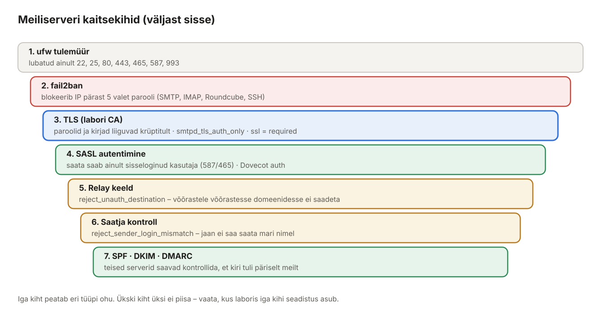
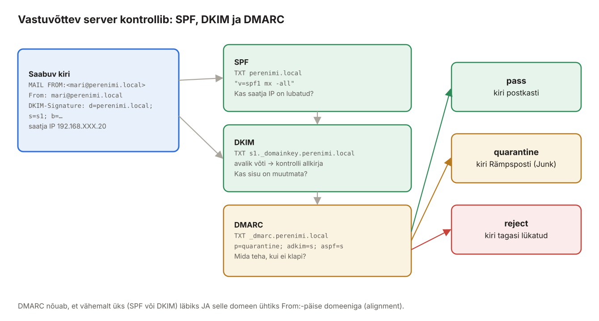

## 11. Meiliserveri turvalisus: DKIM, SPF, DMARC ja fail2ban

Peatükis 10 tehtud server on juba **suletud releega**, **krüpteeritud ühendustega** ja **autentimisega**. Selles peatükis lisame selle, mis aitab **teistel serveritel** sinu kirju usaldada (SPF, DKIM, DMARC), ja kaitse paroolide äraarvamise vastu (fail2ban).



*Joonis 11.1: Kaitsekihid ja kus need laboris seadistatakse*

### 11.1 Miks SPF, DKIM ja DMARC?

SMTP-s võib igaüks kirjutada `MAIL FROM:<direktor@pank.ee>` ja `From: direktor@pank.ee` – protokoll seda ei kontrolli. Nii tehakse õngitsuskirju (*phishing*). Kolm DNS-põhist mehhanismi lasevad vastuvõtjal kontrollida, kas kiri tuli päriselt domeeni omanikult.



*Joonis 11.2: Kuidas vastuvõttev server kirja kontrollib*

| | SPF | DKIM | DMARC |
| --- | --- | --- | --- |
| Täisnimi | *Sender Policy Framework* | *DomainKeys Identified Mail* | *Domain-based Message Authentication, Reporting and Conformance* |
| Küsimus | Kas see **IP** tohib saata domeeni nimel? | Kas kiri on **allkirjastatud** domeeni võtmega ja **muutmata**? | Kas SPF/DKIM domeen **ühtib** `From:` päisega ja mida teha, kui ei? |
| Mida kontrollib | ümbriku `MAIL FROM` domeeni | allkirja `d=` domeeni | `From:` päise domeeni |
| DNS-kirje | `perenimi.local TXT "v=spf1 …"` | `s1._domainkey.perenimi.local TXT "v=DKIM1; p=…"` | `_dmarc.perenimi.local TXT "v=DMARC1; …"` |
| Nõrkus üksi | katkeb edasisaatmisel (*forward*) | ei ütle, mida teha, kui allkiri puudub | vajab SPF-i või DKIM-i |

### 11.2 OpenDKIM paigaldus ja võti

**Ubuntu:**

```bash
sudo apt install -y opendkim opendkim-tools

sudo mkdir -p /etc/opendkim/keys/perenimi.local
sudo opendkim-genkey -b 2048 -d perenimi.local -D /etc/opendkim/keys/perenimi.local -s s1 -v
sudo chown -R opendkim:opendkim /etc/opendkim
sudo chmod 700 /etc/opendkim/keys
```

- `-s s1` – **selektor**: võtme nimi. Ühel domeenil võib olla mitu võtit (nt `s1`, `s2` võtmevahetuseks).
- Tekivad failid `s1.private` (privaatvõti, jääb serverisse) ja `s1.txt` (DNS-kirje).

### 11.3 OpenDKIM tabelid

**Ubuntu:**

```bash
sudo nano /etc/opendkim/key.table
```

```text
s1._domainkey.perenimi.local  perenimi.local:s1:/etc/opendkim/keys/perenimi.local/s1.private
```

```bash
sudo nano /etc/opendkim/signing.table
```

```text
*@perenimi.local  s1._domainkey.perenimi.local
```

```bash
sudo nano /etc/opendkim/trusted.hosts
```

```text
127.0.0.1
localhost
192.168.XXX.0/24
```

| Fail | Küsimus |
| --- | --- |
| `signing.table` | millise saatja aadressiga kirjad allkirjastada ja millise võtmega? |
| `key.table` | kus see võti failisüsteemis asub? |
| `trusted.hosts` | kelle kirju **allkirjastada** (mitte kontrollida)? |

### 11.4 /etc/opendkim.conf

**Ubuntu:**

```bash
sudo cp /etc/opendkim.conf /etc/opendkim.conf.orig
sudo nano /etc/opendkim.conf
```

Asenda kogu sisu:

```text
# /etc/opendkim.conf – DKIM allkirjastamine ja kontroll
Syslog                  yes
SyslogSuccess           yes
LogWhy                  yes
UMask                   007
UserID                  opendkim

Mode                    sv
Canonicalization        relaxed/simple
OversignHeaders         From
SignatureAlgorithm      rsa-sha256

KeyTable                refile:/etc/opendkim/key.table
SigningTable            refile:/etc/opendkim/signing.table
ExternalIgnoreList      /etc/opendkim/trusted.hosts
InternalHosts           /etc/opendkim/trusted.hosts

Socket                  inet:8891@127.0.0.1
PidFile                 /run/opendkim/opendkim.pid

# Ubuntu OpenDKIM kasutab DNS-päringuteks libunboundi, mis EI loe /etc/resolv.conf-i
# ja ei leia .local tsooni üles. Seepärast ütleme nimeserveri otse:
Nameservers             192.168.XXX.10
```

| Seade | Selgitus |
| --- | --- |
| `Mode sv` | **s**ign + **v**erify: allkirjastab väljaminevad, kontrollib sissetulevaid |
| `Canonicalization relaxed/simple` | kuidas päiseid/sisu enne räsimist normaliseerida; `relaxed` talub tühikute muutusi päistes |
| `OversignHeaders From` | takistab hiljem teise `From:` päise lisamist |
| `Socket inet:8891@127.0.0.1` | Postfix ühendub TCP-ga – nii pole vaja tegeleda Postfixi chrooti ja sokli õigustega |
| `Nameservers` | **ilma selleta ei leia OpenDKIM laboris DKIM-võtit** ja `opendkim-testkey` annab vea `unexpected reply class/type (-1/-1)` |

```bash
sudo opendkim -n -x /etc/opendkim.conf && echo "seadistus OK"
sudo systemctl restart opendkim
sudo systemctl enable opendkim
sudo ss -tlnp | grep 8891
```

### 11.5 Postfix kasutab OpenDKIM-i

**Ubuntu:**

```bash
sudo postconf -e \
  'milter_default_action = accept' \
  'milter_protocol = 6' \
  'smtpd_milters = inet:127.0.0.1:8891' \
  'non_smtpd_milters = $smtpd_milters'
sudo systemctl reload postfix
```

- `milter_default_action = accept` – kui OpenDKIM on maas, võetakse kirjad ikkagi vastu (allkirjata). Alternatiiv `tempfail` lükkab kirjad ajutiselt tagasi.
- `non_smtpd_milters` – allkirjastatakse ka käsuga `mail`/`sendmail` saadetud kirjad.

### 11.6 DNS-kirjed: SPF, DKIM, DMARC (Debian)

Vaata Ubuntus DKIM-kirjet ja kopeeri see Debianisse:

**Ubuntu:**

```bash
sudo cat /etc/opendkim/keys/perenimi.local/s1.txt
sudo cp /etc/opendkim/keys/perenimi.local/s1.txt /tmp/ && sudo chmod 644 /tmp/s1.txt
scp /tmp/s1.txt opilane@192.168.XXX.10:
```

Fail on juba BIND-i vormingus (pikk võti on jagatud mitmeks jutumärkides osaks sulgude sees – nii on lubatud):

```text
s1._domainkey	IN	TXT	( "v=DKIM1; h=sha256; k=rsa; "
	  "p=MIIBIjANBgkqhkiG9w0BAQEFAAOCAQ8AMIIBCgKCAQEA4zIiLkO5uGrcHua5/…"
	  "OpzKzY7uqCPIuSj3r9hMod+/jaDypCGopY4rDN+Ghp5N7VorBFDostKFB0F…IDAQAB" )  ; ----- DKIM key s1 for perenimi.local
```

**Debian:**

```bash
sudo nano /etc/bind/zones/db.perenimi.local
```

Suurenda **seerianumbrit** ja lisa faili lõppu:

```text
; --- E-posti autentimine ---
@       IN  TXT     "v=spf1 mx -all"
_dmarc  IN  TXT     "v=DMARC1; p=quarantine; adkim=s; aspf=s; rua=mailto:postmaster@perenimi.local"
```

ja DKIM-kirje failist:

```bash
cat ~/s1.txt | sudo tee -a /etc/bind/zones/db.perenimi.local
sudo named-checkzone perenimi.local /etc/bind/zones/db.perenimi.local
sudo rndc reload perenimi.local
dig +short TXT perenimi.local
dig +short TXT _dmarc.perenimi.local
dig +short TXT s1._domainkey.perenimi.local
```

**SPF kirje lahti seletatuna** – `v=spf1 mx -all`:

| Osa | Tähendus |
| --- | --- |
| `v=spf1` | SPF versioon 1 |
| `mx` | lubatud on IP-d, mis on domeeni MX-kirjete taga (`mail` → 192.168.XXX.20) |
| `-all` | kõik teised IP-d: **fail** (`~all` = softfail, `?all` = neutraalne) |

Muud võimalikud osad: `ip4:192.168.XXX.20`, `a`, `include:_spf.google.com` (luba teenusepakkuja serverid).

**DMARC kirje** – `v=DMARC1; p=quarantine; adkim=s; aspf=s; rua=mailto:postmaster@perenimi.local`:

| Osa | Tähendus |
| --- | --- |
| `p=quarantine` | kui kontroll ebaõnnestub, pane rämpsposti. Alustatakse tavaliselt `p=none` (ainult raportid), siis `quarantine`, lõpuks `reject`. |
| `adkim=s`, `aspf=s` | range (*strict*) vastavus: domeen peab täpselt ühtima (`r` = relaxed lubab alamdomeene) |
| `rua=` | kuhu saata koondraportid (teised serverid saadavad päevased XML-raportid) |

### 11.7 DKIM kontroll

**Ubuntu:**

```bash
sudo opendkim-testkey -x /etc/opendkim.conf -d perenimi.local -s s1 -vvv
```

Oodatav viimane rida: `key OK`. (`key not secure` tähendab ainult, et tsoon pole DNSSEC-iga allkirjastatud – laboris normaalne.)

Saada kiri ja kontrolli allkirja:

```bash
swaks --server mail.perenimi.local -p 587 -tls --auth LOGIN --auth-user jaan --auth-password 'jaani-parool' \
      --from jaan@perenimi.local --to mari@perenimi.local --h-Subject "DKIM test"
F=$(sudo grep -l "DKIM test" /home/mari/Maildir/new/* | tail -1)
sudo grep -A1 "^DKIM-Signature" "$F"
sudo opendkim-testmsg -C /etc/opendkim.conf < <(sudo cat "$F") && echo "Allkiri kehtib"
sudo grep opendkim /var/log/mail.log | tail -3      # "DKIM-Signature field added (s=s1, d=perenimi.local)"
```

Allkirja väljad: `d=` domeen, `s=` selektor, `h=` allkirjastatud päised, `bh=` sisu räsi, `b=` allkiri.

### 11.8 fail2ban

fail2ban loeb logisid ja blokeerib tulemüüris IP-aadressid, kust tuleb palju valesid paroole.

**Ubuntu:**

```bash
sudo apt install -y fail2ban
sudo nano /etc/fail2ban/jail.d/meiliserver.conf
```

```ini
[DEFAULT]
bantime  = 1h
findtime = 10m
maxretry = 5
ignoreip = 127.0.0.1/8 ::1
backend  = auto

[sshd]
enabled = true

[postfix-sasl]
enabled  = true
filter   = postfix[mode=auth]
port     = smtp,submission,submissions
logpath  = /var/log/mail.log

[dovecot]
enabled  = true
port     = imaps
logpath  = /var/log/mail.log

[roundcube-auth]
enabled  = true
port     = http,https
logpath  = /var/log/roundcube/errors.log
```

> `roundcube-auth` vangla vajab logifaili, mis tekib alles peatükis 12. Kuni Roundcube'i pole, pane sellele `enabled = false` või loo fail: `sudo install -d -o www-data -g adm /var/log/roundcube && sudo install -o www-data -g adm -m 640 /dev/null /var/log/roundcube/errors.log`. **Ära loo faili root'i omanduses** – siis ei saa Roundcube sinna kirjutada ja fail2ban ei näe kunagi midagi.

```bash
sudo fail2ban-client -t                       # OK: configuration test is successful
sudo systemctl restart fail2ban
sudo fail2ban-client status
sudo fail2ban-client status postfix-sasl
```

Kas filter tabab päris logiridu?

```bash
sudo fail2ban-regex /var/log/mail.log "postfix[mode=auth]"     # Lines: … matched
```

Test: Windowsi kliendist või Debianist proovi 6 korda vale parooliga (Thunderbird, Roundcube või `swaks … --auth-password vale`). Seejärel:

```bash
sudo fail2ban-client status postfix-sasl      # Banned IP list: 192.168.XXX.10
sudo fail2ban-client set postfix-sasl unbanip 192.168.XXX.10
```

> Ära blokeeri iseennast: kui testid Windowsi kliendist ja see satub vanglasse, ei pääse ka Roundcube'i. `ignoreip` reale võib lisada õpetaja masina IP.

### 11.9 Tulemüüri lõplik seis

**Ubuntu:**

```bash
sudo ufw allow 80/tcp
sudo ufw allow 443/tcp
sudo ufw status verbose
```

Lubatud peavad olema ainult: 22, 25, 80, 443, 465, 587, 993. Port 8891 (OpenDKIM) kuulab ainult `127.0.0.1` ega vaja tulemüüri reeglit.

### 11.10 Turvakontrolli tabel

| Kontroll | Käsk / tegevus | Oodatav tulemus |
| --- | --- | --- |
| Avatud relee | test 3 peatükis 10.10 | `554 5.7.1 Relay access denied` |
| AUTH ilma TLS-ita | test 6 | AUTH-i ei pakuta |
| Võltssaatja | test 5 | `553 5.7.1 … not owned by user` |
| Saatmine ilma paroolita pordilt 587 | `swaks --server mail.perenimi.local -p 587 -tls --from mari@perenimi.local --to jaan@perenimi.local` | `554 5.7.1 … Client host rejected: Access denied` |
| VRFY | `openssl s_client -starttls smtp -connect mail.perenimi.local:587 -crlf -quiet`, siis `VRFY mari` | `502 5.5.1 VRFY command is disabled` |
| Vanad TLS-versioonid | `openssl s_client -connect mail.perenimi.local:993 -tls1_1` | ühendus ebaõnnestub |
| DKIM allkiri | 11.7 | `key OK`, allkiri kehtib |
| fail2ban | 10.8 | IP blokeeritakse |

### 11.11 Valikuline: sissetulevate kirjade SPF-kontroll

OpenDKIM kontrollib sissetulevate kirjade DKIM-allkirju. Sissetulevate kirjade SPF-i kontrolliks on pakett `postfix-policyd-spf-python`, DMARC-poliitika rakendamiseks `opendmarc`. Kuna meie laborisse ei tule kirju internetist (peatükk 13), on need lisaülesanne. Täielikum lahendus, mis teeb ühe teenusena DKIM-i, SPF-i, DMARC-i ja rämpspostifiltri, on **Rspamd**.

> Varasem juhend: [Välise e-posti serveri seadistus koos SPF, DMARC'i ja DKIM'ga](../Epost_DNS/2.%20V%C3%A4lise%20e-posti%20serveri%20seadistus%20%28Postfix%20ja%20Dovecot%29%20koos%20SPF%2C%20DMARC'i%20ja%20DKIM'ga.md).
