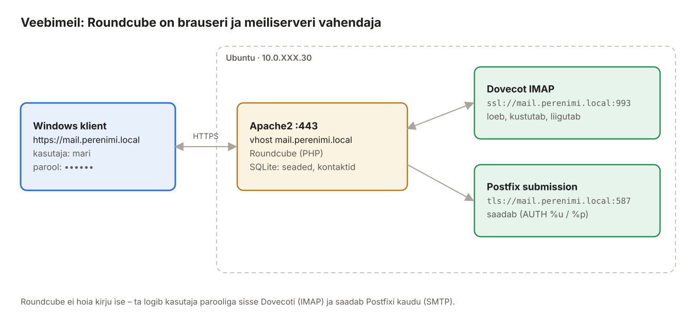

## 12. Veebimeil Roundcube (Ubuntu)

Lõppeesmärk: Windowsi kliendis avad brauseris **`https://mail.perenimi.local`**, logid sisse kasutajaga `mari`, loed kirju ja saadad neid nii oma domeeni kui ka välja. Selleks paigaldame Ubuntu masinasse Apache2 ja **Roundcube'i**.



*Joonis 12.1: Roundcube ühendub kasutaja nimel Dovecoti ja Postfixiga*

#### Kuidas veebimeil töötab

Roundcube on **PHP-rakendus**, mis töötab Ubuntu Apache'is. Kasutaja brauser räägib ainult Roundcube'iga (HTTPS). Kõik meiliga seotud tegevused teeb Roundcube kasutaja nimel ise:

1. **Sisselogimine.** Kasutaja sisestab nime ja parooli. Roundcube **ei kontrolli parooli ise** – ta proovib nende andmetega Dovecoti IMAP-i sisse logida. Kui Dovecot lubab, on kasutaja sees. Roundcube hoiab parooli krüpteeritult sessioonis (`des_key` võtmega), sest vajab seda iga järgmise IMAP-päringu ja kirja saatmise jaoks.
2. **Kirjade lugemine.** Iga kord, kui kasutaja avab kausta või kirja, teeb Roundcube IMAP-päringu. Kirjad jäävad Dovecoti postkasti; Roundcube hoiab ainult vahemälu.
3. **Kirja saatmine.** Roundcube ühendub Postfixi pordile 587, teeb STARTTLS-i ja logib sisse **sama kasutaja ja parooliga** (`%u`, `%p`). Postfixi jaoks on Roundcube tavaline meiliklient nagu Thunderbird.
4. **Saadetud kirja koopia.** Postfix ei pane saadetud kirja kuhugi. Roundcube salvestab koopia IMAP-iga kausta „Saadetud“ (*Sent*).

Seepärast peavad enne Roundcube'i kõik peatüki 10 testid töötama: kui IMAP või port 587 ei tööta, ei tööta ka Roundcube.

### 12.1 Mõisted

| Termin | Selgitus |
| --- | --- |
| Veebimeil | MUA, mis töötab serveris ja mida kasutatakse brauseriga. |
| Roundcube | PHP-s kirjutatud avatud lähtekoodiga veebimeil. Ei hoia kirju ise – kasutab IMAP-i ja SMTP-d. |
| `imap_host` / `smtp_host` | kuhu Roundcube ühendub. Eesliide `ssl://` = implicit TLS (993), `tls://` = STARTTLS (587). |
| `%u` / `%p` | sisseloginud kasutaja nimi / parool – Roundcube kasutab neid ka SMTP autentimiseks. |
| SQLite | failipõhine andmebaas; Roundcube hoiab seal seadeid, kontakte, sessioone. Eraldi andmebaasiserverit pole vaja. |
| Sessioon | sisselogimise olek, seotud küpsisega. `ip_check` seob selle kliendi IP-ga. |

### 12.2 Paigaldus

**Ubuntu:**

```bash
sudo apt install -y apache2 roundcube roundcube-sqlite3 roundcube-plugins php-intl
```

Paigaldusdialoogis:

| Küsimus | Vastus |
| --- | --- |
| Configure database for roundcube with dbconfig-common? | **Yes** |
| Database type to be used by roundcube | **sqlite3** |

Kui dialoog jäi vahele või valisid valesti: `sudo dpkg-reconfigure roundcube-core`.

Paigaldus loob:

| Asukoht | Sisu |
| --- | --- |
| `/etc/roundcube/config.inc.php` | **sinu seadistus** |
| `/etc/roundcube/defaults.inc.php` | kõik võimalikud seaded vaikeväärtustega – ära muuda, kopeeri vajalik `config.inc.php`-sse |
| `/var/lib/roundcube/public_html/` | veebi juurkaust (`DocumentRoot`) |
| `/var/lib/dbconfig-common/sqlite3/roundcube/` | SQLite andmebaas |
| `/var/log/roundcube/errors.log` | vead ja ebaõnnestunud sisselogimised (fail2ban loeb seda) |

### 12.3 Roundcube'i seadistus

Paketi vaikeseadistus on `imap_host = localhost:143` ja `smtp_host = localhost:587`. **Meie karmistatud serveriga need ei tööta:** port 143 on suletud (10.7) ja pordil 587 kontrollib Roundcube serdi nime – sert on tehtud nimele `mail.perenimi.local`, mitte `localhost`.

**Ubuntu:**

```bash
sudo cp /etc/roundcube/config.inc.php /etc/roundcube/config.inc.php.orig
sudo nano /etc/roundcube/config.inc.php
```

Muuda olemasolevad read:

```php
$config['imap_host'] = ['ssl://mail.perenimi.local:993'];
$config['smtp_host'] = 'tls://mail.perenimi.local:587';
$config['smtp_user'] = '%u';
$config['smtp_pass'] = '%p';
$config['product_name'] = 'Perenimi veebimeil';
```

ja lisa faili lõppu:

```php
// --- Labori lisaseaded ---
$config['username_domain'] = 'perenimi.local';   // "mari" -> mari@perenimi.local
$config['mail_domain'] = 'perenimi.local';       // saatja aadressi domeen
$config['language'] = 'et_EE';
$config['force_https'] = true;
$config['login_autocomplete'] = 0;               // brauser ei salvesta parooli
$config['ip_check'] = true;                      // sessioon seotud IP-ga
$config['session_lifetime'] = 30;                // minutit tegevuseta
$config['plugins'] = ['archive', 'zipdownload'];
```

Kontrolli PHP süntaksit:

```bash
sudo php -l /etc/roundcube/config.inc.php      # No syntax errors detected
```

> **Miks `mail.perenimi.local`, mitte `localhost`?** Roundcube kontrollib TLS-ühenduse serti nagu brauser: nimi peab olema SAN-is ja CA usaldatud. Ubuntu usaldab labori CA-d (8.14), seega ühendus valideerub. Kui CA pole paigaldatud, on `errors.log`-is `certificate verify failed`.

| Seade | Mida teeb |
| --- | --- |
| `imap_host` | kuhu ja kuidas Roundcube IMAP-iga ühendub. `ssl://` = TLS kohe (993) |
| `smtp_host` | kuhu Roundcube kirjad saatmiseks annab. `tls://` = STARTTLS (587) |
| `smtp_user` / `smtp_pass` = `%u` / `%p` | Postfixi logitakse sisse sama kasutaja ja parooliga, millega Roundcube'i sisse logiti |
| `username_domain` | kui kasutaja kirjutab ainult `mari`, lisatakse `@perenimi.local` |
| `force_https` | HTTP-päring suunatakse HTTPS-ile ka siis, kui Apache seda ei teeks |
| `login_autocomplete = 0` | brauser ei paku parooli salvestamist (ühiskasutatavad arvutid) |
| `ip_check` | kui keegi varastab sessiooniküpsise, ei saa ta seda teisest IP-st kasutada |
| `session_lifetime` | tegevusetuse aeg minutites, mille järel tuleb uuesti sisse logida |

**Vahekontroll:** `sudo php -l /etc/roundcube/config.inc.php` → `No syntax errors detected`.

### 12.4 Apache virtuaalhost mail.perenimi.local

Pakett lisab üldise aliase `/roundcube`, mis töötaks igal saidil. Meie tahame veebimeili **oma nimel**, seega keelame aliase ja teeme vhosti.

**Ubuntu:**

```bash
sudo a2disconf roundcube
sudo a2enmod ssl headers rewrite
sudo a2dissite 000-default
sudo nano /etc/apache2/sites-available/mail.perenimi.local.conf
```

```apache
# HTTP -> suuna kõik HTTPS-ile
<VirtualHost *:80>
    ServerName mail.perenimi.local
    Redirect permanent / https://mail.perenimi.local/
</VirtualHost>

<VirtualHost *:443>
    ServerName mail.perenimi.local
    DocumentRoot /var/lib/roundcube/public_html

    SSLEngine on
    SSLCertificateFile    /etc/ssl/certs/mail.perenimi.local.crt
    SSLCertificateKeyFile /etc/ssl/private/mail.perenimi.local.key

    Header always set Strict-Transport-Security "max-age=31536000"
    Header always set X-Content-Type-Options "nosniff"
    Header always set X-Frame-Options "SAMEORIGIN"
    Header always set Referrer-Policy "same-origin"

    <Directory /var/lib/roundcube/public_html/>
        Options +FollowSymLinks
        AllowOverride All
        Require all granted
    </Directory>
    <Directory /var/lib/roundcube/config>
        Require all denied
    </Directory>
    <Directory /var/lib/roundcube/temp>
        Require all denied
    </Directory>
    <Directory /var/lib/roundcube/logs>
        Require all denied
    </Directory>

    ErrorLog  ${APACHE_LOG_DIR}/mail.perenimi.local_error.log
    CustomLog ${APACHE_LOG_DIR}/mail.perenimi.local_access.log combined
</VirtualHost>
```

```bash
sudo a2ensite mail.perenimi.local
sudo apache2ctl configtest
sudo systemctl reload apache2
```

**Miks eraldi vhost?** Nii on veebimeil oma nimel (`mail.perenimi.local`), oma serdiga ja oma logidega. Port 80 ainult suunab HTTPS-ile – parooli ei tohi kunagi HTTP-ga saata. Päised (`Strict-Transport-Security`, `X-Frame-Options` jt) kaitsevad tüüpiliste veebirünnakute eest: HSTS keelab brauseril HTTP-d kasutada, `X-Frame-Options` takistab Roundcube'i peitmist võõra lehe raami sisse (*clickjacking*).

Roundcube 1.6 hoiab veebis nähtavaid faile kaustas `public_html` – seadistus, logid ja ajutised failid jäävad veebist väljapoole. `Require all denied` plokid on lisakaitse.

### 12.5 Manuste suurus

PHP lubab vaikimisi üles laadida 2 MB faili. Postfix lubab 25 MB kirja (10.3); manus kasvab kodeerimisel ~37%, seega sobib ~18 MB manus.

**Ubuntu:**

```bash
sudo nano /etc/php/8.3/apache2/php.ini
```

```ini
upload_max_filesize = 18M
post_max_size = 20M
```

```bash
sudo systemctl reload apache2
```

### 12.6 Test käsurealt

**Ubuntu:**

```bash
curl -sI http://mail.perenimi.local/ | head -2           # 301 -> https://mail.perenimi.local/
curl -s https://mail.perenimi.local/ | grep -o "<title>[^<]*"
```

### 12.7 Test Windowsi kliendist

1. Windowsi klient on saanud DHCP-st aadressi ja nimeserveri `192.168.XXX.10` (peatükk 4) ja labori CA on usaldatud (8.7).
2. Ava **`https://mail.perenimi.local`** – lukk, hoiatust pole.
3. Logi sisse: kasutaja **`mari`** (või `mari@perenimi.local`) ja Ubuntu kasutaja parool.
4. **Koosta kiri** → saaja `jaan@perenimi.local` → *Saada*.
5. Logi välja, logi sisse kui `jaan` – kiri on postkastis. Vasta sellele.
6. Ava kirja lähtetekst (kirja menüüst **Rohkem** → *Näita lähtekoodi*) ja leia päised `DKIM-Signature: … d=perenimi.local; s=s1` ja `Received: from … with ESMTPSA`.
7. Kontrolli kausta **Saadetud** – Roundcube salvestab sinna koopia IMAP-i kaudu.

Ubuntu logis näed kogu ahelat:

```text
postfix/submission/smtpd[…]: …: client=mail.perenimi.local[192.168.XXX.20], sasl_method=LOGIN, sasl_username=mari
opendkim[…]: …: DKIM-Signature field added (s=s1, d=perenimi.local)
postfix/lmtp[…]: …: to=<jaan@perenimi.local>, relay=mail.perenimi.local[private/dovecot-lmtp], status=sent
```

Pane tähele: Postfixi jaoks on klient **Ubuntu ise** (Roundcube), mitte Windows – Windows räägib ainult HTTPS-i Apache'iga.

### 12.8 Thunderbird (valikuline)

Thunderbirdi või Outlooki saab samale postkastile seadistada käsitsi:

| | Server | Port | Turvalisus | Autentimine | Kasutaja |
| --- | --- | --- | --- | --- | --- |
| Sissetulev (IMAP) | `mail.perenimi.local` | 993 | SSL/TLS | tavaline parool | `mari` |
| Väljaminev (SMTP) | `mail.perenimi.local` | 587 | STARTTLS | tavaline parool | `mari` |

Saada kiri Thunderbirdist ja ava see Roundcube'is – mõlemad näevad sama postkasti, sest kirjad on serveris (IMAP).

### 12.9 Turvalisus

- **fail2ban** `roundcube-auth` vangla (11.8) – lülita see nüüd sisse (`enabled = true`), kontrolli `sudo fail2ban-client status roundcube-auth`.
- `errors.log` peab kuuluma `www-data`-le. Proovi valet parooli ja vaata: `sudo tail -1 /var/log/roundcube/errors.log` → `IMAP Error: Login failed for mari@perenimi.local … from 192.168.XXX.50`.
- Uuenda Roundcube'i regulaarselt (`apt upgrade`) – veebimeil on internetis üks enim rünnatud rakendusi.
