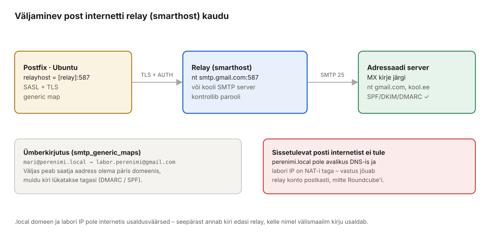

## 13. Väljaminev post internetti relay kaudu (Ubuntu)

Seni liiguvad kirjad ainult domeeni `perenimi.local` sees. Selles peatükis seadistame Postfixi nii, et kiri aadressile `keegi@gmail.com` või `opetaja@kool.ee` jõuab päriselt kohale. Otse saata ei saa – see käib **relay** ehk **smarthost**'i kaudu.



*Joonis 13.1: Relay annab kirja edasi enda nimel*

### 13.1 Miks otse ei saa?

Kui Postfix prooviks kirja ise `gmail.com` MX-serverile viia, lükataks see tagasi mitmel põhjusel:

| Takistus | Selgitus |
| --- | --- |
| `.local` pole päris domeen | `perenimi.local` ei ole avalikus DNS-is; vastuvõtja `reject_unknown_sender_domain` ja DMARC lükkavad saatja tagasi. |
| Pole PTR-kirjet | Labori väline IP (NAT) ei osuta nimele `mail.perenimi.local`. |
| Port 25 on sageli blokeeritud | Kooli-, kodu- ja pilvevõrgud blokeerivad väljuva pordi 25, et nakatunud arvutid spämmi ei saadaks. |
| Maine | Tundmatult IP-lt tulev kiri läheb rämpsposti või lükatakse tagasi. |

**Relay** on server, mis usaldab meid (parooliga) ja mida usaldab internet (päris domeen, SPF, DKIM, maine). Postfix annab kõik välised kirjad relay'le ja relay viib need edasi.

### 13.2 Mõisted

| Termin | Selgitus |
| --- | --- |
| `relayhost` | kuhu Postfix annab **kõik** kirjad, mis pole `mydestination` domeenides. Nurksulud `[smtp.gmail.com]` tähendavad: ära otsi MX-kirjet, ühendu otse selle nimega. |
| SASL klient | Postfix logib **ise** relay'sse sisse (`smtp_sasl_*` seaded – eesliide `smtp_`, mitte `smtpd_`). |
| `sasl_passwd` | fail relay kasutajanime ja parooliga; `postmap` teeb sellest andmebaasi `sasl_passwd.db`. |
| Rakenduse parool (*app password*) | Eraldi parool ühele programmile, mitte konto põhiparool. Gmail nõuab seda (konto peab kasutama kaheastmelist kinnitamist). |
| `smtp_generic_maps` | kirjutab **väljamineva** kirja aadressid ümber (ümbrik + päised): `mari@perenimi.local` → päris aadress. Kohalikke kirju see ei puuduta. |

### 13.3 Relay valik

Relay andmed annab õpetaja. Levinumad variandid:

| Relay | Server ja port | Kasutaja | Parool | Märkus |
| --- | --- | --- | --- | --- |
| Kooli SMTP relay | õpetajalt, nt `[smtp.kool.ee]:587` | õpetajalt | õpetajalt | saatja peab olema kooli domeeni aadress |
| Gmail | `[smtp.gmail.com]:587` | `labor.perenimi@gmail.com` | 16-kohaline rakenduse parool | Gmail kirjutab `From:` alati konto aadressiks |
| Muu teenus (Brevo, Mailgun, SendGrid jm) | teenuse juhendist | API-kasutaja | API-võti | vajab oma päris domeeni kinnitamist |

> **Gmail:** loo laboriks eraldi konto, mitte isiklik. Rakenduse parooli saab teha *Google'i konto → Turvalisus → Kaheastmeline kinnitamine → Rakenduste paroolid*. Google muudab neid reegleid aeg-ajalt – kontrolli enne laborit, et rakenduse paroolid on sinu kontol saadaval.

Allpool on näitena `[smtp.gmail.com]:587`. Kooli relay puhul asenda server, kasutaja ja parool.

#### Kuidas relay käib – samm-sammult

1. Mari saadab Roundcube'ist kirja aadressile `sober@gmail.com`. Postfix võtab selle pordil 587 vastu (nagu peatükis 10).
2. `qmgr` näeb, et `gmail.com` pole `mydestination`-is → kiri tuleb edasi saata. Kuna `relayhost` on määratud, ei otsita `gmail.com` MX-kirjet, vaid kiri antakse **alati relay'le**.
3. Postfixi `smtp` klient ühendub relay'ga pordil 587, teeb STARTTLS-i ja logib sisse failis `sasl_passwd` oleva kasutaja ja parooliga.
4. Enne saatmist kirjutab `smtp_generic_maps` aadressid ümber: `mari@perenimi.local` → relay konto aadress. Muidu lükkaks relay kirja tagasi, sest see konto ei tohi saata võõra domeeni nimel.
5. Relay võtab kirja vastu, allkirjastab oma domeeni DKIM-iga ja viib selle `gmail.com` MX-serverile.

Kohalikud kirjad (`jaan@perenimi.local`) relay'sse ei lähe – need toimetatakse kohale nagu varem.

### 13.4 Eeldus: SASL moodulid

Ubuntu **ei paigalda** Postfixiga koos SASL-i kliendimooduleid. Ilma nendeta ebaõnnestub sisselogimine relay'sse veaga `SASL authentication failure: No worthy mechs found`.

Postfix kasutab SASL-i kahes suunas. **Serverina** (meie kasutajad logivad meie Postfixi) küsib ta paroolikontrolli Dovecotilt – selleks pole lisapaketti vaja. **Kliendina** (meie Postfix logib relay'sse) kasutab ta Cyrus SASL teeki ja selle mooduleid PLAIN ja LOGIN – need on paketis `libsasl2-modules`.

**Ubuntu:**

```bash
sudo apt install -y libsasl2-modules
```

### 13.5 Relay parool

**Ubuntu:**

```bash
sudo nano /etc/postfix/sasl_passwd
```

```text
[smtp.gmail.com]:587    labor.perenimi@gmail.com:abcdefghijklmnop
```

Server peab olema kirjutatud **täpselt samamoodi** nagu `relayhost`-is (nurksulud ja port kaasa arvatud).

```bash
sudo chmod 600 /etc/postfix/sasl_passwd
sudo postmap /etc/postfix/sasl_passwd
ls -l /etc/postfix/sasl_passwd*          # mõlemad -rw------- root
```

`postmap` loob tekstifailist kiire andmebaasi `sasl_passwd.db`, mida Postfix tegelikult loeb. **Iga kord, kui `sasl_passwd` faili muudad, tuleb `postmap` uuesti käivitada** – muidu kasutab Postfix vana parooli. Fail sisaldab parooli avatekstina, seepärast `chmod 600`.

### 13.6 Aadresside ümberkirjutus

Internetis peab saatja aadress olema päris domeenis. Kirjutame väljaminevates kirjades `@perenimi.local` aadressid relay konto aadressiks:

```bash
sudo nano /etc/postfix/generic
```

```text
# Kõik väljaminevad kirjad relay konto nimel
@perenimi.local         labor.perenimi@gmail.com
```

Kui kooli relay lubab igale õppijale oma aadressi, saab kaardistada ka ükshaaval:

```text
mari@perenimi.local     mari.tamm@kool.ee
jaan@perenimi.local     jaan.tamm@kool.ee
```

```bash
sudo postmap /etc/postfix/generic
postmap -q "mari@perenimi.local" hash:/etc/postfix/generic
```

### 13.7 Postfixi seaded

**Ubuntu:**

```bash
sudo postconf -e \
  'relayhost = [smtp.gmail.com]:587' \
  'smtp_sasl_auth_enable = yes' \
  'smtp_sasl_password_maps = hash:/etc/postfix/sasl_passwd' \
  'smtp_sasl_security_options = noanonymous' \
  'smtp_sasl_tls_security_options = noanonymous' \
  'smtp_tls_security_level = encrypt' \
  'smtp_generic_maps = hash:/etc/postfix/generic'
sudo postfix check
sudo systemctl reload postfix
```

**Vahekontroll:**

```bash
postconf relayhost smtp_sasl_auth_enable smtp_tls_security_level
postmap -q "[smtp.gmail.com]:587" hash:/etc/postfix/sasl_passwd     # kasutaja:parool
nc -vz smtp.gmail.com 587                                           # succeeded – port on võrgust kättesaadav
```

| Seade | Selgitus |
| --- | --- |
| `smtp_tls_security_level = encrypt` | relay'ga **ainult** TLS-iga – parool ei liigu kunagi avatekstina |
| `smtp_sasl_security_options = noanonymous` | keela anonüümne sisselogimine |
| `smtp_generic_maps` | aadresside ümberkirjutus ainult väljaminevatel kirjadel |

Kui relay kasutab porti **465** (implicit TLS): `relayhost = [smtp.server.ee]:465` ja lisaks `smtp_tls_wrappermode = yes`.

Kohalikud kirjad (`@perenimi.local`) toimetatakse endiselt Dovecotile – `relayhost` kehtib ainult domeenidele, mis pole `mydestination`-is.

### 13.8 Test

**Windowsi klient:** logi Roundcube'i sisse kui `mari` ja saada kiri **oma isiklikule aadressile** (või õpetaja aadressile).

**Ubuntu:**

```bash
sudo tail -f /var/log/mail.log
```

Edukas saatmine:

```text
postfix/smtp[…]: 7DC7EC4886: to=<sinu.aadress@gmail.com>, relay=smtp.gmail.com[142.250.x.x]:587, delay=1.4, dsn=2.0.0, status=sent (250 2.0.0 OK …)
```

Ava kiri adressaadi postkastis ja vaata päiseid (Gmailis *⋮ → Kuva algne*): `From:` on relay konto aadress, `DKIM: 'PASS' with domain gmail.com`, `SPF: PASS`.

### 13.9 Tüüpilised vead

| Logis | Põhjus | Lahendus |
| --- | --- | --- |
| `SASL authentication failure: No worthy mechs found` | puudub `libsasl2-modules` | 13.4 |
| `535-5.7.8 Username and Password not accepted` | vale kasutaja või parool; Gmailis tavaline parool rakenduse parooli asemel | kontrolli `sasl_passwd`, käivita `postmap` uuesti |
| `Connection timed out` relay pordile | tulemüür / võrk blokeerib väljuva 587 | `nc -vz smtp.gmail.com 587`; küsi õpetajalt, kas port on lubatud |
| `Host or domain name not found … smtp.gmail.com` | Ubuntu ei saa välisnimesid lahendada | Debiani BIND edastajad (3.4), `dig smtp.gmail.com` |
| `TLS is required, but was not offered` | relay ei paku STARTTLS-i sellel pordil | vale port; 465 puhul `smtp_tls_wrappermode = yes` |
| `553 5.7.1 Sender address rejected: not owned by user` (relay vastus) | relay ei luba saatja aadressi | `generic` kaardistus puudub või `postmap` jäi tegemata |
| kiri on järjekorras (`mailq`) | ajutine viga | `sudo postqueue -f` (proovi kohe uuesti), `sudo postsuper -d ALL deferred` (kustuta) |

### 13.10 Mis jääb laboris puudu (ja kuidas päriselt tehakse)

Vastused välisest internetist **ei jõua** Roundcube'i – need lähevad relay konto postkasti, sest `perenimi.local` pole avalikus DNS-is ja labori masinad on NAT-i taga. Päris meiliserveri jaoks oleks vaja:

1. **Päris domeeni** (nt `perenimi.ee`) ja selle avalikku DNS-i: MX, A, SPF, DKIM, DMARC.
2. **Avalikku staatilist IP-d** ja selle **PTR-kirjet** (seab internetiteenuse pakkuja) nimele `mail.perenimi.ee`.
3. Avatud sissetulevat **porti 25** tulemüüris.
4. **Let's Encrypti serti** (Certbot) labori CA asemel.
5. Sissetuleva posti filtreid: SPF/DMARC kontroll, rämpspostifilter (Rspamd), viirusetõrje (ClamAV).
6. Seiret: järjekorra pikkus, `deferred` kirjad, IP mustades nimekirjades (*blocklist*).
