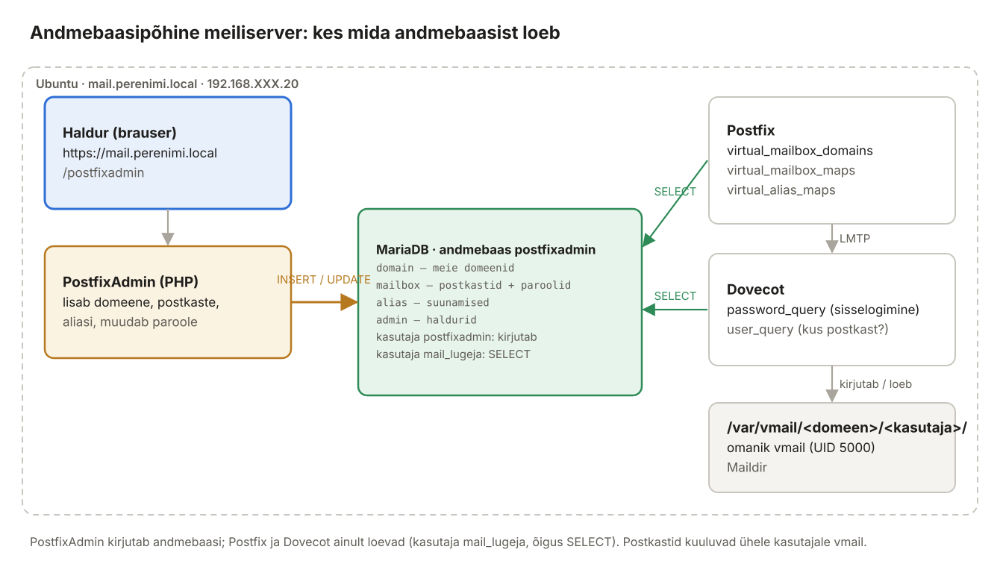
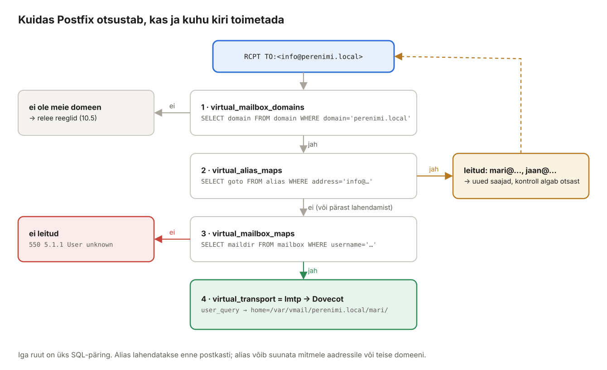
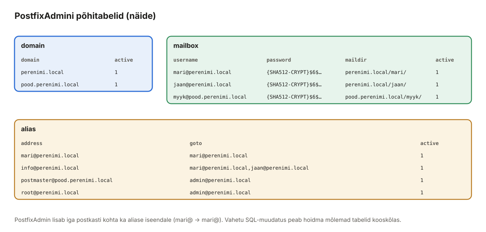

## 17. Osa III: andmebaasipõhine meiliserver – põhimõtted

Peatükkides 10–13 ehitatud meiliserveris on iga meilikasutaja **Linuxi kasutaja**: `adduser mari` loob nii konto kui ka postkasti, parool on Linuxi parool ja domeen on üks (`perenimi.local`). Laboris on see lihtne ja hea õppimiseks, kuid päris teenusepakkujad ja ettevõtted nii ei tee.

Osas III ehitame sama serveri ümber nii, et **domeenid, postkastid, aliased ja paroolid on MariaDB andmebaasis** ja neid hallatakse **veebiliidesega** (PostfixAdmin). Linuxi kasutajaid meili jaoks enam ei looda.



*Joonis 17.1: PostfixAdmin kirjutab andmebaasi, Postfix ja Dovecot loevad*

### 17.1 Miks andmebaas?

| Küsimus | Linuxi kasutajad (Osa II) | Andmebaas (Osa III) |
| --- | --- | --- |
| Kuidas lisada kasutajat? | `sudo adduser` – vaja root-õigusi ja SSH-d | veebivorm – haldur ei vaja serverile ligipääsu |
| Mitu domeeni? | üks (`mydestination`); teine domeen = samad kasutajanimed | piiramatult: `mari@perenimi.local` ja `mari@pood.perenimi.local` on eri postkastid |
| Kas meilikasutaja on ka serveri kasutaja? | jah – iga konto on rünnatav ka teistest teenustest (nt SSH, kui shell unustati keelata) | ei – meilikontol pole serveris mingit õigust |
| Kus on parool? | `/etc/shadow`, muuta saab `passwd` käsuga | andmebaasis räsituna; kasutaja saab ise veebis muuta |
| Aliased | `/etc/aliases` + `newaliases`, ainult root | veebivorm, kehtib kohe |
| Kas muudatus vajab teenuste taaskäivitust? | aliaste puhul `newaliases` | **ei** – iga kiri teeb värske päringu |
| Halduse jagamine | ei saa | domeeni haldur näeb ainult oma domeeni |
| Mastaap | sadu kasutajaid | sadu tuhandeid |

Selle hinnaks on rohkem liikuvaid osi: andmebaas, SQL-päringud, eraldi postkastide omanik `vmail` ja veebirakendus, mida tuleb uuendada ja kaitsta.

### 17.2 Postfixi aadressiklassid

Postfix jagab kõik domeenid **klassidesse**. Klass määrab, kuidas Postfix kirja käsitleb. See on kogu Osa III võtmemõiste.

| Klass | Seade | Mida tähendab | Kus laboris |
| --- | --- | --- | --- |
| **local** | `mydestination` | domeen kuulub serverile, kasutajad on **Linuxi kasutajad** (`/etc/passwd`), aliased `/etc/aliases` | Osa II: `perenimi.local`; Osa III: ainult `mail.perenimi.local` ja `localhost` (serveri enda kirjad) |
| **virtual alias** | `virtual_alias_domains` / `virtual_alias_maps` | domeenil pole postkaste, kõik aadressid suunatakse mujale | aliased (`info@` → `mari@`, `jaan@`) |
| **virtual mailbox** | `virtual_mailbox_domains` | domeen kuulub serverile, postkastid on **virtuaalsed** (andmebaasis), ühe süsteemikasutaja omanduses | Osa III: `perenimi.local`, `pood.perenimi.local` |
| **relay** | `relay_domains` | server on domeeni vahejaam (nt varu-MX), viib kirja edasi | laboris ei kasuta |
| **default** | – | kõik muu: saata välja (MX-i järgi või `relayhost`-ile) | `gmail.com` jne |

> **Üks domeen saab olla ainult ühes klassis.** Kui `perenimi.local` jääb `mydestination`-isse ja lisatakse ka `virtual_mailbox_domains`-isse, kirjutab Postfix logisse `warning: do not list domain perenimi.local in BOTH mydestination and virtual_mailbox_domains` ja kasutab local-klassi – kirjad lähevad Linuxi kasutajatele, mitte andmebaasi postkastidesse.

### 17.3 Kuidas kiri saab kohale



*Joonis 17.2: Iga saaja kohta tehakse kuni kolm SQL-päringut*

Kui Postfix saab `RCPT TO:<info@perenimi.local>`:

1. **Kas domeen on meie oma?** `virtual_mailbox_domains` → päring tabelisse `domain`. Kui ei, kehtivad tavalised relee reeglid (10.5).
2. **Kas aadress on alias?** `virtual_alias_maps` → päring tabelisse `alias`. Kui jah, asendatakse saaja aliase sihtaadressidega (`mari@…`, `jaan@…`) ja kontroll algab nende jaoks otsast. Alias võib osutada ka teise domeeni või välisele aadressile.
3. **Kas postkast on olemas?** `virtual_mailbox_maps` → päring tabelisse `mailbox`. Kui ei leita, vastab Postfix **kohe** SMTP-vestluse ajal `550 5.1.1 User unknown in virtual mailbox table` – saatja saab vea kohe, mitte hiljem tagastusteatena.
4. **Kohaletoimetamine.** `virtual_transport = lmtp:unix:private/dovecot-lmtp` → kiri antakse Dovecotile. Dovecot küsib andmebaasist (`user_query`), kus on postkast (`/var/vmail/perenimi.local/mari/`), ja kirjutab kirja sinna kasutaja `vmail` õigustes.

Sisselogimisel (IMAP või SMTP AUTH) küsib Dovecot `password_query` päringuga parooli räsi ja võrdleb.

### 17.4 Andmebaasi tabelid

PostfixAdmin loob andmebaasi `postfixadmin` ja selles ~15 tabelit. Postfixi ja Dovecoti jaoks on olulised kolm:



*Joonis 17.3: domain, mailbox ja alias*

| Tabel | Olulised veerud | Kes kasutab |
| --- | --- | --- |
| `domain` | `domain`, `description`, `aliases`/`mailboxes` (piirangud), `active` | Postfix (kas domeen on meie oma?) |
| `mailbox` | `username` (= täisaadress), `password` (räsi), `name`, `maildir` (suhteline tee), `quota`, `domain`, `active` | Postfix (kas postkast on olemas?), Dovecot (parool, postkasti asukoht) |
| `alias` | `address`, `goto` (üks või mitu aadressi komaga), `domain`, `active` | Postfix (kuhu suunata?) |
| `admin`, `domain_admins` | haldurid ja nende domeenid | ainult PostfixAdmin |
| `log` | kes mida muutis | ainult PostfixAdmin |

`active = 1/0` laseb konto ajutiselt välja lülitada ilma andmeid kustutamata – kõik päringud sisaldavad tingimust `AND active = '1'`.

### 17.5 Postkastide omanik: kasutaja vmail

Linuxi kasutajate puhul kuulus iga postkast oma kasutajale (`/home/mari` → `mari`). Virtuaalkasutajatel pole Linuxis kontot, seega kuuluvad **kõik postkastid ühele süsteemikasutajale** `vmail` (UID ja GID 5000). Dovecot kirjutab ja loeb postkaste selle kasutaja õigustes.

```text
/var/vmail/                      omanik vmail:vmail, õigused 770
├── perenimi.local/
│   ├── admin/                   Maildir: cur/ new/ tmp/ .Sent/ .Trash/ …
│   ├── jaan/
│   └── mari/
└── pood.perenimi.local/
    └── myyk/
```

Kaust luuakse esimese kirja saabumisel automaatselt – PostfixAdmini postkasti loomine ise kettale midagi ei kirjuta.

### 17.6 Paroolid andmebaasis

Paroole ei hoita kunagi avatekstina. Andmebaasis on **räsi** (*hash*) – ühesuunaline funktsioon, millest parooli tagasi arvutada ei saa:

```text
{SHA512-CRYPT}$6$mldhfPM1uZYz9j0r$pjIX1P6GWnG25FLmKM8RlIvSuqmYSPAd1yKcZUCMJ…
 ^^^^^^^^^^^^^ ^^ ^^^^^^^^^^^^^^^^ ^^^^^^^^^^^^^^^^^^^^^^^^^^^^^^^^^^^^^^^^^^
 skeem Dovecotile  sool (salt)      räsi
              $6$ = SHA-512 crypt
```

- **Sool** (*salt*) on juhuslik ja igal paroolil erinev – kahel kasutajal sama parooliga on erinev räsi ning eelnevalt arvutatud räsitabelitest (*rainbow tables*) pole kasu.
- SHA512-CRYPT räsib parooli tuhandeid kordi järjest, mis teeb äraarvamise aeglaseks.
- Eesliide `{SHA512-CRYPT}` ütleb Dovecotile, millise skeemiga räsi kontrollida.

Sisselogimisel räsib Dovecot kasutaja sisestatud parooli sama soolaga ja võrdleb tulemust andmebaasis olevaga.

> **Ära kasuta** PostfixAdmini vaikeväärtust `md5crypt` ega `cleartext`. MD5 on tänapäeval liiga kiire ja avatekst tähendab, et andmebaasi varundusega lekivad kõik paroolid.

### 17.7 Vähima õiguse põhimõte

Andmebaasis on **kaks kasutajat**:

| Kasutaja | Õigused | Kes kasutab | Miks |
| --- | --- | --- | --- |
| `postfixadmin` | kõik õigused andmebaasile `postfixadmin` | PostfixAdmin (veebiliides) | peab saama lisada, muuta ja kustutada |
| `mail_lugeja` | ainult `SELECT` | Postfix, Dovecot | need ainult loevad. Kui Postfixi seadistusfail lekib, ei saa selle parooliga midagi muuta |

### 17.8 PostfixAdmin ja alternatiivid

**PostfixAdmin** on 2003. aastast arendatav avatud lähtekoodiga PHP-rakendus, mis on Ubuntu pakihoidlas (versioon 3.3). See haldab domeene, postkaste, aliasi ja haldureid, oskab eesti keelt ning sisaldab kasutaja portaali, kus kasutaja saab ise parooli muuta. Selle andmebaasiskeem on de facto standard – paljud juhendid ja tööriistad eeldavad just seda.

Teised võimalused: **ViMbAdmin**, **Modoboa** (Python, sisaldab ka DKIM-i ja statistikat), **iRedMail** ja **mailcow** (terviklikud paketid, mis paigaldavad kogu meiliserveri koos haldusliidesega), või **oma PHP-rakendus** sama andmebaasiskeemi peal.

### 17.9 Mis muutub võrreldes Osaga II

| Komponent | Osa II | Osa III |
| --- | --- | --- |
| Domeeni koht Postfixis | `mydestination` | `virtual_mailbox_domains` (SQL) |
| Kasutaja olemasolu | `/etc/passwd` | `virtual_mailbox_maps` (SQL) |
| Aliased | `/etc/aliases` | `virtual_alias_maps` (SQL) + `/etc/aliases` ainult serveri enda kirjadele |
| Kohaletoimetamine | `mailbox_transport` (local → LMTP) | `virtual_transport` (otse LMTP) |
| Saatja kontroll | `regexp:login_maps.regexp` | SQL (`saatjad.cf`) |
| Dovecot passdb / userdb | PAM / passwd | SQL / SQL |
| Kasutajanimi | `mari` (`%Ln`) | `mari@perenimi.local` (`%Lu`) |
| Postkast | `/home/mari/Maildir` | `/var/vmail/perenimi.local/mari` |
| TLS, DKIM, SPF, DMARC, fail2ban, Roundcube, relay | – | **jääb samaks** |

### 17.10 Osa III ülesehitus

| Peatükk | Sisu |
| --- | --- |
| 18 | PostfixAdmin: andmebaas, veebiliides, domeenid, postkastid, aliased |
| 19 | Postfix ja Dovecot loevad andmebaasi; vanade postkastide kolimine |
| 20 | Igapäevane haldus, teine domeen ja DKIM, varundus, laborid 13–15, tõrkeotsing |

Interaktiivne harjutus: [virtuaalpostkastide simulaator](https://valdonolvak.github.io/meili--ja_veebiserverite_haldus/interaktiivne/virtuaal-simulaator.html) – muuda tabeleid ja vaata, milliseid SQL-päringuid Postfix ja Dovecot teevad.

> **Eeldus:** peatükkide 10–12 seadistus töötab (kõik 10.10 testid läbivad, Roundcube töötab). Tee Ubuntust Proxmoxis **hetktõmmis** `enne-osa-3` – kui midagi läheb valesti, saad tagasi töötava Osa II serveri juurde.
