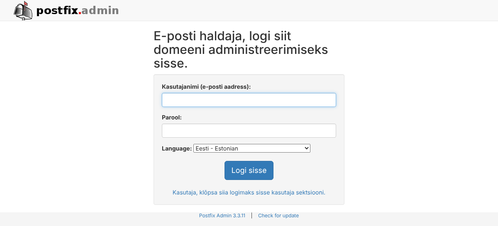
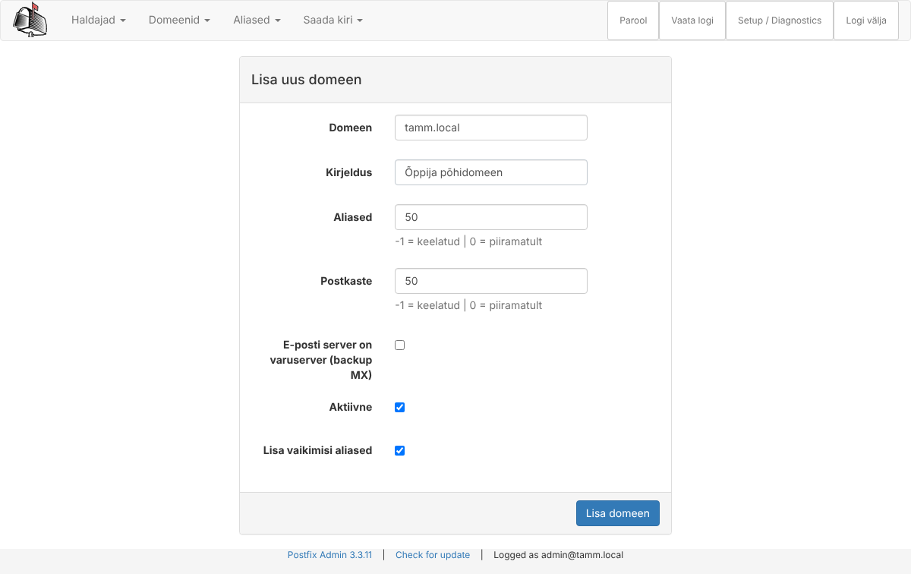
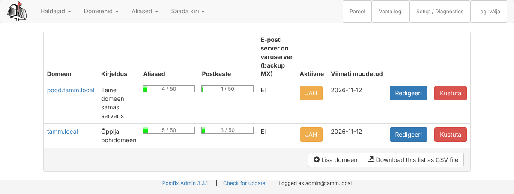
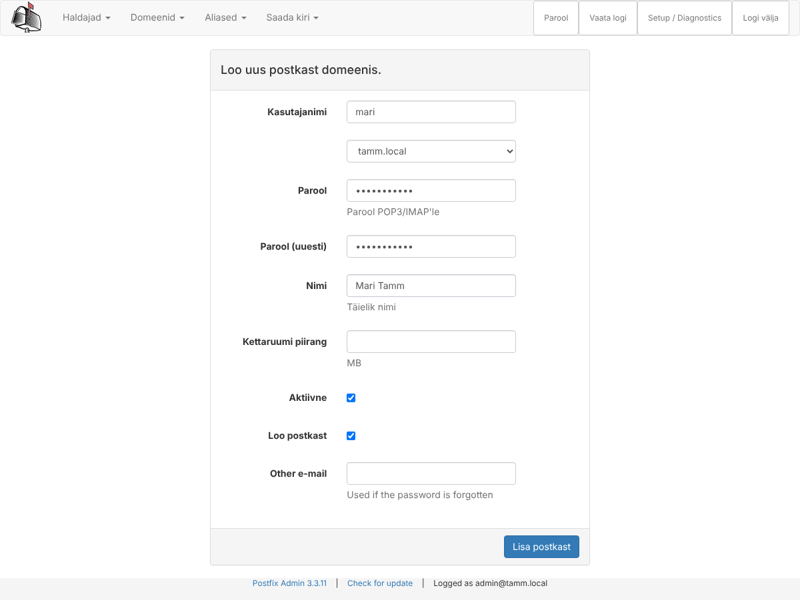
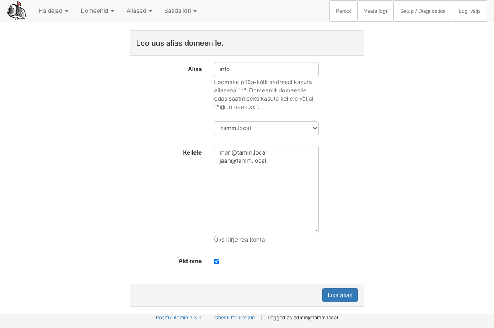
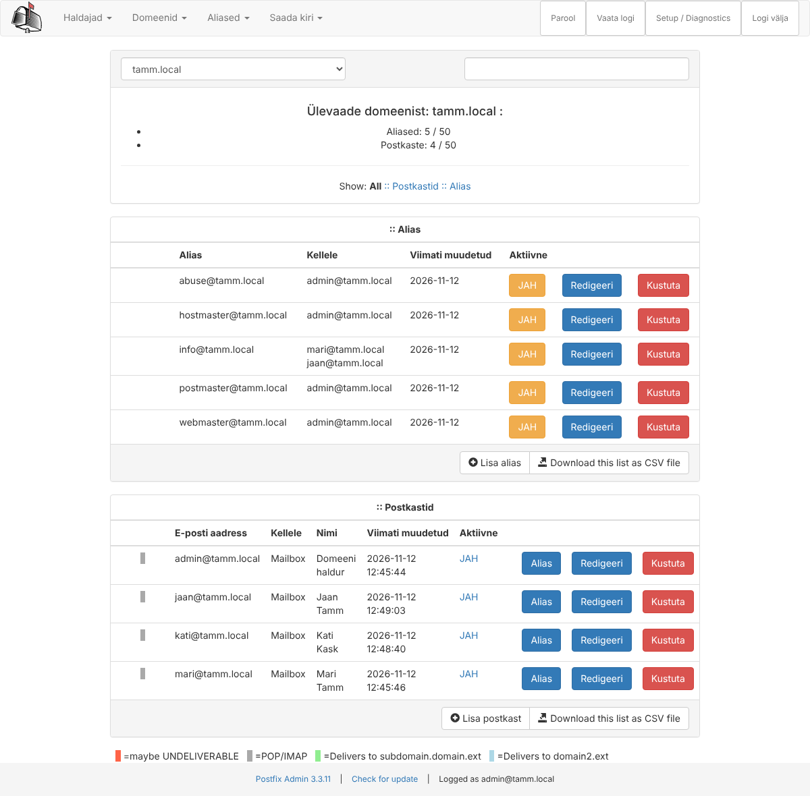
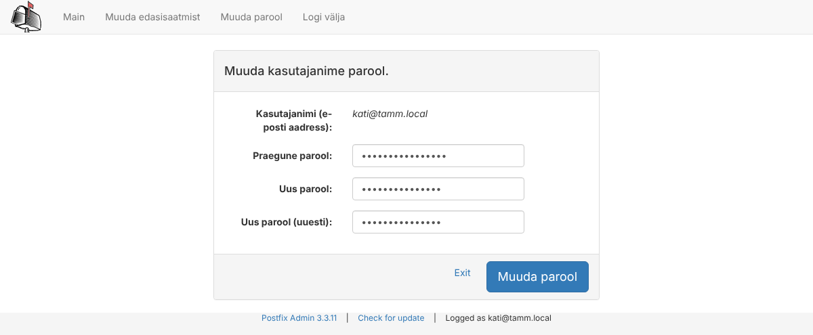

## 18. PostfixAdmin: andmebaas ja veebiliides (Ubuntu)

Selles peatükis paigaldame PostfixAdmini, mis loob MariaDB-sse meiliandmebaasi, ja lisame veebiliidesest domeenid, postkastid ja aliased. **Selle peatüki lõpuks on andmed andmebaasis, kuid Postfix ja Dovecot ei kasuta neid veel** – nende ümberlülitamine on peatükis 19. Nii saad andmed rahulikult valmis teha, ilma et töötav server vahepeal katki läheks.

### 18.1 Mõisted

| Termin | Selgitus |
| --- | --- |
| Superadministraator | PostfixAdmini haldur, kes näeb ja muudab kõiki domeene. **See on halduskonto, mitte postkast** – sama aadressiga postkasti ei pea olema. |
| Domeeni haldur | haldur, kes näeb ainult talle määratud domeene (nt poe IT-inimene haldab ainult `pood.perenimi.local`) |
| `setup.php` | PostfixAdmini paigaldusleht: kontrollib keskkonda, loob/uuendab andmebaasi tabelid, loob superadministraatori. Kaitstud eraldi **setup-parooliga**. |
| `config.local.php` | sinu seaded. Paketi `config.inc.php` faili ei muudeta – uuendus kirjutaks selle üle. |
| dbconfig-common | Debiani/Ubuntu tööriist, mis paigaldusel loob rakendusele andmebaasi ja kasutaja ning kirjutab ühenduse andmed faili |
| Vaikealiased | aliased, mis luuakse iga uue domeeniga automaatselt (`postmaster@`, `abuse@` …) – RFC nõuab, et need töötaksid |

### 18.2 DNS: domeen peab olemas olema enne

PostfixAdmin kontrollib domeeni lisamisel DNS-ist, kas domeen on olemas. Kui DNS-is pole domeeni kohta ühtki kirjet, annab ta vea **„Invalid domain …, and/or not discoverable in DNS“** (testis tekkis see viga just nii). Päris maailmas on see loogiline: meiliserveri domeenil peab olema MX-kirje.

Lisame Debiani tsooni teise e-posti domeeni `pood.perenimi.local` (alamdomeen, mis kasutab sama meiliserverit).

**Debian:**

```bash
sudo nano /etc/bind/zones/db.perenimi.local
```

Suurenda seerianumbrit ja lisa faili lõppu:

```text
; --- Teine e-posti domeen samas serveris ---
pood    IN  MX  10  mail.perenimi.local.
pood    IN  TXT     "v=spf1 mx:perenimi.local -all"
_dmarc.pood IN TXT  "v=DMARC1; p=quarantine; adkim=s; aspf=s"
```

- MX ütleb: `@pood.perenimi.local` kirjad viia serverisse `mail.perenimi.local`.
- SPF `mx:perenimi.local` – lubatud on `perenimi.local` MX-serveri IP (sest `pood` ise meili ei saada, saadab sama server).

```bash
sudo named-checkzone perenimi.local /etc/bind/zones/db.perenimi.local
sudo rndc reload perenimi.local
dig +short MX pood.perenimi.local          # 10 mail.perenimi.local.
```

### 18.3 Paigaldus

MariaDB on Ubuntus juba olemas (peatükk 7, blogi kaugandmebaas).

**Ubuntu:**

```bash
sudo apt install -y postfixadmin
```

Paigaldusdialoog (dbconfig-common) – küsimuste arv ja järjekord võib versiooniti veidi erineda:

| Küsimus | Vastus | Mis juhtub |
| --- | --- | --- |
| Configure database for postfixadmin with dbconfig-common? | **Yes** | luuakse andmebaas ja kasutaja |
| Database type to be used by postfixadmin | **mysql** | MariaDB ühildub MySQL-iga |
| Connection method for MySQL database | **Unix socket** | ühendus samas masinas, mitte üle võrgu |
| (kui küsitakse) Authentication plugin | **default** | |
| MySQL application password for postfixadmin | vali tugev parool (nt `PfaParool.2026`) | andmebaasikasutaja `postfixadmin` parool |

Mida paigaldus tegi:

```bash
sudo mariadb -e "SHOW DATABASES; SELECT user,host FROM mysql.user;"   # andmebaas ja kasutaja postfixadmin
sudo cat /etc/postfixadmin/dbconfig.inc.php                            # ühenduse andmed
ls /usr/share/postfixadmin/public/                                     # veebirakendus
```

| Asukoht | Sisu |
| --- | --- |
| `/usr/share/postfixadmin/public/` | veebis nähtavad PHP-failid |
| `/etc/postfixadmin/config.inc.php` | paketi vaikeseaded – **ära muuda** |
| `/etc/postfixadmin/config.local.php` | **sinu seaded** (loome ise) |
| `/etc/postfixadmin/dbconfig.inc.php` | andmebaasi kasutaja ja parool (dbconfig-common) |
| `/var/cache/postfixadmin/templates_c/` | lehtede vahemälu (Smarty) |

Andmebaas on praegu **tühi** – tabelid luuakse `setup.php` kaudu (18.6).

### 18.4 Seaded: config.local.php

Kõigepealt **setup-parooli räsi**. Setup-parool kaitseb lehte `setup.php`, kust saab luua superadministraatoreid – see peab olema tugev ja teistsugune kui teised paroolid.

**Ubuntu:**

```bash
php -r 'echo password_hash("Seadistus.2026", PASSWORD_DEFAULT), "\n";'
# $2y$10$0Hk… – kopeeri see rida
sudo nano /etc/postfixadmin/config.local.php
```

```php
<?php
// /etc/postfixadmin/config.local.php – labori seaded (kirjutavad config.inc.php üle)
$CONF['configured'] = true;
$CONF['database_type'] = 'mysqli';

// setup.php parool (räsi). Loo: php -r 'echo password_hash("SINU_PAROOL", PASSWORD_DEFAULT);'
$CONF['setup_password'] = '$2y$10$...siia kopeeritud räsi...';

$CONF['default_language'] = 'et';
$CONF['admin_email'] = 'postmaster@perenimi.local';
$CONF['smtp_server'] = 'localhost';

// Paroolid räsitakse SHA512-CRYPT-iga – sama, mida Dovecot oskab kontrollida
$CONF['encrypt'] = 'php_crypt:SHA512::{SHA512-CRYPT}';

// Postkast: /var/vmail/<domeen>/<kasutaja>/
$CONF['domain_path'] = 'YES';
$CONF['domain_in_mailbox'] = 'NO';

// Iga uue domeeniga luuakse need aliased; kõik lähevad ühte postkasti
$CONF['default_aliases'] = array(
    'abuse'      => 'admin@perenimi.local',
    'hostmaster' => 'admin@perenimi.local',
    'postmaster' => 'admin@perenimi.local',
    'webmaster'  => 'admin@perenimi.local',
);

// Vaikimisi piirangud uuele domeenile
$CONF['aliases'] = '50';
$CONF['mailboxes'] = '50';
$CONF['maxquota'] = '0';
$CONF['quota'] = 'NO';
$CONF['domain_quota'] = 'NO';

// Paroolinõuded: vähemalt 10 märki, sh 2 numbrit
$CONF['password_validation'] = array(
    '/.{10}/'       => 'password_too_short 10',
    '/([0-9].*){2}/' => 'password_no_digits 2',
);

// Laboris mittevajalikud moodulid välja
$CONF['fetchmail'] = 'NO';
$CONF['vacation'] = 'NO';
$CONF['alias_domain'] = 'NO';
$CONF['backup'] = 'NO';
$CONF['transport'] = 'NO';
$CONF['password_expiration'] = 'NO';

$CONF['show_footer_text'] = 'NO';
```

```bash
sudo chown root:www-data /etc/postfixadmin/config.local.php
sudo chmod 640 /etc/postfixadmin/config.local.php
sudo php -l /etc/postfixadmin/config.local.php      # No syntax errors detected
```

**Mida olulisemad seaded teevad:**

| Seade | Selgitus |
| --- | --- |
| `database_type = 'mysqli'` | dbconfig kirjutab `mysql`; PostfixAdmin 3.3 soovitab MariaDB jaoks `mysqli` |
| `encrypt` | **kõige olulisem rida**: millise räsiga paroolid salvestatakse. `php_crypt:SHA512::{SHA512-CRYPT}` = PHP `crypt()` SHA-512-ga ja eesliide `{SHA512-CRYPT}`, mida Dovecot tunneb (17.6). Vaikeväärtus `md5crypt` on nõrk. |
| `domain_path = YES`, `domain_in_mailbox = NO` | postkasti suhteline tee `perenimi.local/mari/` – see läheb veergu `mailbox.maildir` |
| `default_aliases` | iga uue domeeniga luuakse `abuse@`, `postmaster@` jne, mis suunatakse **ühte keskset postkasti** `admin@perenimi.local`. Kui siia kirjutada ainult `admin`, suunataks need sama domeeni `admin@`-ile, mida teises domeenis ei pruugi olla. |
| `aliases`, `mailboxes` | mitu aliast/postkasti võib domeenis olla (0 = piiramatu) |
| `password_validation` | paroolinõuded (regulaaravaldised); kehtivad halduri ja kasutaja tehtud muudatustele |
| `fetchmail`, `vacation` … `= 'NO'` | peidab menüüst moodulid, mida me ei seadista |

> **Miks fail kuulub rühmale `www-data`?** PostfixAdmin töötab Apache'i all (kasutaja `www-data`) ja peab faili lugema. Teised kasutajad ei tohi seda näha, sest seal on setup-parooli räsi.

### 18.5 Veebiliides mail.perenimi.local/postfixadmin

PostfixAdmin tuleb samasse HTTPS-vhosti, kus on Roundcube (peatükk 12.4). Halduspaneel peab olema kättesaadav **ainult labori võrgust** – internetis on `/postfixadmin` üks esimesi aadresse, mida ründajad proovivad.

**Ubuntu:**

```bash
sudo nano /etc/apache2/sites-available/mail.perenimi.local.conf
```

Lisa `<VirtualHost *:443>` ploki sisse, rea `ErrorLog` kohale:

```apache
    # --- PostfixAdmin: meilikasutajate haldus ---
    Alias /postfixadmin /usr/share/postfixadmin/public
    <Directory /usr/share/postfixadmin/public>
        Options -Indexes +FollowSymLinks
        AllowOverride None
        # Halduspaneel ainult labori võrgust
        Require ip 127.0.0.1 192.168.XXX.0/24
    </Directory>
```

```bash
sudo apache2ctl configtest
sudo systemctl reload apache2
```

| Rida | Tähendus |
| --- | --- |
| `Alias /postfixadmin …` | aadress `https://mail.perenimi.local/postfixadmin/` näitab kausta `/usr/share/postfixadmin/public` sisu, kuigi see on väljaspool `DocumentRoot`-i |
| `Require ip …` | ligipääs ainult nendelt IP-aadressidelt; teistele `403 Forbidden` |

Pakett paigaldab ka faili `/etc/apache2/conf-available/postfixadmin.conf` (alias kõigile saitidele). Seda **ei luba** – meie alias on ainult HTTPS-vhostis.

### 18.6 Paigaldusleht setup.php

**Windowsi klient:** ava `https://mail.perenimi.local/postfixadmin/setup.php`.

1. Sisesta **setup-parool** (avatekstina, nt `Seadistus.2026`) → *Login with setup_password*.
2. Leht teeb **keskkonnakontrolli**. Kõik read peavad olema ✅. Oluline rida: `Password hashing - $CONF["encrypt"] = php_crypt:SHA512::{SHA512-CRYPT} … hash generation OK`.
3. Leht loob andmebaasi tabelid: *Database Update … updating to version 1 … 1847 … done*. Lõpuks *Database is up to date*.
4. **Add Superadmin Account:** *Setup password* uuesti, *Admin* `admin@perenimi.local`, tugev parool kaks korda → *Add Admin*. Teade: *The admin admin@perenimi.local has been added!*

Kontrolli andmebaasis:

```bash
sudo mariadb -e "SHOW TABLES FROM postfixadmin;"
sudo mariadb -e "SELECT username, superadmin, LEFT(password,30) FROM postfixadmin.admin;"
# admin@perenimi.local  1  {SHA512-CRYPT}$6$mldhfPM1uZYz…
```

Parool on räsitud kujul `{SHA512-CRYPT}$6$…` – `encrypt` seade töötab.

> `setup.php` jääb kättesaadavaks, kuid ilma setup-paroolita sellest kasu pole. Tootmises võib selle pärast paigaldust ära keelata (`Require all denied` ainult sellele failile).

### 18.7 Sisselogimine

Ava `https://mail.perenimi.local/postfixadmin/` ja logi sisse superadministraatorina. Keel: *Eesti – Estonian*.



*Joonis 18.1: Halduri sisselogimine. Lingi „Kasutaja, klõpsa siia …“ kaudu jõuab kasutaja portaali (18.12).*

Ülemine menüü: **Haldajad** (halduskontod), **Domeenid**, **Aliased** (ka postkastid), **Saada kiri**, paremal **Vaata logi** (kes mida muutis).

### 18.8 Domeenide lisamine

*Domeenid → Uus domeen*



*Joonis 18.2: Domeeni lisamine*

| Väli | Väärtus | Tähendus |
| --- | --- | --- |
| Domeen | `perenimi.local` | |
| Kirjeldus | vaba tekst | |
| Aliased / Postkaste | 50 | mitu tohib domeenis olla; 0 = piiramatu, -1 = keelatud |
| E-posti server on varuserver (backup MX) | tühi | märgitud = see server ainult hoiab kirju teise serveri jaoks |
| Aktiivne | ✓ | |
| Lisa vaikimisi aliased | ✓ | luuakse `abuse@`, `hostmaster@`, `postmaster@`, `webmaster@` |

Tee sama domeeniga `pood.perenimi.local`. Kui saad vea *not discoverable in DNS*, vaata 18.2.



*Joonis 18.3: Domeenide loend – aliaste ja postkastide arv ning piirang*

### 18.9 Postkastide lisamine

*Domeenid → Domeenide loend → perenimi.local → Lisa postkast* (või *Aliased → Lisa postkast*)



*Joonis 18.4: Postkasti lisamine*

| Väli | Väärtus |
| --- | --- |
| Kasutajanimi | `mari` + domeen rippmenüüst |
| Parool, Parool (uuesti) | vähemalt 10 märki, 2 numbrit |
| Nimi | `Mari Tamm` – Roundcube näitab seda saatja nimena |
| Kettaruumi piirang | tühi (kvoot pole sees) |
| Aktiivne | ✓ |
| Loo postkast / Saada tervituskiri | võib jätta märgituks – tervituskiri läheb kohale alles pärast peatükki 19 |

Loo postkastid:

| Postkast | Milleks |
| --- | --- |
| `admin@perenimi.local` | kõigi domeenide `postmaster@`, `abuse@`, `root@` kirjad |
| `mari@perenimi.local`, `jaan@perenimi.local` | kasutajad |
| `myyk@pood.perenimi.local` | teise domeeni kasutaja |

### 18.10 Aliased

*Aliased → Lisa alias*



*Joonis 18.5: Alias info@ suunab kirja kahele inimesele*

- `info@perenimi.local` → `mari@perenimi.local` ja `jaan@perenimi.local` (iga aadress eraldi reale);
- `root@perenimi.local` → `admin@perenimi.local` – serveri enda teated (cron, varundus) saadetakse aadressile `root`, mis `myorigin`-i tõttu saab kuju `root@perenimi.local`.

Domeeni ülevaade näitab nüüd aliaseid ja postkaste:



*Joonis 18.6: Domeeni perenimi.local aliased ja postkastid*

### 18.11 Mis andmebaasi tekkis

**Ubuntu:**

```bash
sudo mariadb postfixadmin -e "SELECT domain, active FROM domain;"
sudo mariadb postfixadmin -e "SELECT username, name, maildir, active FROM mailbox;"
sudo mariadb postfixadmin -e "SELECT address, goto, active FROM alias ORDER BY domain, address;"
```

Testis saadud tulemus:

```text
username                maildir                   active
admin@perenimi.local    perenimi.local/admin/     1
jaan@perenimi.local     perenimi.local/jaan/      1
mari@perenimi.local     perenimi.local/mari/      1
myyk@pood.perenimi.local  pood.perenimi.local/myyk/  1

address                         goto
info@perenimi.local             mari@perenimi.local,jaan@perenimi.local
mari@perenimi.local             mari@perenimi.local
postmaster@pood.perenimi.local  admin@perenimi.local
…
```

Pane tähele: **iga postkasti kohta on ka alias iseendale** (`mari@` → `mari@`). PostfixAdmin teeb nii, et ka postkasti saaks hiljem täiendava suunamisega varustada (nt kiri läheb nii postkasti kui ka telefoni). Postfix leiab aadressi seetõttu juba aliaste tabelist.

> **Tee muudatused alati veebiliidesest, mitte otse SQL-iga.** Testis lülitasime SQL-iga välja ainult `mailbox.active`, aga `alias`-tabelis jäi `jaan@ → jaan@` aktiivseks. Tulemus: Postfix võttis Jaanile tuleva kirja vastu (alias leiti) ja Dovecot lükkas selle alles hiljem tagasi – saatja sai tagastusteate, mitte kohest viga. Veebiliides muudab mõlemad tabelid korraga ja siis vastab Postfix kohe `550 User unknown`.

### 18.12 Kasutaja portaal: parooli vahetus

Kasutaja saab ise parooli vahetada: `https://mail.perenimi.local/postfixadmin/users/` (või sisselogimislehelt lingiga *Kasutaja, klõpsa siia …*). Sisselogimiseks täisaadress (`mari@perenimi.local`) ja meiliparool.



*Joonis 18.7: Kasutaja vahetab ise parooli*

Pärast peatükki 19 kehtib uus parool kohe nii Roundcube'is, Thunderbirdis kui ka SMTP-s – kõik küsivad parooli samast tabelist.

> Kasutaja portaal on samuti aadressil `/postfixadmin`, mis on piiratud labori võrguga (18.5). Kui kasutajad peavad parooli vahetama ka väljastpoolt, tee neile eraldi alias ainult `/postfixadmin/users/` jaoks või kasuta Roundcube'i `password`-pluginat.

### 18.13 Vahekontroll

- `https://mail.perenimi.local/postfixadmin/` avaneb Windowsis ja sisselogimine töötab;
- andmebaasis on 2 domeeni, 4 postkasti ja aliased (18.11);
- paroolid on kujul `{SHA512-CRYPT}$6$…`;
- **meiliserver töötab endiselt vanamoodi** (Linuxi kasutajad) – andmebaasi kasutame alates peatükist 19.
